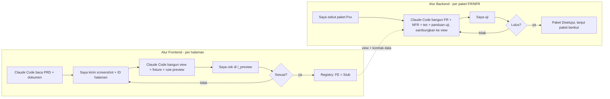

# PRD & Pembagian Tugas Claude Code — Polibatam Verify

**Versi 1.0 · 25 November 2026**
Dokumen kerja untuk mengarahkan Claude Code membangun aplikasi Polibatam Verify. Letakkan di `doc/PRD-CLAUDE-CODE.md` dan rujuk dari `CLAUDE.md`.

Dasar: Deskripsi Projek, Pedoman Microcredential, Pain Points, Personas, User Stories (US-01–32), SRS FR/BR (FR-01–69, BR-01–74), SRS NFR (NFR-01–50), ERD, Use Case/Activity/Class/Sequence, Arsitektur & Teknologi, Keamanan Basis Data, Paket Implementasi Basis Data, Daftar Halaman Web (HW-01–56), Daftar Layar Mobile (HM-01–37), `design-memory`, Keputusan Klarifikasi Scope (K-01–41), Gantt (G-07–G-43).

---

## 0. Cara Memakai Dokumen Ini

Ada dua alur kerja, dan keduanya bertemu di satu titik: **view yang sama, kontrak data yang sama**.



**Yang saya (pemilik proyek) lakukan:**
1. **Frontend:** kirim screenshot Figma + ID halaman (`HW-13`, `HM-08`) → cek hasilnya di rute preview → minta revisi atau lanjut.
2. **Backend:** sebut paket (`kerjakan P03`) → uji memakai `doc/uji/P03.md` → laporkan hasil → `P03 disetujui`, lanjut `P04`.

**Yang Claude Code lakukan:** baca dokumen sesuai §2, bangun sesuai aturan §1, §3, §4, ikuti alur §5, dan lapor dengan format §5.5.

---

## 1. Aturan Emas (tidak boleh dilanggar)

| ID | Aturan | Acuan |
|---|---|---|
| AE-01 | **Aturan bisnis hanya ditulis di Service/Action layer.** Controller web dan controller API hanya "pintu tipis" yang memanggil Action/Query yang sama. | Arsitektur §1, §4 |
| AE-02 | **Jangan mengarang aturan.** Bila dokumen belum menjawab, beri label `[ASUMSI]`, catat di `doc/registry/temuan.md`, lalu tanya saya. Nama kelas, tabel, kolom, status, istilah, dan ID mengikuti dokumen persis (jangan diterjemahkan atau diganti). | Instruksi Project |
| AE-03 | **Data domain tidak pernah dihapus.** Nonaktifkan atau ubah status. Tidak ada `delete()` pada model domain (akun `pv_app` memang tidak punya `DELETE`). | Keamanan DB §3.3 |
| AE-04 | **Status hanya berubah lewat state machine** (`spatie/laravel-model-states`) sesuai tabel transisi SRS §4. Transisi tidak sah ditolak di Service dan dijawab `409` di API. | NFR-28 |
| AE-05 | **Uang = bilangan bulat Rupiah** (`BIGINT UNSIGNED`). **Waktu disimpan UTC**, ditampilkan WIB. Tenggat (H-7, H-14, 7 hari) dihitung dengan kalender WIB. | NFR-29, NFR-30 |
| AE-06 | **Data sensitif:** NIK dan nomor rekening refund terenkripsi (`encrypted` cast); NIK dicari lewat `nik_hash` (HMAC dengan `NIK_HMAC_KEY` terpisah dari `APP_KEY`); ditampilkan tersamar; tidak boleh masuk log, VIEW, ekspor, atau arsip dalam bentuk utuh. | NFR-06, NFR-32, BR-50, BR-62 |
| AE-07 | **Draf tidak pernah terlihat oleh admin mana pun.** Wajib tiga lapis: Policy, query scope `Pendaftaran::untukAdmin()`, dan VIEW `v_data_pendaftaran`. Admin hanya boleh melihat jumlah Draf sebagai angka. | BR-64 |
| AE-08 | **Verifikasi satu per satu.** Tidak ada endpoint, tombol, atau gestur yang memutuskan banyak objek sekaligus. Satu-satunya aksi massal pada daftar data adalah "Ekspor terpilih". | BR-66, BR-74 |
| AE-09 | **Optimistic locking** pada keputusan verifikasi: request membawa `versi` (`updated_at` terakhir yang dilihat admin); bila data sudah berubah → `409` kode `SUDAH_DIVERIFIKASI`. | BR-61, FR-61 |
| AE-10 | **Audit log lewat `AuditLogger` saja**, untuk semua aktivitas di BR-58, termasuk yang gagal/ditolak (kolom `hasil`). Entri tidak boleh diubah atau dihapus. | NFR-31, BR-58 |
| AE-11 | **Operasi multi-langkah atomik** (`DB::transaction`), dan `lockForUpdate()` pada baris kuota dan penghitung nomor. Penempatan kuota, penerbitan NPD, pembatalan peminatan, dan rollover tidak boleh menimbulkan race condition. | NFR-27 |
| AE-12 | **File:** disk privat (`private`, `ekspor`, `arsip`), validasi MIME aktual (magic bytes), PDF/JPG/PNG ≤ 2 MB, nama acak di server, akses lewat URL bertanda tangan ≤ 15 menit. Berkas tidak pernah publik. | NFR-07, BR-12 |
| AE-13 | **Tiga koneksi DB:** `mysql` (`pv_app`) untuk aplikasi, `mysql_report` (`pv_report`) hanya `SELECT` pada VIEW, `mysql_migrator` (`pv_migrator`) hanya untuk migrasi. Tabel/VIEW baru wajib ditambahkan ke `05_grants_dan_kunci.sql`. Tabel riwayat (`tarifs`, `dokumen_versis`, `verifikasi_dokumens`, `audit_logs`) tidak boleh di-`UPDATE`. | NFR-48, Impl. DB §3 |
| AE-14 | **Parameter bisnis dibaca dari `Pengaturan` (tabel `pengaturans`)**, bukan ditulis permanen di kode: batas 7 hari, H-7, H-14, jadwal pengingat, format/ukuran file, format NPD, batas lockout, masa berlaku ekspor. | NFR-40 |
| AE-15 | **UI Bahasa Indonesia.** Rupiah `Rp 1.500.000`, tanggal `21 November 2026`. Status dan peran hanya memakai nama resmi `design-memory` §6. Dilarang: `Draft`, `Micro Credential`, `Jurusan`, `Admin akademik`, `Diterima`, `Perlu Verifikasi`. | NFR-34 |
| AE-16 | **Rahasia tidak masuk repositori** (`.env`, kunci, password). Password di `.env` wajib diberi tanda kutip. | NFR-10 |
| AE-17 | **Gunakan ulang, jangan menciptakan gaya baru.** Setiap elemen UI memakai komponen `x-pv.*` dan token desain yang sudah ada. Bila pola yang sama muncul di ≥ 2 halaman, jadikan komponen baru bernama sejajar komponen Figma `PV/*`. Warna tidak ditulis sebagai hex di view. | design-memory |
| AE-18 | **Screenshot = acuan layout dan gaya visual, bukan acuan isi.** Teks, status, peran, alur, dan data diambil dari SRS dan `design-memory` §6, §9. Bila screenshot bertentangan dengan dokumen, **dokumen menang**: kerjakan sesuai dokumen dan laporkan selisihnya. | design-memory §0 |

---

## 2. Sumber Kebenaran & Peta Dokumen

### 2.1 Urutan prioritas bila dokumen bertentangan

| # | Sumber | Menentukan |
|---|---|---|
| 1 | `keputusan-klarifikasi-scope.md` (K-01–K-41) | Keputusan final; menang atas dokumen lain |
| 2 | `srs-fr-br.md`, `srs-nfr.md` | Perilaku, aturan, tabel transisi status, RBAC |
| 3 | `user-stories.md` | Acceptance criteria (Given–When–Then) = dasar kasus uji |
| 4 | `erd.md` + `database/paket-db/sql/*.sql` | Nama tabel/kolom, constraint, trigger, GRANT |
| 5 | `arsitektur-teknologi.md`, `keamanan-basis-data.md` | Stack, lapisan, endpoint, akun DB, jadwal |
| 6 | `design-memory.md` + screenshot | **Visual saja** (layout, komponen, gaya); status & data tetap dari 2 dan 5 |
| 7 | Use case, activity, sequence, class diagram | Pelengkap alur dan nama kelas |

Bila menemukan konflik: **berhenti di bagian itu**, catat di `doc/registry/temuan.md` (ID `T-01`, dst.), kerjakan bagian lain yang tidak terdampak, lalu tanyakan kepada saya.

### 2.2 Baca apa untuk tugas apa (hemat token)

| Tugas | Baca |
|---|---|
| Awal setiap sesi | `CLAUDE.md`, PRD ini §1, §3, §4, `doc/registry/progres.md` |
| FE-0 (fondasi UI), sekali saja | `design-memory.md` penuh, `daftar-halaman-web.md` bagian "Komponen yang Dipakai Ulang" |
| Halaman web (HW) | Baris paket di PRD §6, FR/BR di `srs-fr-br.md` untuk ID terkait, `daftar-halaman-web.md` baris HW tersebut |
| Layar mobile (HM) | Baris paket PM di PRD §6, `daftar-halaman-mobile.md` baris HM tersebut, `arsitektur-teknologi.md` §6, §7, §11 |
| Paket backend (Pxx) | Paket Pxx di PRD §6; FR/BR/NFR terkait; US/AC terkait di `user-stories.md`; `erd.md` untuk tabel yang disentuh; `arsitektur-teknologi.md` §4, §9 |
| Tabel/VIEW/trigger/GRANT | `implementasi-basis-data.md`, `keamanan-basis-data.md` |
| Alur lintas modul | `activity-diagram.md`, `sequence-diagram.md` |

Dokumen Project disalin ke `doc/` dengan nama yang sama (tanpa prefix `claude/`); `Skills/design-memory.md` menjadi `doc/design-memory.md`; `Deskripsi Singkat Projek.md` menjadi `doc/deskripsi-singkat-projek.md`. Paket SQL berada di `database/paket-db/`.

---

## 3. Struktur Repositori & Konvensi

```text
polibatam-verify/
├── CLAUDE.md
├── doc/
│   ├── PRD-CLAUDE-CODE.md            ← dokumen ini
│   ├── <21 dokumen Project, nama sama>
│   ├── registry/
│   │   ├── progres.md                ← status tiap HW/HM/paket (dikelola Claude Code)
│   │   └── temuan.md                 ← konflik dokumen, asumsi baru, pertanyaan
│   └── uji/P00.md … P12.md           ← panduan uji manual per paket
├── database/
│   ├── migrations/  seeders/
│   └── paket-db/{sql,uji,ops}/       ← paket SQL, sumber kebenaran skema
├── app/                              ← persis arsitektur §4.1 (Actions, Queries, Services, States, Models,
│   │                                    Policies, Jobs, Console/Commands, Http/{Controllers,Requests,Resources}, Notifications)
│   └── Support/
│       ├── Ui/{PortalContext.php, StatusBadge.php, Format.php}
│       └── Preview/PreviewController.php
├── resources/
│   ├── css/app.css                   ← SATU-SATUNYA tempat token desain (warna, font, radius, spacing)
│   ├── js/app.js                     ← Alpine.js
│   ├── views/
│   │   ├── components/pv/            ← <x-pv.*>  (padanan komponen Figma PV/*)
│   │   ├── layouts/{publik,auth,portal}.blade.php
│   │   ├── publik/  auth/  akun/  peserta/  errors/
│   │   └── admin/{bersama,silau,keuangan,track,superadmin}/
│   └── preview/hw-XX.php             ← fixture = kontrak data view
├── routes/{web.php, api.php, console.php, preview.php}
├── tests/{Unit, Feature/<Paket>, Contract}
├── postman/                          ← collection hasil Scribe + environment
└── mobile/                           ← Flutter (monorepo) [ASUMSI; pindahkan bila repo terpisah]
    └── lib/{core, features/{auth,dasbor,verifikasi_berkas,verifikasi_pembayaran,penampil_berkas,notifikasi,profil}}
```

### 3.1 Penamaan

| Hal | Konvensi |
|---|---|
| Kelas domain | Bahasa Indonesia, seperti di arsitektur: `Actions/Pendaftaran/SimpanDraf`, `Services/KodeUnikGenerator` |
| Controller web | `Web\{Peserta,Silau,Keuangan,Track,SuperAdmin,Admin}\…Controller`; `Web\Publik` dan `Web\Auth` untuk halaman publik dan autentikasi `[ASUMSI]`; `Web\Admin` untuk halaman bersama (Data Pendaftaran, Arsip Periode) |
| Controller API | `Api\V1\…Controller`, resource di `Http\Resources\V1` |
| Nama rute | `{area}.{sumber}.{aksi}`, mis. `peserta.tagihan.show`, `admin.verifikasi-berkas.index`. Rute di PRD bersifat ilustratif (K-35): bila diubah, perbarui registry |
| View | `resources/views/{area}/{sumber}/{halaman}.blade.php` (lihat tabel §6) |
| Komponen Blade | `<x-pv.button>`, `<x-pv.badge>`, … padanan `PV/Button`, `PV/Badge`, … |
| Fixture preview | `resources/preview/hw-13.php`, `hw-05.php` (angka mengikuti ID halaman) |
| Marka sementara | `// STUB-FE(P05): …` dan `// STUB-BE(P05): …` (lihat §4.4) |
| Nama tes Pest | memuat ID, mis. `it('BR-17: slot penuh → Daftar Tunggu')` |
| ID uji manual | `TC-P03-01` dst. |
| Branch (bila diminta commit) | `fe/hw-13-dasbor-peserta`, `be/p03-pendaftaran`, `fix/p03-…` |

### 3.2 Token & komponen UI

- Token (warna `#1E376C` dst., Plus Jakarta Sans, radius, spacing) dideklarasikan **sekali** di `resources/css/app.css` (`@theme` bila Tailwind 4, `tailwind.config.js` bila Tailwind 3 `[ASUMSI versi]`) dari `design-memory` §2–§5.
- Pemetaan status resmi → warna badge berada di satu tempat: `App\Support\Ui\StatusBadge` (dari `design-memory` §6.2). View hanya memanggil `<x-pv.badge-status :status="…">`.
- Format Rupiah/tanggal lewat `App\Support\Ui\Format`.

---

## 4. Kontrak Penyambungan Antar Hasil

Bagian ini menjamin hasil FE dan BE yang dikerjakan di waktu berbeda **bisa disambung tanpa dikerjakan ulang**.

### 4.1 Satu halaman = satu view + satu fixture + satu rute nyata + satu rute preview

| Artefak | Isi | Siapa yang membuat |
|---|---|---|
| View | `resources/views/…` hanya memakai `x-pv.*`, tidak ada logika bisnis | FE |
| Fixture (`resources/preview/hw-XX.php`) | Array dengan kunci `peran`, `pengguna`, dan satu entri per **state** (`default`, `kosong`, `galat`, `konflik`, dst.). Isi data memakai dataset `design-memory` §9. **Struktur kunci fixture adalah kontrak data view.** | FE |
| Rute preview | `/_preview/hw-13/{state?}` — hanya aktif bila `APP_ENV=local` dan `PV_PREVIEW=true`; tanpa login; konteks pengguna dari fixture | FE |
| Rute nyata + controller | `routes/web.php` (+ middleware role bila sudah ada) | FE membuat *stub*; BE menggantinya |

### 4.2 Aturan penyambungan

1. **BE tidak mengubah view.** Controller nyata wajib memberi data dengan **struktur kunci yang sama** dengan fixture. Jika BE butuh kunci baru, ubah fixture lebih dulu, lalu view, lalu catat di laporan.
2. **FE tidak menulis query atau aturan bisnis.** Data hanya berasal dari fixture (sementara) atau dari Query/Action (setelah paket BE selesai).
3. **Layout portal** menerima konteks pengguna (nama, inisial 2 huruf, chip peran, menu sidebar per peran) dari satu sumber, `PortalContext`. Mode preview mengisinya dari fixture; mode nyata dari `Auth::user()` dan Spatie.
4. **Tes kontrak** (`tests/Contract`): untuk setiap fixture, render view dengan tiap state dan pastikan tidak error. Setelah BE tersambung, tambah tes yang memastikan controller nyata menghasilkan kunci yang sama.

### 4.3 Event domain antar paket (agar paket tidak saling bergantung langsung)

| Event | Dipicu oleh | Didengar oleh |
|---|---|---|
| `FormulirDiajukan` | P03 `AjukanFormulir` | P05 terbitkan tagihan formulir (FR-26) |
| `SlotDilepas`, `KuotaBertambah` | P04, P07, P09 | P04 `PromosikanDaftarTunggu` (FR-23) |
| `TagihanLunas` | P05 `VerifikasiPembayaran` | P05 NPD / aktivasi semester; P12 notifikasi |
| `PeriodeDitutup` | P04 `TutupPeriode` | P09 refund Tidak Tertampung; P11 `BuatArsipPeriode` |
| `PeminatanDibatalkan` | P09 | P09 refund; P12 notifikasi |
| `RolloverSelesai` | P10 | P05 terbitkan tagihan semester N+1 (FR-27) |

Paket yang selesai lebih dulu daripada pendengarnya menulis pendengar **kosong** bertanda `// STUB-BE(Pxx): diisi di Pxx`.

### 4.4 Penanda sementara

- `STUB-FE(Pxx)`: data masih dari fixture; harus diganti saat paket Pxx selesai.
- `STUB-BE(Pxx)`: perilaku menunggu paket lain.
- **Aturan penutupan paket:** `grep -R "STUB-FE(Pxx)"` dan `grep -R "STUB-BE(Pxx)"` untuk paket yang sedang ditutup **harus kosong**, atau sisanya dijelaskan di laporan.

### 4.5 Registry progres (`doc/registry/progres.md`)

Claude Code membuat berkas ini pada sesi pertama dari tabel §6 dan memperbaruinya setiap tugas selesai.

| ID | Rute | View | Paket | FE | Data | Uji | Catatan |
|---|---|---|---|---|---|---|---|
| HW-13 | `/dasbor` | `peserta/dasbor` | P03 | Selesai | Stub | — | tagihan terdekat menunggu P05 |

- **FE:** `Belum` → `Selesai`. **Data:** `Stub` → `Terhubung`.
- **Paket (P00–P12, PM1–PM3, PN):** `Rencana` → `Dikerjakan` → `Menunggu Uji` → `Perbaikan` → `Disetujui`.

---

## 5. Alur Kerja

### 5.1 Frontend Web (per halaman, berbasis screenshot)

**Masukan dari saya:** satu screenshot frame Figma per pesan + ID halaman + state yang digambarkan (mis. "HW-26, state default; state konflik 409 di screenshot berikutnya"). Bila Figma MCP tersambung, tautan node boleh disertakan, tetapi screenshot tetap menjadi acuan.

**Langkah Claude Code:**

1. **Identifikasi** halaman di tabel §6 (rute, view, paket, FR/BR). Baca FR/BR terkait dan baris di `daftar-halaman-web.md`.
2. **Inventaris dahulu** isi `resources/views/components/pv/`. Pakai ulang komponen yang ada. Bila perlu komponen baru, buat sesuai AE-17.
3. **Bangun** view, fixture (semua state), rute preview, dan controller *stub* + rute nyata bila belum ada (`STUB-FE`).
4. **Terapkan semua state** yang ada di screenshot atau di FR/BR: default, kosong, galat validasi, dan khusus halaman tertentu (konflik 409, Draf → 404, kuota penuh, dst.).
5. **Cek selisih** screenshot vs dokumen (AE-18). Catat selisih di laporan; **jangan** menyalin teks/status yang salah dari screenshot.
6. **Responsif:** halaman peserta dan publik wajib nyaman mulai 360 px (NFR-33); halaman admin minimal 1024 px `[ASUMSI]`.
7. **Jalankan** Pint, tes kontrak, dan buka `/_preview/hw-XX` untuk tiap state.
8. **Perbarui registry**, lalu **lapor** (§5.5).

**Definition of Done (FE web):**
- [ ] Layout dan gaya sama dengan screenshot pada 1440 px; token dan komponen dari `app.css` dan `x-pv.*`, tanpa hex di view.
- [ ] Semua state ada di fixture dan terbuka lewat rute preview.
- [ ] Teks, status, peran, dan data sesuai AE-15 dan AE-18; NIK tersamar.
- [ ] Tidak ada logika bisnis di view; Alpine hanya untuk interaksi UI.
- [ ] Label form, fokus keyboard, dan kontras warna memadai (NFR-36, Should).
- [ ] Tes kontrak lulus; registry diperbarui.

### 5.2 Frontend Mobile (Flutter, per layar)

Sama dengan §5.1, dengan perbedaan:

| Hal | Aturan |
|---|---|
| Acuan | `daftar-halaman-mobile.md` + `design-memory` §5.A (390 px, margin 20, gutter 12, tombol 48, bottom nav 76, bottom sheet radius 16) |
| Struktur | `mobile/lib/features/<fitur>/{data,domain,presentation}`; widget bersama di `core/widgets/pv_*.dart`; token di `core/theme/pv_tokens.dart` |
| Data sementara | `Mock…Repository` dengan data `design-memory` §9; ganti ke `Api…Repository` saat P06 selesai. Dipilih lewat `--dart-define=USE_MOCK=true` |
| Kontrak | Model data mengikuti OpenAPI hasil Scribe (P06); sebelum P06 selesai, ikuti `arsitektur-teknologi.md` §6.4 |
| Aturan keras | Token hanya di `flutter_secure_storage`; berkas **tidak** disimpan permanen di perangkat; tanpa notifikasi push; tanpa PIN/biometrik (K-30); 409 → dialog konflik lalu muat ulang; 401 → layar login |
| DoD tambahan | Widget test untuk alur verifikasi, termasuk 409 dan 401 |

### 5.3 Backend (per paket FR/NFR)

**Masukan dari saya:** `Kerjakan P03` (atau paket lain).

**Langkah Claude Code:**

1. **Baca paket** di §6: FR, BR, NFR, tabel, Action/Service, dependensi, asumsi terbuka. Bila ada **asumsi terbuka yang menyentuh paket ini, tanyakan dulu** sebelum menulis kode. Bila dependensi belum `Disetujui`, beri tahu saya dan tawarkan stub (§4.3).
2. **Bangun per FR**, berurutan per lapisan: migration (hanya bila skema memang kurang, sesuai AE-13) → Model + State → Service/Action → Query → Policy → FormRequest → Controller web / Resource API → rute → Job/Command → Notifikasi → AuditLogger.
3. **Sambungkan ke FE** yang sudah ada: ganti `STUB-FE(Pxx)` dengan Query/Action nyata tanpa mengubah struktur kunci data (§4.2). Halaman yang belum ada FE-nya dibiarkan dan dicatat.
4. **Tulis tes Pest** untuk setiap BR/NFR yang ada di paket. Acceptance criteria di `user-stories.md` menjadi kasus uji. Wajib ada tes: otorisasi per baris Matriks RBAC (403/404), transisi status sah dan tidak sah, dan konkurensi bila paket menyentuh kuota/NPD/kode unik.
5. **Jalankan** Pint, Larastan, dan seluruh tes Pest. Semua harus hijau.
6. **Tulis `doc/uji/Pxx.md`** memakai templat di akhir §5.6 agar saya dapat menguji tanpa membaca kode.
7. **Perbarui registry**, status paket menjadi `Menunggu Uji`, lalu **lapor** (§5.5).

**Definition of Done (paket backend):**
- [ ] Setiap FR/BR/NFR di paket terimplementasi dan punya minimal satu tes yang namanya memuat ID-nya.
- [ ] Pint, Larastan (level ≥ 6 `[ASUMSI]`), dan Pest hijau.
- [ ] Setiap rute dilindungi middleware role + Policy; tidak ada akses lintas pemilik (IDOR).
- [ ] Aktivitas BR-58 yang disentuh paket tercatat di `AuditLogger`; notifikasi BR-56 terkirim lewat `Notifier`.
- [ ] Semua perubahan status lewat state machine; operasi multi-langkah atomik.
- [ ] Parameter bisnis dibaca dari `Pengaturan` (AE-14).
- [ ] Halaman FE terkait terhubung (`Data = Terhubung`) dan tes kontrak memakai controller nyata.
- [ ] `doc/uji/Pxx.md` dan registry terisi; `STUB-*` untuk paket ini kosong atau dijelaskan.

### 5.4 Pengujian oleh saya, perbaikan, dan persetujuan

1. Saya jalankan langkah di `doc/uji/Pxx.md` (akun uji dari `06_seed_dummy_lokal.sql`, daftar di akhir §5.6).
2. Saya laporkan dengan format §5.6.5.
3. Claude Code memperbaiki **hanya** kasus yang gagal, menjalankan ulang tes, dan memperbarui `doc/uji/Pxx.md`.
4. Saat semua lulus saya tulis `Pxx disetujui` → status `Disetujui`. **Paket berikutnya baru dimulai setelah itu**, kecuali pekerjaan FE murni (tidak menunggu persetujuan BE) dan paket mobile yang memakai data mock.

### 5.5 Format laporan Claude Code (singkat, Bahasa Indonesia)

```text
## Selesai: <HW-xx / Pxx>
Ringkasan: 1–2 kalimat apa yang sekarang bisa dilakukan.
File: dibuat / diubah (ringkas, per folder).
Cara mencoba: URL preview / perintah / langkah singkat (+ akun uji).
Keputusan & asumsi: [ASUMSI] baru atau keputusan teknis penting.
Selisih dokumen/screenshot: ... (atau "tidak ada")
Dampak ke paket lain: stub yang dibuat, event yang menunggu pendengar, fixture yang berubah.
Berikutnya: usulan 1 langkah.
```

Tanpa rekap langkah kerja. Hasil uji (Pint/Larastan/Pest) cukup satu baris ringkas.

### 5.6 Templat prompt (salin-tempel)

**5.6.1 Awal sesi / sesi baru**
```text
Baca CLAUDE.md, doc/PRD-CLAUDE-CODE.md (§1, §3, §4) dan doc/registry/progres.md.
Ringkas status terakhir dalam 5 baris, lalu tunggu perintah saya.
Jika doc/registry/progres.md belum ada, buat dari tabel §6 PRD.
```

**5.6.2 Frontend web (+ screenshot)**
```text
Kerjakan HW-13 (Dasbor Peserta), state default. Screenshot terlampir.
Ikuti PRD §5.1 dan Aturan Emas. Gunakan ulang komponen x-pv.* yang ada.
Lapor dengan format §5.5.
```

**5.6.3 Frontend mobile (+ screenshot)**
```text
Kerjakan HM-12 (Periksa dokumen) untuk Admin SILAU. Screenshot terlampir.
Ikuti PRD §5.2. Pakai MockRepository dulu. Lapor dengan format §5.5.
```

**5.6.4 Backend**
```text
Kerjakan P03 (Pendaftaran) sesuai PRD §6 dan §5.3.
Bekerja langsung tanpa meminta persetujuan rencana. Berhenti dan tanya hanya bila
ada asumsi terbuka, konflik dokumen, atau perubahan skema.
Buat doc/uji/P03.md. Lapor dengan format §5.5.
```

**5.6.5 Melaporkan hasil uji**
```text
Hasil uji P03:
- TC-P03-01 s.d. 06: LULUS
- TC-P03-07: GAGAL — <yang terjadi, pesan galat, langkah yang dilakukan, screenshot/log>
- TC-P03-09: GAGAL — ...
Perbaiki yang gagal saja, jalankan ulang tes, perbarui doc/uji/P03.md.
```
Bila semua lulus: `P03 disetujui. Lanjut P04.`

**5.6.6 Revisi frontend**
```text
HW-13: <bagian yang salah, mis. jarak kartu terlalu rapat, badge status warna salah>. Screenshot pembanding terlampir.
```

#### Templat `doc/uji/Pxx.md` (dibuat Claude Code)

```markdown
# Panduan Uji P03 — Pendaftaran
Prasyarat: perintah menyiapkan data, akun uji (email, peran), URL, alat (browser / Postman).
| ID | Terkait | Langkah | Hasil diharapkan | Hasil (diisi penguji) |
|---|---|---|---|---|
| TC-P03-01 | FR-11, BR-68 | 1) Login peserta1… 2) … | Nomor `PV-2026-…` terbit sekali | |
Cek basis data (bila perlu): kueri SELECT sebagai pv_dba/root dan hasil yang diharapkan.
Cek negatif: akses oleh peran lain → 403/404.
```

Akun uji lokal (dari `06_seed_dummy_lokal.sql`, password `Uji12345!`, **khusus lokal**): `superadmin@`, `silau@`, `keuangan@`, `track@polibatam-verify.test`; `uji1@`, `uji2@`, `peserta1@`–`peserta4@contoh.test` (peserta1 punya pendaftaran + tagihan; peserta2 sudah Peserta Didik ber-NPD; peserta3 Draf; peserta4 Diajukan). Admin belum memiliki TOTP; Fortify meminta pengaturan 2FA saat login pertama.

---

## 6. Paket Kerja

Setiap paket memuat FE dan BE yang saling terhubung. **Gantt** menunjukkan tugas `G-xx` padanannya. Urutan paket mengikuti alur status pendaftaran (K-01).

| Paket | Nama | Gantt | Cakupan utama | Bergantung pada |
|---|---|---|---|---|
| P00 | Fondasi proyek & UI | G-09, G-10 | Setup Laravel, DB, komponen UI, halaman sistem | — |
| P01 | Layanan inti | G-13 | AuditLogger, NikHasher, state machine, Notifier, CekVersiData | P00 |
| P02 | Akun & akses | G-14 | Registrasi, login, 2FA, RBAC, akun admin | P01 |
| P03 | Pendaftaran | G-15 | Draf, formulir, berkas, kartu pendaftar | P02 |
| P04 | Verifikasi berkas & kuota | G-16 | Antrean, keputusan dokumen, kuota, daftar tunggu | P03 |
| P05 | Tagihan & pembayaran | G-17 | Tagihan, bukti, verifikasi, NPD, rekening institusi | P04 |
| P06 | REST API v1 | G-18 | API verifikasi untuk mobile | P04, P05 |
| P07 | Data master, tarif, kuota | G-19 | Track, peminatan, tarif berversi, kuota | P05 |
| P08 | Publik & CMS | G-20 | Beranda, katalog, CMS | P07 |
| P09 | Refund & pembatalan peminatan | G-21 | Evaluasi kuota, refund | P05, P07 |
| P10 | Periode & rollover | G-22 | Periode, rollover semester | P05, P07 |
| P11 | Data pendaftaran, ekspor & arsip | G-23 | Daftar admin, ekspor, arsip periode | P04, P10 |
| P12 | Notifikasi, audit, pengaturan & dasbor | G-24 | Notifikasi, pengingat, audit log UI, pengaturan, dasbor | P05 |
| PM1–PM3 | Aplikasi mobile | G-25–G-32 | Flutter untuk Admin SILAU & Keuangan | PM1 mulai tanpa P06 (mock); integrasi setelah P06 |
| PN | Gerbang NFR lintas modul | G-33–G-43 | Keamanan UAS, beban, backup, deploy | Semua paket |

> **Catatan urutan:** P00 membangun `Pengaturan` (AE-14) dan struktur preview sejak awal supaya paket berikutnya tidak menulis angka bisnis di kode. FR-06 (akun admin) dikerjakan penuh di P02 karena aktivasi akun admin (HW-11) bergantung padanya; ini sedikit mendahului Gantt (G-24).

---

### P00 — Fondasi Proyek & UI

**FE-0 (fondasi UI; screenshot dari halaman Figma "🧩 Komponen PV" dan frame HW)**

| Pekerjaan | Isi |
|---|---|
| Token | `resources/css/app.css` dari `design-memory` §2–§5 |
| Komponen `x-pv.*` | `button` (Primary/Secondary/Danger/Link), `badge` (Success/Warning/Error/Neutral/Info), `badge-status`, `tab`, `step`, `sidebar`, `sidebar-item`, `alert` (Info/Warning/Error/Success), `field` (Input/Select/Textarea), `header-portal`, `header-publik`, `page-header`, `stat-card`, `footer` |
| Komponen tambahan (di Figma masih placeholder) | `table` (filter, cari, urut, paginasi, kotak centang opsional), `dialog` (konfirmasi + alasan wajib), `upload-area`, `document-viewer`, `empty-state`, `toast` |
| Layout | `layouts/publik` (header 72 px, footer 3 kolom), `layouts/auth`, `layouts/portal` (header 72 px, sidebar 240–260 px per peran, footer tipis) |
| Infrastruktur preview | `routes/preview.php`, `PreviewController`, `PortalContext`, `tests/Contract` |
| Halaman sistem | HW-49 sampai HW-55 → `errors/{403,404,410,419,429,500,503}.blade.php` |

| HW | Halaman | View |
|---|---|---|
| HW-49 | 403 Tidak berhak | `errors/403` |
| HW-50 | 404 Tidak ditemukan | `errors/404` |
| HW-51 | 410 Tautan kedaluwarsa | `errors/410` |
| HW-52 | 419 Sesi berakhir | `errors/419` |
| HW-53 | 429 Terlalu banyak permintaan | `errors/429` |
| HW-54 | 500 Kesalahan server (tanpa detail teknis, NFR-35) | `errors/500` |
| HW-55 | Pemeliharaan (503) | `errors/503` |

**BE-0 (fondasi teknis)**
- Laravel 13 / PHP 8.4; paket: Fortify, Sanctum, `spatie/laravel-permission`, `spatie/laravel-model-states`, `maatwebsite/excel`, `barryvdh/laravel-dompdf`, Scribe, Pest, Pint, Larastan, Telescope (lokal saja); Tailwind + Vite + Alpine.js.
- Tiga koneksi DB (`mysql`, `mysql_report`, `mysql_migrator`) dan `.env.example` (termasuk `NIK_HMAC_KEY`, `DB_REPORT_*`, `DB_MIGRATOR_*`, `FILESYSTEM_ARSIP_*`).
- Tiga disk privat: `private`, `ekspor`, `arsip`. `APP_TIMEZONE=UTC`, locale `id`, mail adapter (Mailpit lokal).
- Migration meniru `01_skema_tabel.sql`; VIEW dan trigger lewat `DB::unprepared` (satu statement per trigger, tanpa `DELIMITER`); seeder meniru `04_seed_data_awal.sql`. GRANT tetap di `05_grants_dan_kunci.sql` (oleh `pv_dba`), **bukan** di migration.
- `Pengaturan` service (baca `pengaturans`), helper `Format`, pemindai rahasia (gitleaks) dan konfigurasi Pint/Larastan.

**FR/BR:** — · **NFR:** NFR-10, 29, 30, 34, 40 (dasar), 42, 44, 48.
**Uji wajib:** `migrate` pada DB kosong lewat `mysql_migrator` berhasil; ketiga koneksi terbukti memakai akun yang benar; seeder menghasilkan role, permission, dan pengaturan; `.env` tidak terlacak Git; setiap halaman sistem terbuka di preview.
**Terbuka:** A-65 (jumlah pengembang) tidak memblokir.

---

### P01 — Layanan Inti

**FR/BR:** FR-55 (pencatatan), FR-61 (inti), FR-53 (inti `Notifier`) · BR-58, BR-61 · **NFR:** NFR-06, 26, 27 (pola kunci), 28, 31, 32.

| Layanan | Spesifikasi |
|---|---|
| `AuditLogger` | Tabel `audit_logs` append-only, `hash` + `prev_hash` (hash chain), diserialkan `GET_LOCK('audit_chain')`; mencatat pelaku, role, kanal (web/mobile), aksi, entitas, nilai sebelum/sesudah, alasan, **hasil** (`berhasil`/`gagal`/`ditolak`) |
| `NikHasher` | HMAC-SHA256 dengan `NIK_HMAC_KEY`; helper masker NIK |
| `CekVersiData` | Optimistic locking `updated_at` `TIMESTAMP(6)` + kondisi status pada `UPDATE`; melempar pengecualian yang dipetakan ke `409 SUDAH_DIVERIFIKASI` |
| State machine | Pendaftaran (termasuk `draf → dibatalkan`), Dokumen, Tagihan, Peserta Didik, Refund, Arsip Periode; sesuai SRS §4.2–§4.6 (RekeningInstitusi §4.7 `[ASUMSI]` ikut) |
| `Notifier` | Email + in-app lewat queue, retry 3×, kegagalan dicatat (NFR-26) |
| Penanganan galat | Pemetaan pengecualian → 403/404/409/422; format respons API sesuai arsitektur §6.2; *log scrubber* (tanpa password, token, rekening lengkap, isi dokumen) |

**Uji wajib:** unit test setiap transisi sah dan tidak sah (NFR-28); merusak satu baris audit terdeteksi `audit:verifikasi-hash`; `pv_app` tidak bisa `UPDATE`/`DELETE` `audit_logs`; hasil `HMAC` deterministik dan memakai kunci terpisah; dua pembaruan bersamaan pada data yang sama → satu `409`.
**Tanpa FE.**

---

### P02 — Akun & Akses

**FR:** FR-01–07, FR-59 · **BR:** BR-01–06, BR-59 · **NFR:** NFR-02, 03, 04, 08, 09, 11, 43 · **US:** US-02, US-03, US-27.

| HW | Halaman | Rute | View |
|---|---|---|---|
| HW-05 | Registrasi (+ persetujuan kebijakan privasi dicatat bersama waktu) | `/register` | `auth/register` |
| HW-06 | Verifikasi email | `/email/verify` | `auth/verify-email` |
| HW-07 | Login (satu untuk semua role) | `/login` | `auth/login` |
| HW-08 | Verifikasi 2FA | `/two-factor-challenge` | `auth/two-factor` |
| HW-09 | Lupa password | `/forgot-password` | `auth/forgot-password` |
| HW-10 | Reset password | `/reset-password/{token}` | `auth/reset-password` |
| HW-11 | Aktivasi akun admin (password → QR TOTP → recovery code) | `/aktivasi/{token}` | `auth/aktivasi` |
| HW-12 | Profil & keamanan akun | `/akun` | `akun/profil` |
| HW-44 | Akun & role admin (Super Admin) | `/admin/akun` | `admin/superadmin/akun/index` |

**Poin kerja:** 2FA TOTP **wajib untuk semua admin** (Fortify); sesi tidak aktif 30 menit (admin) dan 60 menit (peserta); lockout 15 menit setelah 5 gagal; reset password 60 menit sekali pakai dengan pesan "Email tidak terdaftar" (K-32); pesan login gagal umum; rate limit 10/menit/IP; role `calon_peserta` dan `peserta_didik` terpisah dan **tidak bisa diubah manual** (BR-06); Super Admin terakhir tidak bisa dinonaktifkan (BR-05); menonaktifkan akun mencabut sesi dan token mobile.
**Uji wajib:** alur registrasi → verifikasi email → login; lockout; token reset kedaluwarsa dan sekali pakai; login admin tanpa TOTP ditolak; setiap rute admin menolak peran lain (403); IDOR; 429 pada brute force; undangan aktivasi admin.

---

### P03 — Pendaftaran

**FR:** FR-11–17, FR-68 · **BR:** BR-07–09, 11, 12, 14, 62, 64, 68, 73 (BR-10 informasional) · **NFR:** NFR-07, 12, 16, 35 · **US:** US-04–08.
**Asumsi yang harus dikonfirmasi sebelum mulai:** **A-63** (kartu pendaftar dibangkitkan saat diunduh, tanpa QR).

| HW | Halaman | Rute | View |
|---|---|---|---|
| HW-13 | Dasbor peserta (tracker 5 tahap, kartu status, ringkasan, kartu pendaftar) | `/dasbor` | `peserta/dasbor` |
| HW-14 | Pilih peminatan (membuat Draf + nomor pendaftaran) | `/pendaftaran/baru` | `peserta/pendaftaran/pilih-peminatan` |
| HW-15 | Formulir pendaftaran (satu halaman, 3 tab: Data Diri · Berkas · Tinjau & Ajukan) | `/pendaftaran/{nomor}` | `peserta/pendaftaran/formulir` |
| HW-16 | Detail berkas & revisi | `/pendaftaran/{nomor}/berkas` | `peserta/pendaftaran/berkas` |
| HW-20 | Notifikasi peserta (FE di sini, data di P12) | `/notifikasi` | `peserta/notifikasi` |

**Actions/Services:** `SimpanDraf`, `NomorPendaftaranGenerator` (`PV-{TAHUN}-{6 digit}`, penghitung per tahun di `pengaturans` dikunci `FOR UPDATE`), `AjukanFormulir` (memicu event `FormulirDiajukan`), `UnggahDokumen` (magic bytes, ≤ 2 MB, versi, nama acak), pembuat kartu pendaftar PDF (`dompdf`).
**Poin kerja:** simpan Draf tanpa harus lengkap; NIK terenkripsi + `nik_hash`; pilihan track/peminatan terkunci setelah Diajukan; satu pendaftaran aktif per akun per periode; formulir hanya bisa diajukan pada periode terbuka untuk peminatan aktif ber-kuota dan ber-tarif; hanya dokumen Ditolak yang boleh diunggah ulang; email harus terverifikasi.
**`STUB-BE`:** penerbitan tagihan formulir (P05); kartu "Tagihan Formulir" tampil `Belum terbit` sampai P05.
**Uji wajib:** Draf tidak terlihat oleh akun lain atau admin (404/403); nomor pendaftaran unik pada simpan Draf bersamaan; file berekstensi palsu dan > 2 MB ditolak; revisi hanya untuk dokumen Ditolak; periode tertutup tidak bisa diajukan.

---

### P04 — Verifikasi Berkas & Kuota

**FR:** FR-18–21, FR-24, FR-25, FR-61 (sisi web) · **BR:** BR-13, 15, 17, 20, 21, 23, 65, 66, 75 · **NFR:** NFR-17, 25 · **US:** US-08–11. (FR-22/23 dan BR-16/18/19/22 dihapus oleh K-42.)
**Asumsi:** **A-64 disetujui 26-11-2026** (alasan penolakan = kriteria *checklist* yang tidak terpenuhi dan/atau catatan; minimal salah satu).

| HW | Halaman | Rute | View |
|---|---|---|---|
| HW-25 | Antrean verifikasi berkas | `/admin/verifikasi-berkas` | `admin/silau/verifikasi-berkas/index` |
| HW-26 | Detail verifikasi berkas (document viewer, checklist, Valid/Ditolak + alasan, kuota minimum & NPD Terbit, Selesaikan, dialog 409) | `/admin/verifikasi-berkas/{nomor}` | `admin/silau/verifikasi-berkas/show` |

**Actions/Command:** `VerifikasiDokumen`, `SelesaikanVerifikasi` (semua wajib Valid → Masuk Kuota, tanpa batas jumlah), `BatalkanKedaluwarsa` (`pendaftaran:batalkan-kedaluwarsa`, tiap jam), `TutupPeriode` (`periode:tutup`, tiap 15 menit, idempoten). **Skema (K-42, disetujui 26-11-2026):** hapus `peminatan_periodes.kuota_maks`, `slot_terpakai`, CHECK terkait, dan `pendaftarans.nomor_urut_tunggu` lewat berkas SQL baru.
**Poin kerja:** berkas valid → Masuk Kuota tanpa batas jumlah (K-42); pembatalan 7 hari mengecualikan tagihan Menunggu Verifikasi; `TutupPeriode` mengubah **Draf → Dibatalkan** (alasan tercatat, formulir terkunci) lalu memicu `PeriodeDitutup` (penandaan kuota minimum dihitung di evaluasi FR-39); antrean tanpa Draf dan tanpa aksi massal.
**`STUB-BE`:** pembuatan arsip (P11) hanya berupa pendengar event kosong.
**Uji wajib:** dua admin memutuskan dokumen yang sama → satu `409`; penolakan tanpa alasan → 422; `periode:tutup` dan `pendaftaran:batalkan-kedaluwarsa` dijalankan dua kali tidak menghasilkan efek ganda.

---

### P05 — Tagihan & Pembayaran

**FR:** FR-26–38, FR-57, FR-67 · **BR:** BR-25–41, BR-70–72 (efek BR-06, BR-42) · **NFR:** NFR-07, 19 (rekap), 29, 39 · **US:** US-06, US-12–17.
**Asumsi yang harus dikonfirmasi:** **A-62** (rekening institusi dipisah per jenis tagihan, satu aktif per jenis, nomor tidak dienkripsi); format NPD masih *dummy* (`MC-{TAHUN}-{KODE_PEMINATAN}-{NO_URUT_4_DIGIT}`) dan harus dapat dikonfigurasi (BR-41).

| HW | Halaman | Rute | View |
|---|---|---|---|
| HW-17 | Daftar tagihan peserta | `/tagihan` | `peserta/tagihan/index` |
| HW-18 | Detail tagihan & unggah bukti (+ data pengiriman wajib) | `/tagihan/{kode_referensi}` | `peserta/tagihan/show` |
| HW-28 | Antrean verifikasi pembayaran | `/admin/verifikasi-pembayaran` | `admin/keuangan/verifikasi-pembayaran/index` |
| HW-29 | Detail verifikasi pembayaran (gerbang ganda, 409) | `/admin/verifikasi-pembayaran/{kode_referensi}` | `admin/keuangan/verifikasi-pembayaran/show` |
| HW-32 | Rekap & ekspor keuangan | `/admin/rekap` | `admin/keuangan/rekap/index` |
| HW-56 | Rekening institusi | `/admin/rekening` | `admin/keuangan/rekening/index` |
| HW-42 | Tagihan tanpa jatuh tempo | `/admin/tagihan/tanpa-jatuh-tempo` | `admin/superadmin/tagihan/tanpa-jatuh-tempo` |
| HW-43 | Cari & koreksi tagihan | `/admin/tagihan`, `/admin/tagihan/{kode_referensi}` | `admin/superadmin/tagihan/{index,show}` |

**Actions/Services:** `TarifResolver` (versi tarif efektif terbaru ≤ tanggal terbit), `KodeUnikGenerator` (3 digit acak, unik di antara tagihan terbuka bernominal dasar sama), `TerbitkanTagihan` (snapshot nominal dasar **dan** rekening tujuan), `UnggahBukti` (hash duplikat ditolak, data pengiriman wajib, peringatan selisih nominal), `VerifikasiPembayaran` (gerbang ganda BR-39), `TerbitkanNpd` (atomik: NPD, status NPD Terbit, role Peserta Didik, status Belum Aktif Semester 1, tagihan Semester 1, notifikasi), `TetapkanJatuhTempo`; command `tagihan:cek-tanpa-jatuh-tempo`.
**Poin kerja:** tagihan formulir terbit saat `FormulirDiajukan`; Semester 1 saat NPD terbit; jatuh tempo semester H-7 sebelum semester mulai, manual oleh Super Admin bila sudah lewat; unggah bukti hanya untuk Belum Bayar/Ditolak; Lunas final, koreksi hanya Super Admin dengan alasan; tidak ada rekening aktif atau tarif → tagihan tidak terbit + peringatan; fixture dan kartu "Tagihan Formulir" di P03 terhubung di sini. Pendengar `RolloverSelesai` (FR-27) dipasang di P10.
**Uji wajib:** NPD dan kode unik tetap unik pada konkurensi (NFR-27); snapshot tidak berubah saat tarif atau rekening diubah; Lunas pada formulir yang belum Masuk Kuota → ditolak dengan keterangan "Menunggu verifikasi berkas"; role akun otomatis berubah saat NPD terbit; unggah bukti terkunci pada Menunggu Verifikasi/Lunas; bukti dengan hash sama ditolak; ekspor 10.000 baris ≤ 60 detik.

---

### P06 — REST API v1 (untuk mobile)

**FR:** FR-60, FR-61 (API), FR-69 (sisi API) · **BR:** BR-60, 61, 74 · **NFR:** NFR-08, 14, 43, 47 · **US:** US-30.

Endpoint mengikuti `arsitektur-teknologi.md` §6.4: `POST /auth/login` (selalu mengembalikan `challenge_token`), `POST /auth/two-factor`, `POST /auth/logout`, `GET /me`, `GET /dasbor/ringkasan`, `GET /notifikasi`, `PATCH /notifikasi/{id}/dibaca`, `GET /berkas/{id}/tautan`, verifikasi berkas (`GET /verifikasi-berkas`, `GET …/{pendaftaran_id}`, `PUT …/dokumen/{dokumen_id}`, `POST …/selesai`), verifikasi pembayaran (`GET /verifikasi-pembayaran`, `GET …/{kode_referensi}`, `POST …/lunas`, `POST …/tolak`).

**Poin kerja:** token Sanctum per perangkat berlaku 12 jam, terbit **hanya setelah TOTP**, dicabut saat logout/akun nonaktif/role berubah; seluruh endpoint (kecuali auth) hanya untuk `admin_silau` dan `admin_keuangan`, role lain → 403; **tidak ada endpoint untuk peserta dan tidak ada endpoint keputusan massal**; setiap PUT/POST verifikasi membawa `versi` → 409 `SUDAH_DIVERIFIKASI`; URL berkas bertanda tangan ≤ 15 menit; format respons arsitektur §6.2–§6.3; dokumentasi Scribe (OpenAPI + Postman) ke `postman/`.
**Uji wajib:** suite Newman (200/401/403/404/409/422/429); token dicabut pada empat kondisi; tautan berkas kedaluwarsa; Admin SILAU tidak dapat membuka antrean pembayaran, dan sebaliknya.

---

### P07 — Data Master, Tarif & Kuota

**FR:** FR-45–49 · **BR:** BR-15, 20, 25–27, 52, 53 · **NFR:** NFR-04 · **US:** US-21–24.

| HW | Halaman | Rute | View |
|---|---|---|---|
| HW-33 | Track | `/admin/track` | `admin/track/track/index` |
| HW-34 | Peminatan | `/admin/peminatan` | `admin/track/peminatan/index` |
| HW-35 | Tarif peminatan (berversi) | `/admin/peminatan/{kode}/tarif` | `admin/track/peminatan/tarif` |
| HW-36 | Kuota per periode | `/admin/kuota` | `admin/track/kuota/index` |
| HW-37 | Dasbor kuota | `/admin/kuota/dasbor` | `admin/track/kuota/dasbor` |

**Actions:** `SimpanVersiTarif` (versi baru + tanggal efektif; versi lama tidak boleh diubah/dihapus), `AturKuota` (0 ≤ min ≤ maks; maks boleh naik dengan alasan dan tidak boleh di bawah slot terpakai; **min hanya Super Admin**); kenaikan kuota memicu `KuotaBertambah` → `PromosikanDaftarTunggu`.
**Poin kerja:** hapus hanya bila belum pernah dipakai, selain itu nonaktifkan (BR-53); Admin Keuangan hanya membaca tarif; Admin SILAU hanya membaca kuota; peringatan dasbor bila ≤ 7 hari sebelum periode ditutup NPD Terbit masih di bawah kuota minimum.
**Uji wajib:** tarif lama tidak berubah; tarif ≤ 0 ditolak; kuota maks tidak bisa diturunkan di bawah slot terpakai; Admin Track tidak bisa mengubah kuota minimum.

---

### P08 — Publik & CMS

**FR:** FR-08–10 · **BR:** BR-27, 54, 55 · **NFR:** NFR-15, 33, 36 · **US:** US-01, US-29.

| HW | Halaman | Rute | View |
|---|---|---|---|
| HW-01 | Beranda | `/` | `publik/beranda` |
| HW-02 | Katalog peminatan | `/katalog` | `publik/katalog` |
| HW-03 | Detail peminatan | `/katalog/{kode}` | `publik/peminatan` |
| HW-04 | Kebijakan privasi | `/kebijakan-privasi` | `publik/kebijakan-privasi` |
| HW-46 | CMS landing page (Super Admin) | `/admin/cms` | `admin/superadmin/cms/index` |

**Poin kerja:** `KatalogQuery` (peminatan aktif, tarif berlaku, sisa kuota, label "Kuota Penuh – Daftar Tunggu"); tarif dan kuota di landing diambil dari data master, bukan diketik (BR-55); tombol daftar nonaktif + jadwal periode berikutnya bila tidak ada periode terbuka; `KontenCms` (edit, pratinjau, terbitkan; hanya Super Admin; tercatat di audit log).
**Uji wajib:** p95 katalog ≤ 1,5 detik; perubahan tarif/kuota tampil ≤ 1 menit bila memakai cache; peminatan nonaktif tidak tampil.

---

### P09 — Refund & Pembatalan Peminatan

**FR:** FR-39–44, FR-62 (+ FR-25 bagian refund) · **BR:** BR-24, 47–51, 63 · **NFR:** NFR-06, 27 · **US:** US-18–20.

| HW | Halaman | Rute | View |
|---|---|---|---|
| HW-19 | Refund peserta (daftar + formulir rekening) | `/refund`, `/refund/{id}` | `peserta/refund/{index,show}` |
| HW-30 | Daftar refund (Admin Keuangan) | `/admin/refund` | `admin/keuangan/refund/index` |
| HW-31 | Proses refund (pencocokan mutasi, rekening lengkap, bukti transfer) | `/admin/refund/{id}` | `admin/keuangan/refund/show` |
| HW-41 | Evaluasi kuota & pembatalan peminatan | `/admin/evaluasi-kuota` | `admin/superadmin/evaluasi-kuota/index` |

**Actions:** `EvaluasiKuotaMinimum`, `BatalkanPeminatan` (atomik: pendaftaran, Peserta Didik, tagihan belum Lunas → Dibatalkan; refund dibuat), `HitungRefund` (**nominal dasar saja**, tanpa kode unik), `ProsesRefund`; pendengar `PeriodeDitutup` (refund Tidak Tertampung) dan `PeminatanDibatalkan`.
**Poin kerja:** rekening refund terenkripsi, tersamar kecuali 4 digit terakhir, akses lengkap hanya Admin Keuangan/Super Admin dan **tercatat di audit log**; satu pendaftaran boleh memiliki beberapa refund; tiap tagihan hanya boleh menjadi rincian satu refund (`refund_items.tagihan_id` unik); semua rincian dikecualikan (Rp0) → status Ditolak + notifikasi.
**Uji wajib:** pembatalan peminatan atomik; nominal refund tidak mengandung kode unik; rincian tidak bisa dipakai dua kali; nomor rekening tidak muncul di log; hanya Super Admin yang membatalkan peminatan.

---

### P10 — Periode & Rollover

**FR:** FR-50–52, FR-58 · **BR:** BR-35, 43–46, 54 · **NFR:** NFR-18, 27, 30 · **US:** US-25, US-26.

| HW | Halaman | Rute | View |
|---|---|---|---|
| HW-38 | Periode pendaftaran | `/admin/periode-pendaftaran` | `admin/superadmin/periode-pendaftaran/index` |
| HW-39 | Periode akademik | `/admin/periode-akademik` | `admin/superadmin/periode-akademik/index` |
| HW-40 | Rollover semester (pratinjau → konfirmasi → status) | `/admin/rollover` | `admin/superadmin/rollover/index` |

**Actions/Command:** `PratinjauRollover`, `JalankanRollover` (atomik, satu kali per periode akademik), `rollover:peringatan` (harian 08.00; peringatan H-14), pembukaan dan penutupan periode otomatis sesuai tanggal.
**Aturan transisi (BR-45):** Aktif Semester N dengan N < D → Belum Aktif Semester N+1 + tagihan N+1; N = D → Selesai Masa Program; tagihan N belum Lunas → Tertahan (tanpa tagihan baru). Durasi memakai *snapshot* saat mendaftar (BR-43). Tertahan kembali Aktif setelah tunggakan Lunas (BR-46).
**Uji wajib:** tiap baris tabel transisi §4.3 SRS; kegagalan di tengah menggagalkan seluruhnya; eksekusi kedua untuk periode yang sama ditolak; periode tumpang tindih ditolak; **5.000 peserta ≤ 10 menit**, pratinjau ≤ 30 detik (data sintetis).

---

### P11 — Data Pendaftaran, Ekspor & Arsip

**FR:** FR-63–66 · **BR:** BR-64, 65, 67, 69 · **NFR:** NFR-12, 19, 25, 39, 49, 50 · **US:** US-31, US-32.
**Asumsi yang harus dikonfirmasi:** **A-61** (arsip `.xlsx` saja, `BuatArsipPeriode` maksimal 3 percobaan).

| HW | Halaman | Rute | View |
|---|---|---|---|
| HW-22 | Data Pendaftaran (semua admin; ekspor hanya SILAU & Super Admin) | `/admin/data-pendaftaran` | `admin/bersama/data-pendaftaran/index` |
| HW-23 | Detail pendaftaran baca-saja (Draf → 404) | `/admin/data-pendaftaran/{nomor}` | `admin/bersama/data-pendaftaran/show` |
| HW-27 | Arsip Periode (SILAU & Super Admin) | `/admin/arsip-periode` | `admin/bersama/arsip-periode/index` |

**Actions/Jobs/Command:** `DataPendaftaranQuery` (lewat `mysql_report` dan VIEW `v_data_pendaftaran`), `EksporDataPendaftaran` (> 10.000 baris → job + tautan lewat notifikasi, berlaku 24 jam → 410 setelahnya), `BersihkanEkspor` (`ekspor:bersihkan` tiap jam), `BuatArsipPeriode` (idempoten, satu arsip per periode, SHA-256, *write-once*), `UnduhArsipPeriode` (verifikasi *checksum*), `arsip:periksa-integritas` (bulanan). Controller di `Web\Admin\`.
**Uji wajib (dari arsitektur §3.4, K-37 dan K-38):** Draf tidak muncul pada query admin mana pun (daftar, detail, ekspor, arsip, VIEW); ekspor ditolak untuk Admin Keuangan/Track (403); nomor pendaftaran unik pada simpan Draf bersamaan; penutupan periode idempoten; file ekspor terhapus setelah 24 jam tanpa menyentuh disk `arsip`; arsip hanya dibuat sekali per periode walau penutupan terpicu berulang; akun aplikasi tidak dapat menimpa/menghapus arsip; unduhan ditolak bila *checksum* dimanipulasi; Admin Keuangan/Track mendapat 403 di arsip.

---

### P12 — Notifikasi, Audit, Pengaturan & Dasbor

**FR:** FR-53–56 · **BR:** BR-56–58 · **NFR:** NFR-26, 31 (UI), 32, 35, 40 (UI) · **US:** US-07, US-15, US-27–29.

| HW | Halaman | Rute | View |
|---|---|---|---|
| HW-20 | Notifikasi peserta (data nyata) | `/notifikasi` | `peserta/notifikasi` |
| HW-24 | Notifikasi admin | `/admin/notifikasi` | `admin/bersama/notifikasi` |
| HW-21 | Dasbor admin per role | `/admin` | `admin/bersama/dasbor` |
| HW-45 | Audit log (hanya baca) | `/admin/audit-log` | `admin/superadmin/audit-log/index` |
| HW-47 | Pengaturan sistem (parameter NFR-40) | `/admin/pengaturan` | `admin/superadmin/pengaturan/index` |
| HW-48 | Kriteria checklist dokumen | `/admin/kriteria-checklist` | `admin/superadmin/kriteria-checklist/index` |

**Poin kerja:** notifikasi email dan in-app untuk setiap perubahan status (BR-56) dari satu `Notifier`; `tagihan:kirim-pengingat` (07.00; H-7 dan H-1), `audit:verifikasi-hash` (02.00); penelusuran audit log dengan filter pelaku/aktivitas/entitas/kanal/hasil/tanggal; halaman pengaturan menulis `pengaturans` dan setiap perubahan tercatat di audit log; dasbor HW-21: tiap kartu memakai data nyata bila paket sumbernya `Disetujui`, selain itu tetap fixture bertanda `STUB-FE`; pemetaan error handler ke halaman HW-49–55.
**Uji wajib:** pengingat hanya untuk tagihan Belum Bayar/Ditolak yang ber-jatuh tempo; email gagal tidak menghilangkan notifikasi in-app; audit log tidak punya tombol ubah/hapus; mengubah parameter (mis. 7 hari) langsung memengaruhi perilaku tanpa ubah kode.

---

### PM1–PM3 — Aplikasi Mobile (Flutter, hanya Admin SILAU & Admin Keuangan)

Mulai paralel dengan P00 memakai data mock (G-25 kontrak API sudah dari arsitektur §6.4). Integrasi dengan API nyata setelah P06 (G-31).

**PM1 — Fondasi & layar bersama (G-26, G-27)**

| HM | Layar | Folder | API |
|---|---|---|---|
| HM-01 | Splash (cek token) | `features/auth` | `/me` |
| HM-02, 03 | Login, login gagal | `features/auth` | `POST /auth/login` |
| HM-04 | Verifikasi 2FA | `features/auth` | `POST /auth/two-factor` |
| HM-05 | Notifikasi | `features/notifikasi` | `/notifikasi` |
| HM-06, 07 | Profil, konfirmasi logout | `features/profil` `[ASUMSI]` | `/me`, `POST /auth/logout` |

Setup: `dio` + interceptor (token, 401, 409), `flutter_riverpod`, `go_router` (keduanya `[ASUMSI]`), `flutter_secure_storage`, `freezed` + `json_serializable`, `intl` (`id_ID`), `pdfx`/`photo_view` `[ASUMSI]`; widget `PV/M *` (App Bar, Header Besar, Hero Sapaan, Quick Info, List Item, Doc Thumb, Nav Item, Bottom Nav).

**PM2 — Admin SILAU (G-28)**

| HM | Layar | Folder |
|---|---|---|
| HM-08 | Dashboard Admin SILAU | `features/dasbor` |
| HM-09, 10 | Antrean pendaftaran, filter | `features/verifikasi_berkas` |
| HM-11 | Detail verifikasi berkas | `features/verifikasi_berkas` |
| HM-12–14 | Periksa dokumen, form penolakan, validasi alasan kosong | `features/verifikasi_berkas`, `penampil_berkas` |
| HM-15, 16 | Konfirmasi selesaikan, hasil tersimpan | `features/verifikasi_berkas` |
| HM-17–22 | **Fast Verify** per dokumen (petunjuk, kartu, geser kanan/kiri, ringkasan pendaftar, antrean selesai) | `features/verifikasi_berkas/fast_verify` |

**PM3 — Admin Keuangan, kondisi sistem, integrasi (G-29–G-32)**

| HM | Layar | Folder |
|---|---|---|
| HM-23 | Dashboard Admin Keuangan | `features/dasbor` |
| HM-24, 25 | Antrean pembayaran, detail | `features/verifikasi_pembayaran` |
| HM-26–28 | Form penolakan, konfirmasi Lunas, hasil + NPD terbit | `features/verifikasi_pembayaran` |
| HM-29–32 | **Fast Verify** per tagihan | `features/verifikasi_pembayaran/fast_verify` |
| HM-33–37 | Konflik 409, sesi berakhir 401, tanpa koneksi, akses ditolak 403, antrean kosong | `core/widgets/state` |

**Aturan Fast Verify (BR-74, AE-08):** satu kartu = satu objek; geser kanan Valid hanya bila seluruh kriteria *checklist* dicentang; geser kiri wajib alasan; tersedia tombol sebagai alternatif gestur; tagihan formulir yang belum lolos gerbang ganda tidak masuk antrean Keuangan; tidak ada aksi massal.
**Uji wajib:** widget test alur verifikasi, 409 → dialog + muat ulang, 401 → login, token hanya di secure storage, berkas tidak tersimpan permanen, menu hanya sesuai peran dari `/me`.

---

### PN — Gerbang NFR Lintas Modul

Dikerjakan setelah paket fungsional `Disetujui`. Sebagian berupa pekerjaan operasional yang saya jalankan sendiri; Claude Code membantu menyiapkan skrip, konfigurasi, dan tes.

| Gerbang | NFR | Isi | Pelaksana | Gantt |
|---|---|---|---|---|
| N-1 Keamanan aplikasi & API | NFR-04, 05, 08, 09 | TST-43–67 (UAS-02–12): autentikasi, otorisasi/IDOR, token, injeksi, CSRF/XSS; risk register, mitigasi, retest | Saya + Claude Code | G-33, G-34 |
| N-2 Kualitas | NFR-41 | Newman semua modul; cakupan Pest ≥ 80% untuk kuota, tagihan, NPD, rollover, refund | Claude Code | G-35 |
| N-3 Beban & konkurensi | NFR-14, 20, 27 | k6: 500 pengguna bersamaan, 5.000 pendaftaran/periode, p95 baca ≤ 2 dtk, tulis ≤ 3 dtk, slot terakhir ≥ 50 simultan | Claude Code (skrip), saya (jalankan) | G-36 |
| N-4 Keandalan & backup | NFR-24, 25 | Backup harian DB + disk `arsip` ke lokasi terpisah, uji restore, alert setelah 3 kegagalan job | Saya + Claude Code | G-39–G-41 |
| N-5 Kapasitas & ketersediaan | NFR-21, 22, 23 | Web *stateless*, queue terpisah, uptime 99,5%/99,9%, pemeliharaan di luar 08.00–22.00 | Saya | G-39 |
| N-6 Privasi & retensi | NFR-11, 13 | Persetujuan privasi tercatat; job retensi (Should); arsip dikecualikan | Claude Code | — |
| N-7 Usability & kompatibilitas | NFR-33, 36, 37, 38 | 360 px, WCAG 2.1 AA (axe/Lighthouse ≥ 90), uji lintas browser, uji usability ≥ 5 responden | Saya | G-37 |
| N-8 Email produksi | NFR-44–46 | SMTP Polibatam atau paket berbayar; SPF, DKIM, DMARC | Saya | G-40 |
| N-9 Deploy | NFR-01, 42 | Linux, Nginx + PHP-FPM, HTTPS TLS ≥ 1.2 + HSTS, BL-07/17/21 di Linux, penetration test | Saya + Claude Code | G-39–G-43 |

---

## 7. Urutan Pengerjaan yang Disarankan

| Tahap | Backend | Frontend | Catatan |
|---|---|---|---|
| 1 | P00, P01 | FE-0 (komponen, layout, HW-49–55) | Dasar semua halaman |
| 2 | P02 | HW-05–12, HW-44 | Login dulu, agar halaman lain bisa diuji dengan peran |
| 3 | P03 | HW-13–16, HW-20 | Alur peserta pertama |
| 4 | P04 | HW-25, 26 | Verifikasi berkas dan kuota |
| 5 | P05 | HW-17, 18, 28, 29, 32, 42, 43, 56 | Alur utama sampai NPD terbit (**MS-03 setelah P06**) |
| 6 | P06 | — | API siap; PM1–PM3 diintegrasikan |
| 7 | P07, P08 | HW-33–37, HW-01–04, HW-46 | Data master dan wajah publik |
| 8 | P09, P10 | HW-19, 30, 31, 41, HW-38–40 | Refund dan rollover |
| 9 | P11, P12 | HW-22, 23, 27, HW-21, 24, 45, 47, 48 | Pelaporan, audit, pengaturan |
| 10 | PN | — | Keamanan, beban, deploy |

Mobile (PM1–PM3) berjalan paralel mulai tahap 1 dengan data mock.

---

## 8. Matriks Keterlacakan

### 8.1 FR → Paket

| FR | Paket | FR | Paket |
|---|---|---|---|
| FR-01–07, 59 | P02 | FR-45–49 | P07 |
| FR-08–10 | P08 | FR-50–52, 58 | P10 |
| FR-11–17, 68 | P03 | FR-53–54 | P12 (inti `Notifier` di P01) |
| FR-18–24 | P04 | FR-55 | P01 (inti) + P12 |
| FR-25 | P04 (a: sebagian), P09 (refund), P11 (arsip) | FR-56 | P12 |
| FR-26–38, 57, 67 | P05 | FR-60, 69 | P06 + PM1–PM3 |
| FR-39–44, 62 | P09 | FR-61 | P01 (inti), P04, P05, P06 |
| | | FR-63–66 | P11 |

### 8.2 BR → Paket

| BR | Paket | BR | Paket |
|---|---|---|---|
| 01–06, 59 | P02 | 47–51, 63 | P09 |
| 07–09, 11–12, 14, 62, 64, 68, 73 | P03 | 52–53 | P07 |
| 13, 15–23, 65, 66 | P04 | 54 | P10 |
| 24 | P09 | 55 | P08 |
| 25–27 | P05 (+P07) | 56–58 | P12 (+P01) |
| 28–41, 70–72 | P05 | 60, 61, 74 | P06 + PM |
| 42 | P05 | 64 | P03, P11 |
| 43–46 | P10 | 67, 69 | P11 |

### 8.3 NFR → Paket

| NFR | Paket | NFR | Paket |
|---|---|---|---|
| 01 | PN (N-9) | 26 | P01, P12 |
| 02, 03, 04, 08, 09, 11, 43 | P02 | 27 | P01 (pola), P04, P05, P09, P10 |
| 05 | PN (N-1) | 28 | P01 |
| 06 | P01 | 29, 30 | P00 |
| 07 | P03, P05 | 31 | P01, P12 |
| 10 | P00 | 32 | P01 |
| 12 | P03, P11 | 33 | P08, PN (N-7) |
| 13 | PN (N-6) | 34 | P00 |
| 14 | P06, PN (N-3) | 35 | P03, P12 |
| 15 | P08 | 36, 37, 38 | PN (N-7) |
| 16 | P03 | 39 | P05, P11 |
| 17 | P04 | 40 | P00, P12 |
| 18 | P10 | 41 | PN (N-2) |
| 19 | P05, P11 | 42 | P00, PN (N-9) |
| 20, 21, 22, 23 | PN (N-3, N-5) | 44 | P00 |
| 24 | PN (N-4) | 45, 46 | PN (N-8) |
| 25 | P04, P11, PN (N-4) | 47 | P06 |
| | | 48 | P00 |
| | | 49, 50 | P11 |

---

## 9. Asumsi & Hal Terbuka

| Ref | Hal | Harus dijawab sebelum | Sumber |
|---|---|---|---|
| A-61 | Arsip periode berformat `.xlsx` saja; maksimal 3 percobaan | P11 | srs-fr-br §6 |
| A-62 | Rekening institusi: satu aktif per jenis tagihan, nomor tidak dienkripsi | P05 | srs-fr-br §6 |
| A-63 | Kartu pendaftar dibangkitkan saat diunduh, tanpa QR | P03 | srs-fr-br §6 |
| A-64 | Alasan penolakan dari kriteria *checklist* / alasan baku + catatan | P04, PM2, PM3 | srs-fr-br §6 |
| A-65 | Jumlah pengembang (mempengaruhi paralelisme web vs mobile) | PM1 | gantt |
| A-66, A-67 | Tanggal assessment UTS/UAS dan target go-live | PN | gantt |
| — | Format NPD resmi dari Polibatam (sementara *dummy*, dapat dikonfigurasi) | go-live | K-23 |
| — | Lokasi hosting produksi dan layanan email produksi | N-8, N-9 | K-26, K-27 |
| Baru | Asumsi yang muncul saat membangun dicatat Claude Code di `doc/registry/temuan.md` dengan ID berurutan melanjutkan A-68, lalu ditanyakan kepada saya | — | — |

---

## 10. Persiapan Sebelum Memulai (sekali saja)

1. Buat repositori Laravel dan folder `doc/`, `database/paket-db/`.
2. Salin 21 dokumen Project ke `doc/` (nama sesuai §2.2) dan paket SQL ke `database/paket-db/`.
3. Letakkan `CLAUDE.md` di root repositori; pastikan ia menunjuk ke `doc/PRD-CLAUDE-CODE.md` dan memakai jalur `doc/` untuk dokumen.
4. Jalankan paket DB di Laragon sesuai `implementasi-basis-data.md` §1 (akun `pv_*`, `my.ini` baseline).
5. Mulai sesi pertama dengan templat §5.6.1, lalu `Kerjakan P00` (§5.6.4) dan kirim screenshot komponen untuk FE-0.
