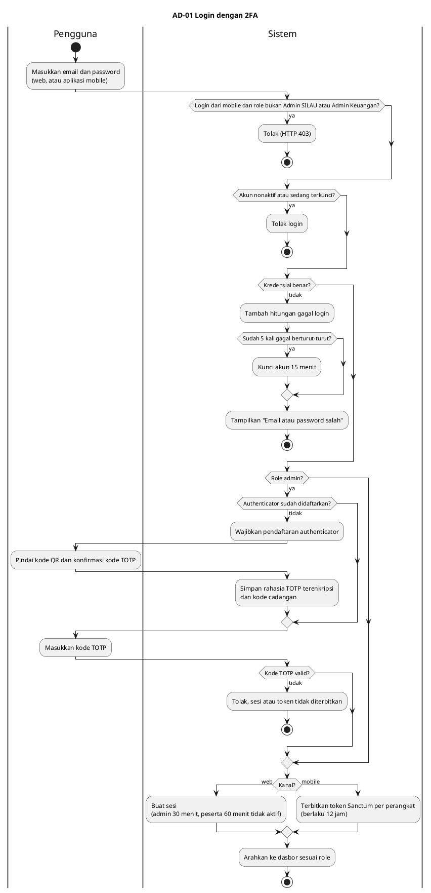
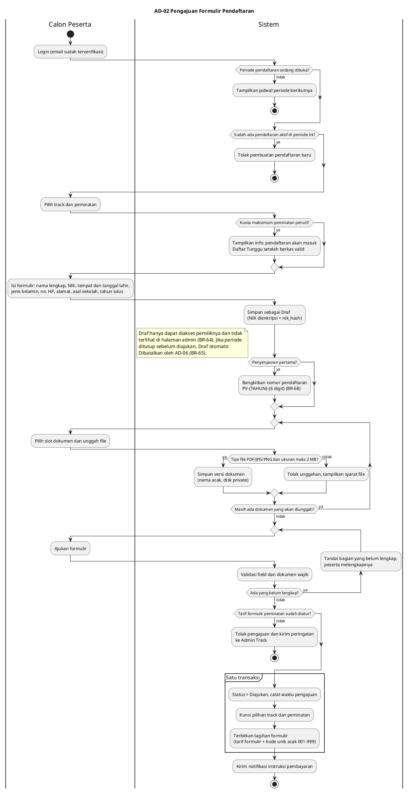
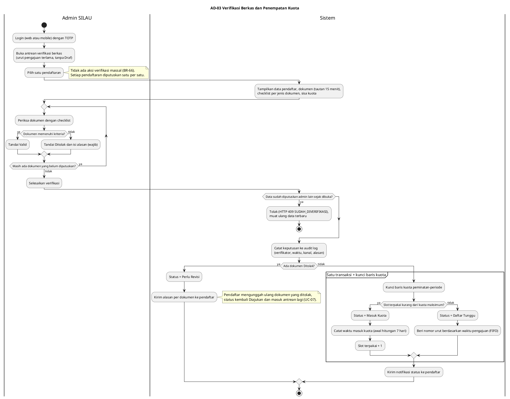
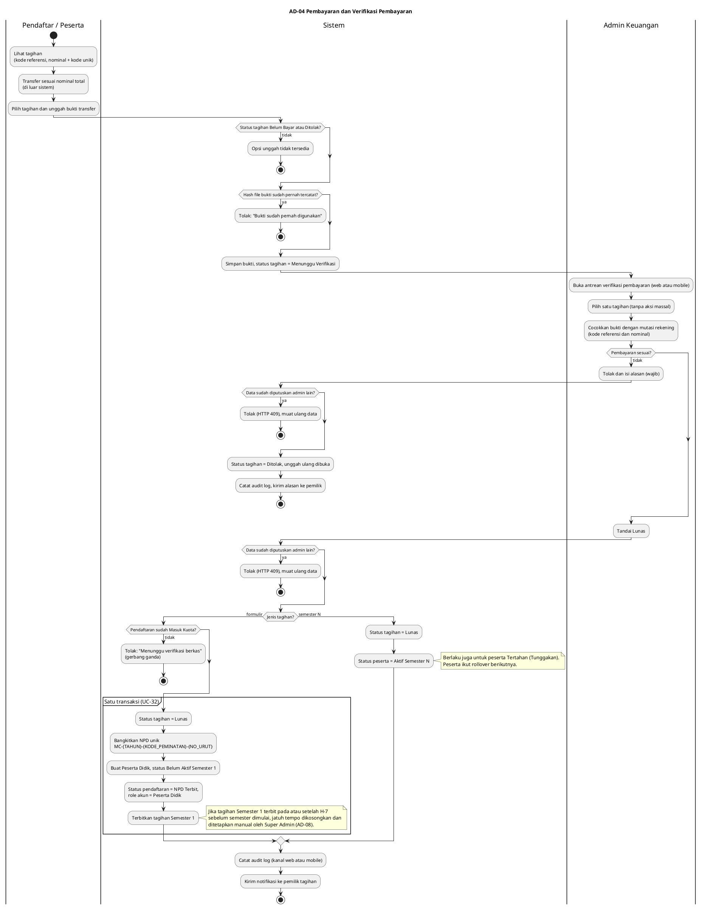
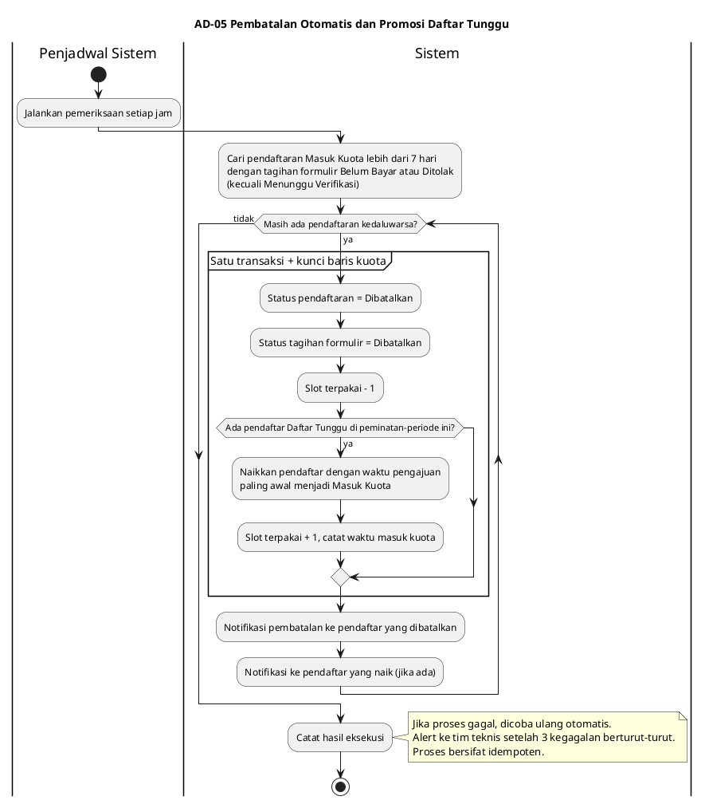
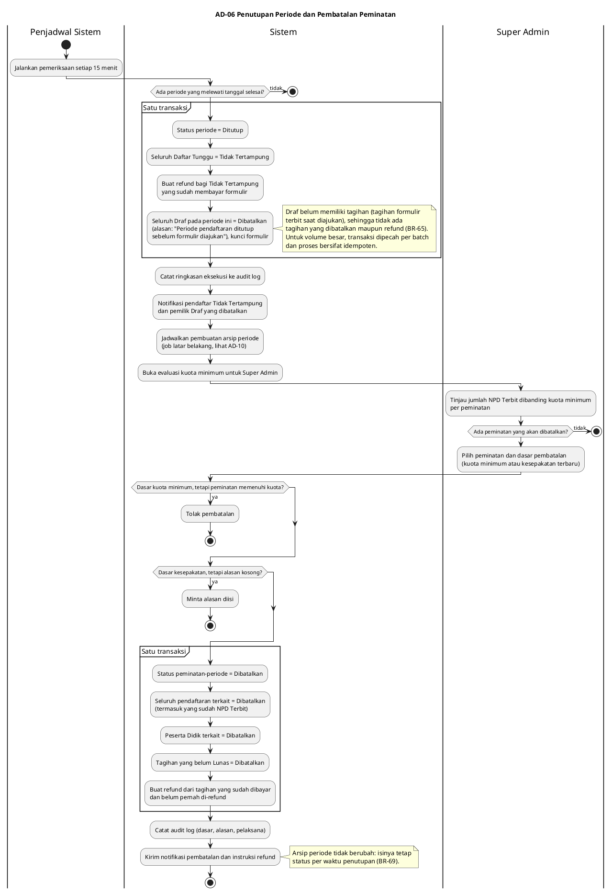
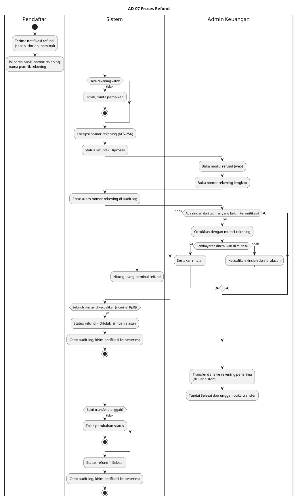
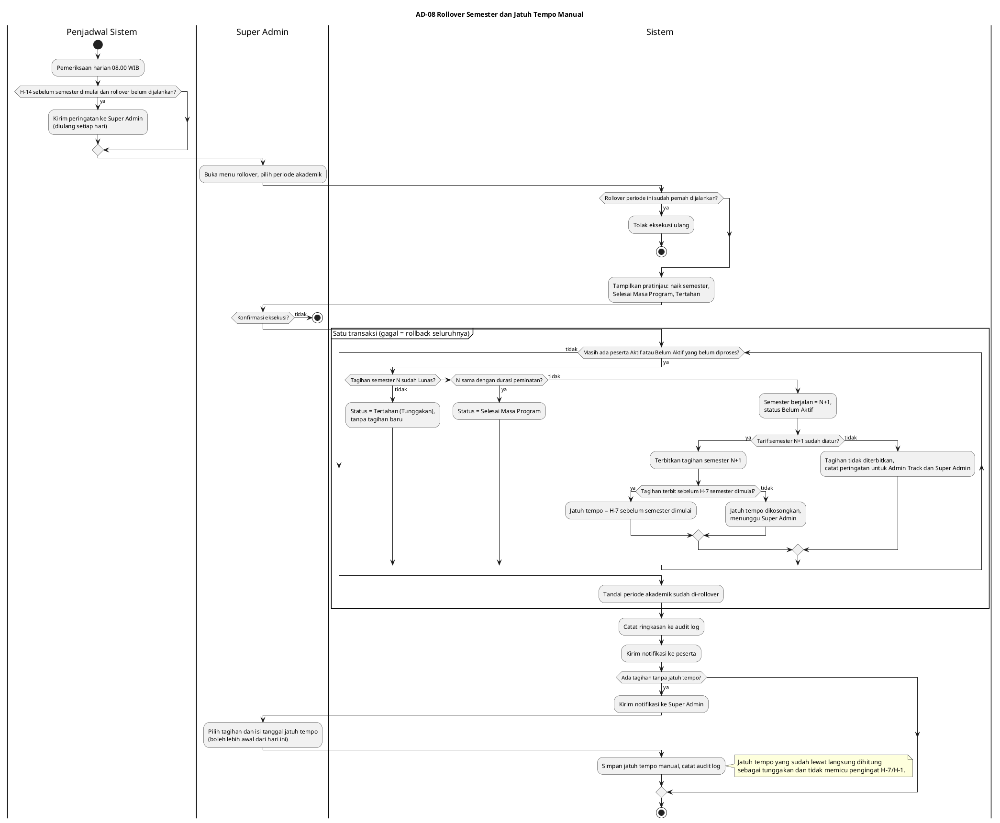
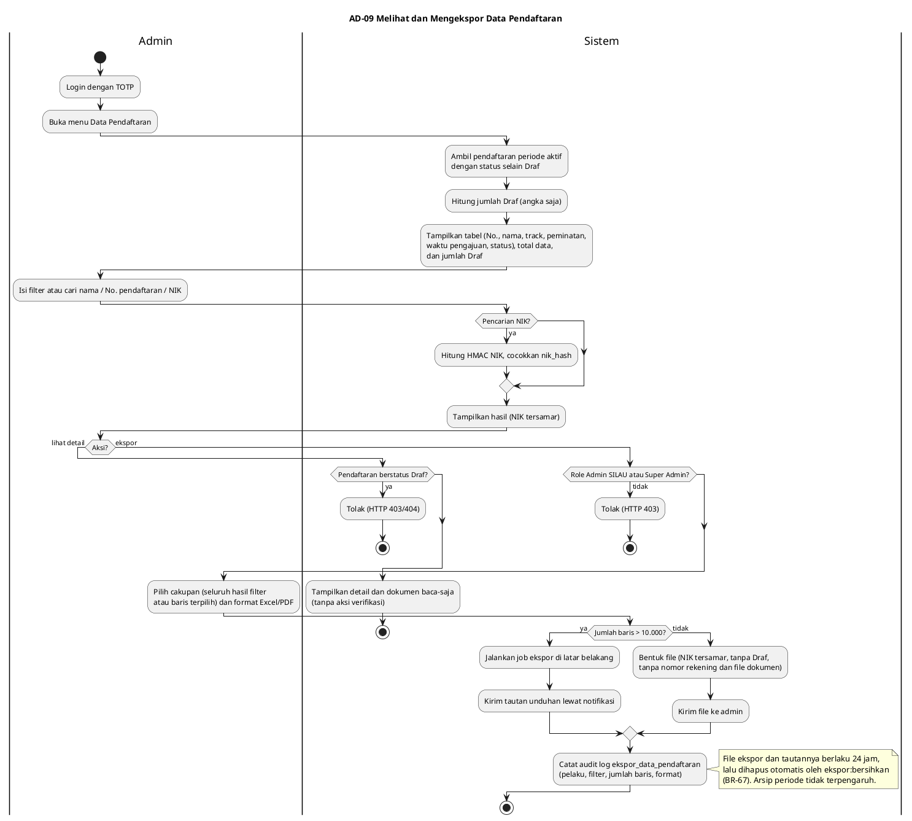
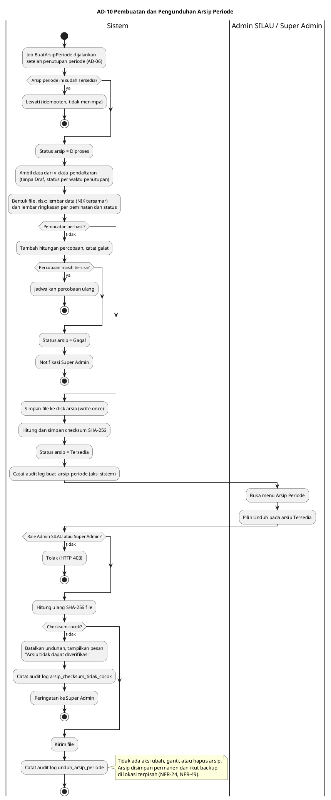

# Activity Diagram — Polibatam Verify
 
Disusun berdasarkan *Use Case Scenario* (UC-01 s.d. UC-34), *FR & BR* (FR-01 s.d. FR-66, BR-01 s.d. BR-69), *Class Diagram*, dan *Keputusan Klarifikasi Scope* (K-01 s.d. K-38).
 
**Konvensi:**
- Diagram ditulis dalam **PlantUML** dengan *swimlane* per aktor, sehingga terlihat jelas siapa melakukan apa.
- Jalur **Sistem** mewakili aplikasi Polibatam Verify (web dan REST API memakai Service layer yang sama).
- Blok `partition "Satu transaksi"` menandai langkah yang harus berhasil seluruhnya atau dibatalkan seluruhnya (NFR-27).
- Setiap diagram dilengkapi rujukan ke UC, FR, dan BR.
## Daftar Activity Diagram
 
| ID | Alur | Aktor | Use Case |
|---|---|---|---|
| AD-01 | Login dengan 2FA (web & mobile) | Pengguna, Sistem | UC-03 |
| AD-02 | Pengajuan formulir pendaftaran | Calon Peserta, Sistem | UC-05, UC-06 |
| AD-03 | Verifikasi berkas & penempatan kuota | Admin SILAU, Sistem | UC-12, UC-31 |
| AD-04 | Pembayaran & verifikasi pembayaran (formulir → NPD, semester → aktif) | Pendaftar/Peserta, Admin Keuangan, Sistem | UC-10, UC-13, UC-32 |
| AD-05 | Pembatalan otomatis 7 hari & promosi Daftar Tunggu | Penjadwal Sistem, Sistem | UC-28, UC-31 |
| AD-06 | Penutupan periode (termasuk Draf & arsip), evaluasi kuota & pembatalan peminatan | Penjadwal Sistem, Super Admin, Sistem | UC-29, UC-22 |
| AD-07 | Proses refund | Pendaftar, Admin Keuangan, Sistem | UC-11, UC-14 |
| AD-08 | *Rollover* semester & jatuh tempo manual | Penjadwal Sistem, Super Admin, Sistem | UC-21, UC-23, UC-30 |
| AD-09 | Melihat & mengekspor data pendaftaran | Admin, Sistem | UC-33 |
| AD-10 | Pembuatan & pengunduhan arsip periode | Sistem, Admin SILAU / Super Admin | UC-29, UC-34 |
 
---
 
## AD-01 — Login dengan 2FA (Web & Mobile)
 
**Rujukan:** UC-03 · FR-03, FR-04, FR-59, FR-60 · BR-03, BR-59, BR-60 · NFR-03, NFR-09, NFR-47
 

 
---
 
## AD-02 — Pengajuan Formulir Pendaftaran
 
**Rujukan:** UC-05, UC-06 · FR-11–14, FR-26, FR-28 · BR-07–12, BR-29, BR-32, BR-62, BR-64, BR-65, BR-68
 

 
---
 
## AD-03 — Verifikasi Berkas & Penempatan Kuota
 
**Rujukan:** UC-12, UC-31 · FR-18–23, FR-60, FR-61 · BR-13, BR-16–19, BR-61, BR-64, BR-66 · NFR-27
 

 
---
 
## AD-04 — Pembayaran & Verifikasi Pembayaran
 
**Rujukan:** UC-10, UC-13, UC-32 · FR-29–35, FR-60, FR-61 · BR-36–42, BR-46, BR-61, BR-66
 

 
---
 
## AD-05 — Pembatalan Otomatis 7 Hari & Promosi Daftar Tunggu
 
**Rujukan:** UC-28, UC-31 · FR-23, FR-24 · BR-18, BR-19, BR-21 · NFR-25, NFR-27
 

 
Promosi Daftar Tunggu yang sama juga dipicu saat kuota maksimum ditambah (UC-18). Pada kasus itu, sistem menaikkan pendaftar sebanyak slot yang bertambah.
 
---
 
## AD-06 — Penutupan Periode, Evaluasi Kuota & Pembatalan Peminatan
 
**Rujukan:** UC-29, UC-22 · FR-25, FR-39–42, FR-62, FR-65 · BR-22–24, BR-47, BR-48, BR-63, BR-65, BR-69
 

 
---
 
## AD-07 — Proses Refund
 
**Rujukan:** UC-11, UC-14 · FR-42–44, FR-62 · BR-48–51, BR-63 · NFR-06
 

 
---
 
## AD-08 — Rollover Semester & Jatuh Tempo Manual
 
**Rujukan:** UC-21, UC-23, UC-30 · FR-27, FR-51, FR-52, FR-57, FR-58 · BR-34, BR-35, BR-44, BR-45 · NFR-18
 

 
---
 
## AD-09 — Melihat & Mengekspor Data Pendaftaran
 
**Rujukan:** UC-33 · FR-63, FR-64 · BR-04, BR-58, BR-62, BR-64, BR-66, BR-67, BR-68 · K-37, K-38
 

 
---
 
## AD-10 — Pembuatan & Pengunduhan Arsip Periode
 
**Rujukan:** UC-29, UC-34 · FR-65, FR-66 · BR-58, BR-64, BR-69 · NFR-24, NFR-25, NFR-49 · K-38
 

 
---
 
## Keterlacakan
 
| AD | Use Case | FR | BR |
|---|---|---|---|
| AD-01 | UC-03 | FR-03, FR-04, FR-59, FR-60 | BR-03, BR-59, BR-60 |
| AD-02 | UC-05, UC-06 | FR-11–14, FR-26, FR-28 | BR-07–12, BR-29, BR-32, BR-62, BR-64, BR-65, BR-68 |
| AD-03 | UC-12, UC-31 | FR-18–23, FR-60, FR-61 | BR-13, BR-16–19, BR-61, BR-64, BR-66 |
| AD-04 | UC-10, UC-13, UC-32 | FR-29–35, FR-60, FR-61 | BR-36–42, BR-46, BR-61, BR-66 |
| AD-05 | UC-28, UC-31 | FR-23, FR-24 | BR-18, BR-19, BR-21 |
| AD-06 | UC-29, UC-22 | FR-25, FR-39–42, FR-62, FR-65 | BR-22–24, BR-47, BR-48, BR-63, BR-65, BR-69 |
| AD-07 | UC-11, UC-14 | FR-42–44, FR-62 | BR-48–51, BR-63 · K-34 |
| AD-08 | UC-21, UC-23, UC-30 | FR-27, FR-51, FR-52, FR-57, FR-58 | BR-34, BR-35, BR-44, BR-45 |
| AD-09 | UC-33 | FR-63, FR-64 | BR-04, BR-58, BR-62, BR-64, BR-66, BR-67, BR-68 |
| AD-10 | UC-29, UC-34 | FR-65, FR-66 | BR-58, BR-64, BR-69 |
 
Use case yang tidak digambar sebagai activity diagram (katalog, registrasi, CRUD data master, CMS, *audit log*) memiliki alur linear tanpa percabangan penting, sehingga cukup dijelaskan oleh *use case scenario*.
 
---
 
## Status Asumsi
 
| # | Asumsi | Bagian | Status |
|---|---|---|---|
| A-48 | Saat peminatan dibatalkan, Peserta Didik yang sudah memiliki NPD pada peminatan itu ikut berstatus Dibatalkan. | AD-06 | Disetujui (K-34) |
| A-49 | Jika seluruh rincian sebuah refund dikecualikan, refund berstatus Ditolak dengan alasan, tanpa bukti transfer. | AD-07 | Disetujui (K-34) |
| A-57 | Nomor pendaftaran `PV-{TAHUN}-{6 digit}` dibangkitkan saat Draf pertama kali disimpan (BR-68). | AD-02 | Disetujui (K-37) |
| A-58 | Ekspor data pendaftaran hanya untuk Admin SILAU dan Super Admin (BR-67). | AD-09 | Disetujui (K-37) |
| A-59 | File ekspor dan tautannya berlaku 24 jam (BR-67). | AD-09 | Disetujui (K-38) |
| A-60 | Arsip periode dibuat otomatis dan disimpan permanen (BR-69). | AD-06, AD-10 | Disetujui (K-38) |
| A-61 | `[ASUMSI]` Arsip berformat `.xlsx` saja dengan status per waktu penutupan. | AD-10 | Menunggu konfirmasi |