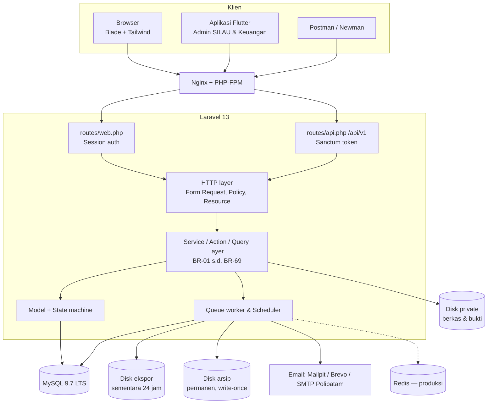

# Dokumen Arsitektur & Teknologi — Polibatam Verify
 
Disusun berdasarkan *SKPPL* (FR-01 s.d. FR-66, BR-01 s.d. BR-69, NFR-01 s.d. NFR-50), *Dokumen Keamanan Basis Data*, dan *Keputusan Klarifikasi Scope* (K-01 s.d. K-38).
 
---
 
## 1. Ringkasan Keputusan Arsitektur
 
| Aspek | Keputusan |
|---|---|
| Gaya arsitektur | **Monolit modular Laravel** dengan dua pintu masuk: **Web (Blade)** dan **REST API (`/api/v1`)**. Keduanya memanggil **Service layer yang sama**. |
| Web | **Blade + Tailwind CSS** (di-*build* lewat Vite), dirender di server. Dipakai oleh seluruh peran: Calon Peserta/Peserta Didik dan semua admin. |
| Mobile | **Flutter (Dart)** yang memanggil REST API, **khusus Admin SILAU dan Admin Keuangan** untuk mempercepat verifikasi (K-29). |
| Basis data | **MySQL 9.7 LTS** |
| Web server | **Nginx + PHP-FPM** |
| Lingkungan pengembangan | **Laragon** (Windows) |
| Pengujian API | **Postman** (manual) + **Newman** (otomatis) |
 
**Prinsip utama:** seluruh aturan bisnis (BR) hanya ditulis sekali di Service/Action layer. Controller Web dan Controller API hanya menjadi "pintu" yang tipis, sehingga perilaku web dan mobile selalu sama.
 
---
 
## 2. Diagram Arsitektur
 

 
---
 
## 3. Tumpukan Teknologi
 
### 3.1 Backend & Web
 
| Komponen | Teknologi | Versi / Catatan | Ref |
|---|---|---|---|
| Bahasa | PHP | 8.4 (Laravel 13 mendukung 8.3–8.5) | — |
| Framework | Laravel | 13.x | — |
| Web UI | Blade + Tailwind CSS + Alpine.js | Tailwind di-*build* dengan Vite; Alpine.js untuk interaksi ringan (modal, *dropdown*, pratinjau unggah, pilihan baris tabel) | NFR-33, NFR-34 |
| Autentikasi web | Session guard bawaan Laravel | Cookie `HttpOnly`, `Secure`, `SameSite` | NFR-03 |
| Autentikasi API | **Laravel Sanctum** (*personal access token*) | Untuk aplikasi Flutter | NFR-43 |
| 2FA admin (wajib, K-33) | **Laravel Fortify** | TOTP | NFR-09, FR-59 |
| Role & izin | **spatie/laravel-permission** | 5 *role* sesuai Matriks RBAC | FR-07, NFR-04 |
| State machine | **spatie/laravel-model-states** | Pendaftaran (termasuk `draf → dibatalkan`), Dokumen, Tagihan, Peserta Didik, Refund, Arsip Periode | NFR-28, BR-65, BR-69 |
| Ekspor | **maatwebsite/excel** (.xlsx), **barryvdh/laravel-dompdf** (PDF) | Rekap keuangan, data pendaftaran, dan arsip periode (.xlsx) | FR-38, FR-64, FR-65, NFR-39 |
| Dokumentasi API | **Scribe** | Menghasilkan OpenAPI + Postman collection | — |
| Queue | Laravel Queue | Driver `database` (lokal), **Redis** (produksi) | NFR-22, NFR-25 |
| Scheduler | Laravel Scheduler | `schedule:work` (lokal), cron `schedule:run` (produksi) | FR-24, FR-25, FR-54, FR-58 |
| Email | Laravel Mail | Mailpit → Brevo/Resend → SMTP Polibatam (K-27) | NFR-44, NFR-46 |
| *Debugging* | Laravel Telescope | **Hanya lingkungan lokal** | — |
 
### 3.2 Data & Infrastruktur
 
| Komponen | Teknologi | Catatan | Ref |
|---|---|---|---|
| Basis data | MySQL 9.7 LTS | InnoDB, `utf8mb4` | — |
| Cache & antrean (produksi) | Redis | Lokal cukup `database`/`file` | NFR-22 |
| Penyimpanan file | Laravel Filesystem, tiga *disk* privat terpisah | `private` (berkas pendaftaran, bukti bayar, bukti transfer); `ekspor` (file ekspor sementara, dihapus setelah 24 jam, tidak di-*backup*); `arsip` (arsip periode permanen, *write-once*, ikut *backup* ke lokasi terpisah). Lokal: `storage/app/{private,ekspor,arsip}`. Produksi: disk server atau S3-compatible (mis. MinIO dengan *object lock* untuk `arsip`). | NFR-07, NFR-21, NFR-24, NFR-49, NFR-50 |
| Web server | Nginx + PHP-FPM | Sama di lokal (Laragon) dan produksi | NFR-01 |
| OS produksi | **Linux** (distribusi mis. Ubuntu Server LTS) | Laragon hanya untuk pengembangan | K-26, K-29 |
 
### 3.3 Mobile
 
| Komponen | Teknologi | Catatan |
|---|---|---|
| Framework | Flutter (Dart), versi stabil terbaru | Android & iOS |
| HTTP client | `dio` | *Interceptor* untuk token & penanganan *error* seragam |
| State management | `flutter_riverpod` [ASUMSI] | — |
| Routing | `go_router` [ASUMSI] | — |
| Penyimpanan token | `flutter_secure_storage` | Token Sanctum tidak disimpan di *shared preferences* biasa |
| Model data | `freezed` + `json_serializable` | Mengikuti skema dari dokumentasi Scribe |
| Penampil dokumen | `pdfx` / `photo_view` [ASUMSI] | Menampilkan PDF/JPG/PNG berkas dan bukti bayar tanpa menyimpan permanen ke perangkat |
| Format lokal | `intl` (`id_ID`) | Rupiah dan tanggal Indonesia, NFR-34 |
 
### 3.4 Kualitas & Pengujian
 
| Jenis | Alat | Target | Ref |
|---|---|---|---|
| Unit & feature test | Pest (di atas PHPUnit) | Cakupan ≥ 80% modul kritis | NFR-41 |
| Uji API manual | Postman | Collection dihasilkan Scribe | — |
| Uji API otomatis | Newman | Dijalankan sebelum *merge* | — |
| Uji beban & konkurensi | k6 | NFR-14, NFR-20, NFR-27 | — |
| Format kode | Laravel Pint | — | — |
| Analisis statis | Larastan | Level ≥ 6 [ASUMSI] | — |
| Uji Flutter | `flutter_test` | *Widget test* alur verifikasi admin | — |
| Version control | Git + GitHub | Branch `main` dilindungi, *pull request* wajib | — |
 
Uji wajib untuk K-37: Draf tidak pernah muncul pada *query* admin mana pun (daftar, detail, ekspor, arsip, VIEW), ekspor ditolak untuk Admin Keuangan/Track, nomor pendaftaran tetap unik pada penyimpanan Draf bersamaan, dan penutupan periode bersifat idempoten.
 
Uji wajib untuk K-38: file ekspor terhapus setelah 24 jam tanpa menyentuh *disk* `arsip`; arsip periode hanya dibuat sekali per periode walau penutupan terpicu berulang; akun aplikasi tidak dapat menimpa atau menghapus file arsip; unduhan ditolak bila *checksum* dimanipulasi; Admin Keuangan/Track mendapat 403 di halaman arsip.
 
---
 
## 4. Lapisan Aplikasi Laravel
 
| Lapisan | Tanggung jawab | Tidak boleh |
|---|---|---|
| **Route** (`web.php`, `api.php`) | Memetakan URL ke controller, *middleware* auth/role | Berisi logika |
| **Controller** (`Web\*`, `Api\V1\*`) | Menerima *request*, memanggil Service/Action/Query, mengembalikan view atau JSON | Berisi aturan bisnis |
| **Form Request** | Validasi input (format, wajib, ukuran file) | Mengubah data |
| **Policy** | Otorisasi per data (mis. peserta hanya melihat tagihannya sendiri; admin tidak dapat membuka Draf; hanya SILAU/Super Admin mengunduh arsip) | — |
| **Service / Action** | Menjalankan BR, transaksi DB, memicu *event*/*job* | Mengetahui apakah pemanggil web atau API |
| **Query** | *Query* baca untuk daftar, filter, dan agregat (selalu memakai *scope* yang sesuai *role*) | Mengubah data |
| **Model + State** | Relasi, *cast* (termasuk enkripsi), *scope* (`untukAdmin()`), transisi status yang sah | Memanggil layanan eksternal |
| **Job / Command** | Proses latar belakang dan terjadwal | — |
| **API Resource** | Membentuk JSON respons | — |
 
### 4.1 Struktur Folder
 
```text
app/
├── Actions/                 # satu aksi bisnis = satu kelas
│   ├── Pendaftaran/         # SimpanDraf, AjukanFormulir, VerifikasiDokumen, EksporDataPendaftaran, ...
│   ├── Kuota/               # TempatkanKuota, PromosikanDaftarTunggu, ...
│   ├── Periode/             # TutupPeriode (Daftar Tunggu + Draf)
│   ├── Arsip/               # UnduhArsipPeriode, BersihkanEkspor
│   ├── Tagihan/             # TerbitkanTagihan, VerifikasiPembayaran, TerbitkanNpd, ...
│   ├── Refund/
│   └── Rollover/
├── Queries/                 # KatalogQuery, DataPendaftaranQuery, RekapQuery
├── Services/                # KodeUnikGenerator, NpdGenerator, NomorPendaftaranGenerator, TarifResolver, AuditLogger, NikHasher
├── States/                  # state machine per entitas
├── Models/
├── Policies/                # TagihanPolicy, PendaftaranPolicy, ArsipPeriodePolicy, ...
├── Jobs/                    # KirimNotifikasi, EksporLaporan, EksporDataPendaftaran, BuatArsipPeriode, JalankanRollover
├── Console/Commands/        # perintah terjadwal
├── Http/
│   ├── Controllers/
│   │   ├── Web/{Peserta,Silau,Keuangan,Track,SuperAdmin,Admin}/
│   │   └── Api/V1/
│   ├── Requests/
│   └── Resources/V1/
└── Notifications/           # template email + in-app
resources/views/             # Blade per peran
routes/{web.php, api.php, console.php}
```
 
`Http/Controllers/Web/Admin/` berisi halaman yang dipakai bersama oleh beberapa *role* admin, misalnya `DataPendaftaranController` (FR-63, FR-64) dan `ArsipPeriodeController` (FR-66).
 
### 4.2 Pemetaan Modul ke Kode
 
| Modul FR | Actions / Services utama |
|---|---|
| Akun & Akses (FR-01–07) | Fortify, Sanctum, `spatie/permission` |
| Informasi Publik (FR-08–10) | `KatalogQuery`, `KontenCms` |
| Pendaftaran (FR-11–17) | `SimpanDraf`, `NomorPendaftaranGenerator`, `AjukanFormulir`, `UnggahDokumen` |
| Verifikasi Berkas (FR-18–25) | `VerifikasiDokumen`, `TempatkanKuota`, `PromosikanDaftarTunggu`, `BatalkanKedaluwarsa`, `TutupPeriode` |
| Tagihan & Pembayaran (FR-26–38, FR-57) | `TarifResolver`, `KodeUnikGenerator`, `TerbitkanTagihan`, `UnggahBukti`, `VerifikasiPembayaran`, `TerbitkanNpd`, `TetapkanJatuhTempo` |
| Kuota & Refund (FR-39–44) | `EvaluasiKuotaMinimum`, `BatalkanPeminatan`, `HitungRefund`, `ProsesRefund` |
| Data Master (FR-45–49) | CRUD Track/Peminatan, `SimpanVersiTarif`, `AturKuota` |
| Periode & Rollover (FR-50–52, FR-58) | `PratinjauRollover`, `JalankanRollover` |
| Notifikasi & Audit (FR-53–56) | `AuditLogger` (*hash chain*), Notifications |
| Keamanan Akun, Mobile & Refund Bertahap (FR-59–62) | Fortify (TOTP wajib), `Api\V1\*` + Sanctum, `CekVersiData` (409), `HitungRefund` dengan `refund_items` |
| Data Pendaftaran Admin (FR-63–64) | `DataPendaftaranQuery`, `PendaftaranPolicy`, `EksporDataPendaftaran` (+ job), `BersihkanEkspor`, VIEW `v_data_pendaftaran` |
| Arsip Periode (FR-65–66) | `BuatArsipPeriode` (job), `UnduhArsipPeriode`, `ArsipPeriodePolicy`, model `ArsipPeriode`, *disk* `arsip` |
 
---
 
## 5. Pembagian Kanal Web dan Mobile
 
Aplikasi mobile dibuat **khusus untuk mempermudah verifikasi** oleh Admin SILAU dan Admin Keuangan (K-29). Seluruh fitur lain tetap di web.
 
| Fitur | Web (Blade) | Mobile (Flutter via API) |
|---|---|---|
| Katalog, registrasi, formulir, tagihan, refund (Calon Peserta / Peserta Didik) | ✓ | — |
| Antrean & verifikasi dokumen (Admin SILAU) | ✓ | ✓ |
| Antrean & verifikasi pembayaran formulir/semester (Admin Keuangan) | ✓ | ✓ |
| Notifikasi *in-app* untuk admin | ✓ | ✓ |
| Data Pendaftaran (lihat: semua admin; ekspor: Admin SILAU & Super Admin) | ✓ | — |
| Arsip Periode (lihat & unduh: Admin SILAU & Super Admin) | ✓ | — |
| Proses refund, rekap & ekspor laporan (Admin Keuangan) | ✓ | — (K-30) |
| Data master, tarif, kuota (Admin Track) | ✓ | — |
| Periode, *rollover*, akun, *audit log*, CMS (Super Admin) | ✓ | — |
 
Konsekuensi desain:
- API v1 **tidak membuka *endpoint* untuk peserta**. Seluruh *endpoint* v1 (kecuali autentikasi) hanya dapat diakses *role* `admin_silau` dan `admin_keuangan`.
- Karena verifikasi bisa dilakukan dari web dan mobile secara bersamaan oleh admin berbeda, setiap keputusan verifikasi memakai ***optimistic locking***: jika data sudah diputuskan admin lain, API menjawab `409` dan aplikasi memuat ulang data.
- Tidak ada *endpoint* keputusan verifikasi massal, baik di web maupun API (BR-66). Satu permintaan = satu dokumen/pendaftaran atau satu tagihan.
---
 
## 6. Konvensi REST API
 
### 6.1 Aturan Umum
 
| Aturan | Ketentuan |
|---|---|
| Base URL | `https://{domain}/api/v1` |
| Format | JSON, `Content-Type: application/json`. |
| Autentikasi | Header `Authorization: Bearer {token}` (Sanctum) |
| Penamaan | Kata benda jamak, huruf kecil, *kebab-case*: `/verifikasi-berkas`, `/verifikasi-pembayaran/{kode_referensi}` |
| Waktu | ISO 8601 dalam UTC, mis. `2026-11-21T03:00:00Z`. Klien menampilkan dalam WIB. |
| Uang | Bilangan bulat Rupiah, mis. `1500123` |
| Paginasi | `?page=1&per_page=20`, maksimal `per_page=100` |
| Versi | Perubahan yang merusak kompatibilitas → `/api/v2`. v1 tetap berjalan sampai aplikasi mobile lama tidak dipakai. |
| *Rate limit* | Sesuai NFR-08, respons `429` dengan header `Retry-After` |
 
### 6.2 Format Respons
 
**Berhasil:**
```json
{
  "success": true,
  "message": "Antrean verifikasi pembayaran berhasil dimuat.",
  "data": [{ "kode_referensi": "TG-2026-000123", "nominal_total": 1500123, "status": "menunggu_verifikasi" }],
  "meta": { "page": 1, "per_page": 20, "total": 3 }
}
```
 
**Gagal:**
```json
{
  "success": false,
  "message": "Data yang dikirim tidak valid.",
  "code": "VALIDATION_ERROR",
  "errors": { "alasan": ["Alasan penolakan wajib diisi."] }
}
```
 
### 6.3 Kode Status HTTP
 
| Kode | Arti | Contoh |
|---|---|---|
| 200 / 201 | Berhasil / data dibuat | Keputusan verifikasi tersimpan |
| 204 | Berhasil tanpa isi | Logout |
| 401 | Belum login / token tidak valid | Token kedaluwarsa |
| 403 | Tidak berhak | Admin SILAU membuka antrean pembayaran; Admin Keuangan mengekspor data pendaftaran atau membuka arsip periode |
| 404 | Data tidak ditemukan | Admin membuka Draf lewat URL langsung |
| 409 | Konflik status / aturan bisnis | Tagihan sudah diverifikasi admin lain, atau formulir belum Masuk Kuota (gerbang ganda) |
| 410 | Sumber sudah tidak tersedia | Tautan file ekspor yang sudah lewat 24 jam |
| 422 | Validasi gagal | Menolak tanpa alasan |
| 429 | Terlalu banyak permintaan | — |
| 500 | Kesalahan server | Detail teknis tidak ditampilkan (NFR-35) |
 
### 6.4 Daftar Endpoint Utama (v1)
 
**Autentikasi & umum**
 
| Method | Endpoint | Fungsi | Role | FR |
|---|---|---|---|---|
| POST | `/auth/login` | Login (email, password, nama perangkat). Karena 2FA wajib untuk admin (K-33), selalu mengembalikan `challenge_token`. | SILAU, Keuangan | FR-03 |
| POST | `/auth/two-factor` | Verifikasi kode TOTP, mengembalikan token Sanctum | SILAU, Keuangan | NFR-09 |
| POST | `/auth/logout` | Mencabut token perangkat ini | SILAU, Keuangan | FR-03 |
| GET | `/me` | Profil dan *role* | SILAU, Keuangan | — |
| GET | `/dasbor/ringkasan` | Jumlah antrean yang menunggu verifikasi | SILAU, Keuangan | FR-18, FR-31 |
| GET | `/notifikasi` | Daftar notifikasi *in-app* | SILAU, Keuangan | FR-53 |
| PATCH | `/notifikasi/{id}/dibaca` | Tandai dibaca | SILAU, Keuangan | FR-53 |
| GET | `/berkas/{id}/tautan` | URL bertanda tangan untuk melihat file (≤ 15 menit) | SILAU, Keuangan | NFR-07 |
 
**Verifikasi berkas — Admin SILAU**
 
| Method | Endpoint | Fungsi | FR |
|---|---|---|---|
| GET | `/verifikasi-berkas` | Antrean pendaftaran berstatus Diajukan (tanpa Draf; filter periode, track, peminatan, status; urut terlama) | FR-18 |
| GET | `/verifikasi-berkas/{pendaftaran_id}` | Detail pendaftar, daftar dokumen + *checklist* per jenis, sisa kuota peminatan | FR-19, FR-20 |
| PUT | `/verifikasi-berkas/{pendaftaran_id}/dokumen/{dokumen_id}` | Keputusan Valid/Ditolak per dokumen + hasil *checklist* + alasan (wajib jika Ditolak) | FR-20 |
| POST | `/verifikasi-berkas/{pendaftaran_id}/selesai` | Menyelesaikan verifikasi → Perlu Revisi / Masuk Kuota / Daftar Tunggu | FR-21, FR-22 |
 
**Verifikasi pembayaran — Admin Keuangan**
 
| Method | Endpoint | Fungsi | FR |
|---|---|---|---|
| GET | `/verifikasi-pembayaran` | Antrean tagihan Menunggu Verifikasi (filter jenis formulir/semester ke-*n*, peminatan, periode) | FR-31 |
| GET | `/verifikasi-pembayaran/{kode_referensi}` | Detail tagihan: nominal + kode unik, pemilik, bukti transfer, status gerbang ganda | FR-31, FR-33 |
| POST | `/verifikasi-pembayaran/{kode_referensi}/lunas` | Tandai Lunas → memicu NPD (formulir) atau aktivasi semester | FR-32, FR-34, FR-35 |
| POST | `/verifikasi-pembayaran/{kode_referensi}/tolak` | Tolak dengan alasan wajib | FR-32 |
 
Setiap permintaan PUT/POST verifikasi menyertakan `versi` (nilai `updated_at` terakhir yang dilihat admin). Jika data sudah berubah, API menjawab `409 Conflict` dengan kode `SUDAH_DIVERIFIKASI`.
 
### 6.5 Rute Web Data Pendaftaran & Arsip (bukan API v1)
 
| Method | Rute | Fungsi | Role | FR |
|---|---|---|---|---|
| GET | `/admin/data-pendaftaran` | Daftar pendaftaran tanpa Draf + jumlah Draf, filter & pencarian | Semua admin | FR-63 |
| GET | `/admin/data-pendaftaran/{nomor_pendaftaran}` | Detail baca-saja (Draf → 404) | Semua admin | FR-63 |
| POST | `/admin/data-pendaftaran/ekspor` | Ekspor Excel/PDF (filter atau `ids` terpilih); > 10.000 baris → *job* | Admin SILAU, Super Admin | FR-64 |
| GET | `/admin/ekspor/{berkas}` | Unduh file ekspor lewat URL bertanda tangan yang berlaku 24 jam; lewat batas → 410 | Pembuat ekspor | FR-64 |
| GET | `/admin/arsip-periode` | Daftar arsip periode (status, jumlah baris, ukuran) | Admin SILAU, Super Admin | FR-66 |
| GET | `/admin/arsip-periode/{id}/unduh` | Unduh arsip setelah verifikasi SHA-256 | Admin SILAU, Super Admin | FR-66 |
| POST | `/admin/arsip-periode/{id}/ulangi` | Jadwalkan ulang pembuatan arsip berstatus Gagal | Super Admin | FR-65 |
 
Tidak ada rute ubah atau hapus arsip. Nama rute bersifat ilustratif (K-35).
 
---
 
## 7. Autentikasi & Otorisasi
 
| Kanal | Mekanisme | Masa berlaku |
|---|---|---|
| Web — peserta | Session + CSRF token | Tidak aktif 60 menit, NFR-03 |
| Web — admin | Session + CSRF + TOTP (Fortify) | Tidak aktif 30 menit, NFR-03, NFR-09 |
| Mobile — Admin SILAU / Keuangan | Sanctum token per perangkat, diterbitkan **setelah TOTP berhasil** | **12 jam** sejak terbit (K-30); dicabut saat logout, akun dinonaktifkan, atau *role* berubah |
 
Karena admin mengakses data pribadi (KTP, ijazah, bukti transfer) dari perangkat genggam, aplikasi mobile wajib:
- menyimpan token hanya di `flutter_secure_storage`;
- **tidak menyimpan file berkas secara permanen** di perangkat (hanya ditampilkan dari URL bertanda tangan, *cache* dihapus saat keluar layar);
- meminta login ulang setelah token kedaluwarsa.
Kunci PIN/biometrik saat aplikasi dibuka kembali dari latar belakang **tidak diperlukan** (K-30).
 
Otorisasi berlapis:
1. **Middleware role** (`spatie/permission`): membatasi akses per kelompok halaman/endpoint sesuai Matriks RBAC.
2. **Policy**: membatasi akses per data, misalnya `TagihanPolicy::view` memastikan pemilik tagihan sama dengan pengguna yang login; `PendaftaranPolicy::view` menolak admin membuka Draf; `PendaftaranPolicy::export` dan `ArsipPeriodePolicy::download` hanya untuk Admin SILAU dan Super Admin; `ArsipPeriodePolicy::retry` hanya Super Admin (BR-64, BR-67, BR-69).
3. **Query scope**: `Pendaftaran::untukAdmin()` menyaring `status <> 'draf'` di setiap *query* admin, sebagai lapis kedua setelah Policy.
4. **State machine**: menolak aksi yang tidak sah untuk status saat ini, dijawab `409` di API.
---
 
## 8. Lapisan Data
 
| Aspek | Ketentuan | Ref |
|---|---|---|
| Skema | Dikelola dengan *migration* Laravel; tidak ada perubahan skema manual | NFR-42 |
| Uang | Kolom `BIGINT UNSIGNED` dalam Rupiah | NFR-29 |
| Waktu | Disimpan UTC (`APP_TIMEZONE=UTC`), ditampilkan WIB di Blade dan Flutter | NFR-30 |
| NIK, nomor rekening, rahasia 2FA | `encrypted` cast (AES-256), kunci `APP_KEY` di `.env`, bukan di repositori | NFR-06, NFR-10 |
| `nik_hash` | HMAC-SHA256 dengan kunci terpisah `NIK_HMAC_KEY` di `.env` (K-36) | NFR-06 |
| *Optimistic locking* | `updated_at` `TIMESTAMP(6)` pada tabel yang diverifikasi + kondisi status di `UPDATE` (K-36) | FR-61 |
| Konkurensi kuota | `DB::transaction` + `lockForUpdate()` pada baris kuota peminatan | FR-22, NFR-27 |
| Nomor pendaftaran | `PV-{TAHUN}-{6 digit}`; penghitung per tahun di `pengaturans` dikunci `FOR UPDATE` dalam transaksi `SimpanDraf` | BR-68 |
| Keunikan | *Unique index* pada `npd`, `kode_referensi`, `nomor_pendaftaran`, kombinasi (`kode_unik`, `nominal_dasar`) untuk tagihan terbuka, `email`, `arsip_periodes.periode_pendaftaran_id` | BR-01, BR-29, BR-31, BR-41, BR-68, BR-69 |
| Visibilitas Draf | *Policy* + *query scope* `untukAdmin()` + VIEW `v_data_pendaftaran` yang sudah menyaring Draf | BR-64 |
| File ekspor | Disimpan di *disk* `ekspor`, tidak dicatat di tabel; masa berlaku di `pengaturans` (`masa_berlaku_ekspor_jam`, default 24) | BR-67, NFR-50 |
| Arsip periode | Tabel `arsip_periodes` + *disk* `arsip`. Akun `pv_app` tanpa `DELETE`; *trigger* `trg_arsip_periodes_kunci` menolak perubahan kolom file setelah `tersedia`; di sistem berkas, pengguna proses PHP hanya dapat membuat file baru dan membaca (tanpa timpa/hapus) | BR-69, NFR-49 |
| *Audit log* | Tabel `audit_logs` dengan kolom `hasil`, `prev_hash`, dan `hash`. Akun `pv_app` hanya punya hak `INSERT` dan `SELECT`; *trigger* menolak `UPDATE`/`DELETE`; penulisan diserialkan `GET_LOCK('audit_chain')`. Mencakup aksi `ekspor_data_pendaftaran`, `batal_draf_periode_ditutup`, `buat_arsip_periode`, `unduh_arsip_periode`, dan `arsip_checksum_tidak_cocok`. | NFR-31, BR-58 |
| VIEW laporan | `v_antrean_verifikasi_berkas`, `v_rekap_pembayaran`, `v_status_refund`, `v_data_pendaftaran`, dibaca lewat koneksi `mysql_report` | NFR-12, FR-64, FR-65 |
| *Snapshot* | `tagihan.nominal_dasar` dan `pendaftaran.durasi_snapshot` disalin saat terbit | BR-28, BR-43 |
| Data awal | *Seeder* untuk *role*, akun Super Admin pertama, contoh track/peminatan (sesuai pedoman; peminatan Teknik Elektro "Umum") | — |
 
### 8.1 Akun & Koneksi Basis Data (K-36)
 
| Akun MySQL | Host | Koneksi Laravel | Fungsi |
|---|---|---|---|
| `pv_app` | IP server aplikasi (lokal `127.0.0.1`) | `mysql` (bawaan) | Web, API, *queue*, *scheduler*. Hak per tabel, tanpa DDL dan tanpa `DELETE` tabel domain (termasuk `arsip_periodes`). |
| `pv_report` | IP server aplikasi | `mysql_report` | Dasbor, ekspor laporan, dan pembentukan arsip periode; hanya `SELECT` pada VIEW |
| `pv_migrator` | IP server aplikasi | `mysql_migrator` | `php artisan migrate --database=mysql_migrator`; dikunci di luar jendela *deploy* |
| `pv_backup` | Server DB | — | `mysqldump` terjadwal |
| `pv_dba` | Server DB | — | Administrasi dan *restore* |
 
`root` tidak dipakai aplikasi. Rincian GRANT, *baseline* MySQL, dan prosedur *backup*/*restore* ada di **Dokumen Keamanan Basis Data**.
 
Variabel `.env` tambahan: `NIK_HMAC_KEY`, `DB_MIGRATOR_USERNAME`/`PASSWORD`, `DB_REPORT_USERNAME`/`PASSWORD`, `FILESYSTEM_ARSIP_*` (konfigurasi *disk* arsip).
 
---
 
## 9. Proses Latar Belakang
 
### 9.1 Jadwal (Scheduler)
 
| Perintah | Jadwal (WIB) | Fungsi | Ref |
|---|---|---|---|
| `pendaftaran:batalkan-kedaluwarsa` | Setiap jam | Batalkan Masuk Kuota > 7 hari tanpa pelunasan, lepas slot | FR-24, BR-21 |
| `periode:tutup` | Setiap 15 menit | Tutup periode yang berakhir: Daftar Tunggu → Tidak Tertampung (+ refund), Draf → Dibatalkan (per batch, idempoten), lalu *dispatch* `BuatArsipPeriode` | FR-25, FR-65, BR-22, BR-65, BR-69 |
| `tagihan:kirim-pengingat` | Harian 07.00 | Pengingat H-7 dan H-1 | FR-54, BR-57 |
| `rollover:peringatan` | Harian 08.00 | Peringatan *rollover* H-14 | FR-58, BR-44 |
| `tagihan:cek-tanpa-jatuh-tempo` | Harian 08.00 | Notifikasi Super Admin | FR-57 |
| `audit:verifikasi-hash` | Harian 02.00 | Memastikan *hash chain* utuh | NFR-31 |
| `ekspor:bersihkan` | Setiap jam | Hapus file di *disk* `ekspor` yang berumur > 24 jam; *disk* `arsip` tidak disentuh | FR-64, BR-67, NFR-50 |
| `arsip:periksa-integritas` | Bulanan, tanggal 1 pukul 03.00 | Hitung ulang SHA-256 seluruh arsip, perbarui `diperiksa_pada`, peringatkan Super Admin bila ada yang tidak cocok | BR-69, NFR-49 |
| `backup-db` (skrip cron server DB, di luar Laravel) | Harian 01.00 | `mysqldump` terenkripsi oleh `pv_backup` | NFR-24 |
| `backup-arsip` (skrip cron server, di luar Laravel) | Harian 01.30 | Salin *disk* `arsip` ke lokasi terpisah (tanpa menghapus salinan lama) | NFR-24 |
 
Setiap perintah bersifat idempoten, tercatat, dan mengirim *alert* setelah 3 kegagalan berturut-turut (NFR-25).
 
### 9.2 Antrean (Queue)
 
| Job | Pemicu | Ref |
|---|---|---|
| `KirimNotifikasi` | Setiap perubahan status | FR-53, NFR-26 |
| `EksporLaporan` | Ekspor rekap keuangan > 10.000 baris | FR-38, NFR-19 |
| `EksporDataPendaftaran` | Ekspor data pendaftaran > 10.000 baris | FR-64, NFR-19 |
| `BuatArsipPeriode` | Penutupan periode (`periode:tutup`) atau Super Admin memicu ulang arsip Gagal; maksimal 3 percobaan dengan jeda bertahap [ASUMSI] | FR-65, NFR-25 |
| `JalankanRollover` | Super Admin mengeksekusi *rollover* (atomik dalam satu transaksi) | FR-52, NFR-18 |
 
---
 
## 10. Lingkungan
 
| Lingkungan | Perangkat | Email | Queue/Cache | Catatan |
|---|---|---|---|---|
| **Local** | Laragon (Nginx, PHP 8.4, MySQL 9.7) | Mailpit | `database` | Jalankan `php artisan queue:work` dan `php artisan schedule:work` di terminal terpisah; `npm run dev` untuk Vite. **Pengujian keamanan basis data dilakukan di sini oleh pengembang sebelum *deploy* ke Linux** (K-36). |
| **Staging** | Server Linux | Brevo/Resend (gratis) | Redis | Data dummy/anonim, NFR-42 |
| **Production** | Server **Linux** (*on-premise* atau *cloud*, belum ditetapkan) | SMTP Polibatam / paket berbayar | Redis | HTTPS wajib, *backup* harian basis data dan *disk* arsip ke lokasi terpisah, NFR-23/24 |
 
Konfigurasi yang berbeda per lingkungan disimpan di `.env` yang tidak masuk repositori (NFR-10). Parameter bisnis yang dapat diubah (NFR-40) disimpan di tabel `pengaturan` dan dikelola Super Admin.
 
---
 
## 11. Struktur Aplikasi Flutter (Admin Verifikasi)
 
```text
lib/
├── core/                    # konfigurasi, dio client, interceptor token, tema, format Rupiah/tanggal
├── features/
│   ├── auth/                # login + TOTP
│   ├── dasbor/              # ringkasan antrean sesuai role
│   ├── verifikasi_berkas/   # Admin SILAU: antrean, detail, checklist, keputusan
│   ├── verifikasi_pembayaran/ # Admin Keuangan: antrean, detail bukti, Lunas/Tolak
│   ├── penampil_berkas/     # viewer PDF/gambar dari URL bertanda tangan
│   └── notifikasi/
└── main.dart
```
 
- Menu yang tampil ditentukan oleh *role* dari `/me`: Admin SILAU hanya melihat modul verifikasi berkas, Admin Keuangan hanya modul verifikasi pembayaran.
- **Interceptor `dio`** menambahkan header token, mengarahkan `401` ke layar login, dan menampilkan dialog "data sudah diverifikasi admin lain" untuk `409`.
- Model data mengikuti dokumentasi API (Scribe/OpenAPI).
- **Tidak ada notifikasi *push*** (K-30). Notifikasi hanya tampil di dalam aplikasi, diambil dari `/notifikasi` saat aplikasi dibuka atau di-*refresh*, dan ringkasan antrean dari `/dasbor/ringkasan`.
- Halaman Data Pendaftaran, ekspor, dan Arsip Periode **tidak** tersedia di aplikasi mobile (K-29, K-30).
---
 
## 12. Keterlacakan ke NFR
 
| NFR | Diwujudkan oleh |
|---|---|
| NFR-01 HTTPS | Nginx + sertifikat TLS di staging/produksi |
| NFR-02 Password | `Hash::make` (bcrypt/Argon2id) |
| NFR-04 Otorisasi | Middleware role + Policy + *query scope* `untukAdmin()` |
| NFR-05 OWASP | Eloquent/parameter binding, Blade escaping, CSRF bawaan |
| NFR-06 Enkripsi | `encrypted` cast |
| NFR-07 File | Disk private + `temporarySignedRoute` + validasi MIME |
| NFR-08 *Rate limit* | `RateLimiter` Laravel |
| NFR-09 2FA | Laravel Fortify |
| NFR-12 Data tersamar | NIK tersamar di daftar, antrean, ekspor, dan arsip; VIEW tanpa data sensitif |
| NFR-13 Retensi | Retensi 5 tahun sementara; arsip periode dikecualikan (permanen) |
| NFR-19 Ekspor besar | *Job* `EksporLaporan`, `EksporDataPendaftaran`, `BuatArsipPeriode` |
| NFR-22, NFR-25 | Queue + Scheduler |
| NFR-24 Backup | `backup-db` + `backup-arsip` ke lokasi terpisah; *disk* `ekspor` dikecualikan |
| NFR-27 Konkurensi | Transaksi + `lockForUpdate()` (kuota, penghitung nomor pendaftaran) |
| NFR-28 Transisi status | `spatie/laravel-model-states` |
| NFR-31 *Audit log* | Tabel *append-only* + *hash chain* + kolom `hasil` + *trigger* |
| NFR-40 Konfigurasi | Tabel `pengaturan` (termasuk masa berlaku ekspor) |
| NFR-43–46 Integrasi | Sanctum/Fortify mandiri, adapter Mail Laravel |
| NFR-48 Akun DB | Akun terpisah per fungsi, GRANT per tabel (§8.1) |
| NFR-49 Arsip *write-once* | *Disk* `arsip` terpisah, *trigger* `trg_arsip_periodes_kunci`, verifikasi SHA-256, `arsip:periksa-integritas` |
| NFR-50 Ekspor 24 jam | `ekspor:bersihkan` setiap jam + URL bertanda tangan 24 jam |
 
---
 
## 13. Status Asumsi
 
| # | Asumsi | Bagian | Status |
|---|---|---|---|
| A-33 | Aplikasi mobile khusus Admin SILAU dan Admin Keuangan untuk verifikasi. | §5 | Disetujui (K-29) |
| A-34 | Token mobile berlaku 12 jam, diterbitkan setelah TOTP, dicabut saat logout/akun nonaktif/role berubah. | §7 | Disetujui (K-30) |
| A-35 | Flutter memakai Riverpod dan go_router. | §3.3 | Standar awal |
| A-36 | Tanpa notifikasi *push*; hanya notifikasi di dalam aplikasi. | §11 | Disetujui (K-30) |
| A-37 | Produksi memakai server Linux. | §3.2, §10 | Disetujui (K-29) |
| A-38 | Larastan level ≥ 6. | §3.4 | Standar awal |
| A-39 | Proses refund serta rekap & ekspor laporan Admin Keuangan hanya di web. | §5 | Disetujui (K-30) |
| A-40 | Kunci PIN/biometrik aplikasi mobile. | §7 | Tidak diperlukan (K-30) |
| A-57 | Nomor pendaftaran `PV-{TAHUN}-{6 digit}` dengan penghitung per tahun yang dikunci. | §8 | Disetujui (K-37) |
| A-58 | Ekspor data pendaftaran hanya untuk Admin SILAU dan Super Admin, hanya di web. | §5, §6.5, §7 | Disetujui (K-37) |
| A-59 | File ekspor dan tautannya berlaku 24 jam, dibersihkan `ekspor:bersihkan` setiap jam. | §3.2, §9.1 | Disetujui (K-38) |
| A-60 | Arsip periode permanen di *disk* `arsip` terpisah, *write-once*, ikut *backup* ke lokasi terpisah. | §3.2, §8, §9 | Disetujui (K-38) |
| A-61 | `[ASUMSI]` Arsip berformat `.xlsx` saja; `BuatArsipPeriode` maksimal 3 percobaan. | §9.2 | Menunggu konfirmasi |