# Class Diagram — Polibatam Verify
 
Disusun berdasarkan *ERD & Kamus Data*, *FR & BR* (FR-01 s.d. FR-66, BR-01 s.d. BR-69), *Dokumen Arsitektur*, dan *Keputusan Klarifikasi Scope* (K-01 s.d. K-38).
 
**Konvensi:**
- Diagram ditulis dalam **Mermaid** (`classDiagram`) agar dapat dirender langsung di GitHub, GitLab, Notion, dan VS Code.
- Diagram dibagi tiga: **(1) Model Domain**, **(2) Enumerasi Status**, dan **(3) Lapisan Service/Action**.
- Nama kelas mengikuti model Laravel (bentuk tunggal, *PascalCase*). Nama tabel ada di dokumen ERD.
- Atribut teknis bawaan (`id`, `created_at`, `updated_at`) tidak ditulis ulang.
- Visibilitas: `+` publik, `-` privat, `#` *protected*. Metode bertanda `$` bersifat statis.
- `[ASUMSI]` menandai nama metode atau kelas yang belum pernah dikonfirmasi.
---
 
## 1. Model Domain
 
### 1.1 Diagram

```mermaid
classDiagram
    direction LR
 
    class User {
        +string name
        +string email
        -string password
        +datetime email_verified_at
        +bool is_active
        -string two_factor_secret
        +datetime two_factor_confirmed_at
        +datetime privacy_consented_at
        +hasRole(Role role) bool
        +isAdmin() bool
        +wajib2FA() bool
        +bolehEksporPendaftaran() bool
        +bolehUnduhArsip() bool
        +nonaktifkan() void
        +cabutSemuaToken() void
    }
 
    class Track {
        +string kode
        +string nama
        +bool is_active
        +nonaktifkan() void
    }
 
    class Peminatan {
        +string kode
        +string nama
        +int durasi_semester
        +bool is_active
        +tarifBerlaku(JenisTagihan jenis, int semesterKe, date tanggal) Tarif
        +nonaktifkan() void
    }
 
    class Tarif {
        +JenisTagihan jenis
        +int semester_ke
        +int nominal
        +date tanggal_efektif
    }
 
    class PeriodePendaftaran {
        +string nama
        +datetime tanggal_mulai
        +datetime tanggal_selesai
        +string status
        +sedangDibuka() bool
        +tutup() void
        +jumlahDraf() int
    }
 
    class ArsipPeriode {
        +StatusArsip status
        +string path
        +string nama_file
        +string format
        +int jumlah_baris
        +json ringkasan
        +int ukuran_byte
        +string sha256
        +int percobaan
        +string galat_terakhir
        +datetime dibuat_pada
        +datetime diperiksa_pada
        +tandaiDiproses() void
        +tandaiTersedia(string path, string sha256, int ukuran, int jumlahBaris) void
        +tandaiGagal(string galat) void
        +tersedia() bool
        +checksumCocok() bool
    }
 
    class PeminatanPeriode {
        +int kuota_min
        +int kuota_maks
        +int slot_terpakai
        +string status
        +DasarPembatalan dasar_pembatalan
        +string alasan_pembatalan
        +slotTersedia() int
        +penuh() bool
        +memenuhiKuotaMinimum() bool
        +tambahKuotaMaks(int jumlah, string alasan) void
        +batalkan(DasarPembatalan dasar, string alasan) void
    }
 
    class Pendaftaran {
        +string nomor_pendaftaran
        +StatusPendaftaran status
        +string nama_lengkap
        -string nik_terenkripsi
        -string nik_hash
        +string tempat_lahir
        +date tanggal_lahir
        +string jenis_kelamin
        +string no_hp
        +string alamat
        +string asal_sekolah
        +int tahun_lulus
        +datetime waktu_pengajuan
        +datetime waktu_masuk_kuota
        +int nomor_urut_tunggu
        +int durasi_semester_snapshot
        +string alasan_batal
        +nikTersamar() string
        +isDraf() bool
        +ajukan() void
        +tandaiPerluRevisi() void
        +masukKuota() void
        +masukDaftarTunggu(int nomorUrut) void
        +tidakTertampung() void
        +batalkan(string alasan) void
        +batalkanDrafPeriodeDitutup() void
        +kedaluwarsa() bool
        +semuaDokumenWajibValid() bool
        +scopeUntukAdmin(Builder q)$ Builder
    }
 
    class Dokumen {
        +JenisDokumen jenis
        +bool wajib
        +StatusDokumen status
        +bisaDiganti() bool
        +putuskan(Keputusan keputusan, string alasan, User verifikator, Kanal kanal) void
    }
 
    class DokumenVersi {
        +string path
        +string nama_asli
        +string mime
        +int ukuran
        +string sha256
        +datetime diunggah_pada
    }
 
    class VerifikasiDokumen {
        +string keputusan
        +json hasil_checklist
        +string alasan
        +Kanal kanal
    }
 
    class KriteriaChecklist {
        +JenisDokumen jenis_dokumen
        +string teks
        +int urutan
        +bool is_active
    }
 
    class PesertaDidik {
        +string npd
        +int semester_berjalan
        +int durasi_semester
        +StatusPeserta status
        +datetime npd_terbit_pada
        +aktifkan() void
        +naikSemester() void
        +tahan() void
        +selesaikanMasaProgram() void
        +semesterTerakhir() bool
    }
 
    class PeriodeAkademik {
        +string nama
        +date tanggal_mulai
        +date tanggal_selesai
        +datetime rollover_dijalankan_pada
        +jatuhTempoOtomatis() date
        +sudahRollover() bool
    }
 
    class Tagihan {
        +string kode_referensi
        +JenisTagihan jenis
        +int semester_ke
        +int nominal_dasar
        +int kode_unik
        +int nominal_total
        +date jatuh_tempo
        +bool jatuh_tempo_manual
        +StatusTagihan status
        +datetime lunas_pada
        +bisaUnggahBukti() bool
        +tandaiMenungguVerifikasi() void
        +tandaiLunas() void
        +tolak(string alasan) void
        +batalkan() void
        +tetapkanJatuhTempo(date tanggal) void
        +lewatJatuhTempo() bool
        +terbuka() bool
    }
 
    class BuktiPembayaran {
        +string path
        +string mime
        +int ukuran
        +string sha256
        +string keputusan
        +string alasan
        +Kanal kanal
        +datetime diverifikasi_pada
    }
 
    class Refund {
        +SebabRefund sebab
        +int nominal
        +string nama_bank
        -string no_rekening_terenkripsi
        +string nama_pemilik_rekening
        +StatusRefund status
        +string alasan_ditolak
        +string bukti_transfer_path
        +hitungNominal() int
        +rekeningTersamar() string
        +isiRekening(string bank, string noRekening, string pemilik) void
        +tandaiSelesai(string buktiTransfer) void
        +tolak(string alasan) void
    }
 
    class RefundItem {
        +int nominal_dasar
        +bool disertakan
        +string alasan_dikecualikan
        +kecualikan(string alasan) void
    }
 
    class AuditLog {
        +string role
        +string aksi
        +HasilAudit hasil
        +string entitas_type
        +int entitas_id
        +json nilai_sebelum
        +json nilai_sesudah
        +string alasan
        +Kanal kanal
        +string prev_hash
        +string hash
        +catat(...)$ AuditLog
    }
 
    class Pengaturan {
        +string kunci
        +json nilai
        +ambil(string kunci)$ mixed
        +naikkanPenghitung(string kunci)$ int
    }
 
    class KontenCms {
        +string bagian
        +string judul
        +string isi
        +string status
        +terbitkan() void
    }
 
    Track "1" --> "0..*" Peminatan : memiliki
    Peminatan "1" *-- "1..*" Tarif : berversi
    Peminatan "1" --> "0..*" PeminatanPeriode : ditawarkan
    PeriodePendaftaran "1" *-- "0..*" PeminatanPeriode : membuka
    PeriodePendaftaran "1" --> "0..1" ArsipPeriode : diarsipkan
    PeminatanPeriode "1" --> "0..*" Pendaftaran : menampung
    User "1" --> "0..*" Pendaftaran : mengajukan
    Pendaftaran "1" *-- "3..4" Dokumen : slot berkas
    Dokumen "1" *-- "1..*" DokumenVersi : riwayat unggah
    DokumenVersi "1" --> "0..*" VerifikasiDokumen : diputuskan
    VerifikasiDokumen ..> KriteriaChecklist : menilai
    VerifikasiDokumen "0..*" --> "1" User : diverifikasi oleh
    Pendaftaran "1" --> "0..1" PesertaDidik : menghasilkan
    User "1" --> "0..*" PesertaDidik : menjadi
    Pendaftaran "1" --> "0..*" Tagihan : ditagih
    PesertaDidik "1" --> "0..*" Tagihan : tagihan semester
    PeriodeAkademik "1" --> "0..*" Tagihan : periode tagihan
    Tarif "1" --> "0..*" Tagihan : sumber snapshot
    Tagihan "1" *-- "0..*" BuktiPembayaran : dibuktikan
    Pendaftaran "1" --> "0..*" Refund : dikembalikan
    Refund "1" *-- "1..*" RefundItem : merinci
    RefundItem "0..1" --> "1" Tagihan : mengembalikan
    User "0..1" --> "0..*" AuditLog : pelaku
```
 

 
### 1.2 Keterangan Relasi
 
| Relasi | Jenis | Multiplisitas | Aturan Pengikat |
|---|---|---|---|
| Track → Peminatan | Asosiasi | 1 : 0..* | BR-52, BR-53. Track yang sudah dipakai hanya dapat dinonaktifkan. |
| Peminatan ◆ Tarif | Komposisi | 1 : 1..* | BR-25, BR-26. Tarif berversi, versi lama tidak diubah. |
| PeriodePendaftaran ◆ PeminatanPeriode | Komposisi | 1 : 0..* | BR-15. Kuota melekat pada pasangan peminatan–periode. |
| PeriodePendaftaran → ArsipPeriode | Asosiasi | 1 : 0..1 | BR-69. Satu arsip beku per periode; arsip tidak ikut terhapus dan tidak dapat diubah setelah Tersedia. |
| PeminatanPeriode → Pendaftaran | Asosiasi | 1 : 0..* | BR-16, BR-17. `slot_terpakai` dikunci saat penempatan kuota. |
| User → Pendaftaran | Asosiasi | 1 : 0..* | BR-08. Maksimal satu pendaftaran non-akhir per periode. |
| Pendaftaran ◆ Dokumen | Komposisi | 1 : 3..4 | BR-11. 3 dokumen wajib + 1 opsional. |
| Dokumen ◆ DokumenVersi | Komposisi | 1 : 1..* | FR-17. Riwayat setiap unggahan. |
| Pendaftaran → PesertaDidik | Asosiasi | 1 : 0..1 | BR-41. Terbentuk saat NPD terbit. |
| Pendaftaran → Tagihan | Asosiasi | 1 : 0..* | BR-32. Tagihan formulir terbit saat diajukan; Draf belum memiliki tagihan (BR-65). |
| PesertaDidik → Tagihan | Asosiasi | 1 : 0..* | BR-33. Satu tagihan per semester ke-*n*. |
| Tagihan ◆ BuktiPembayaran | Komposisi | 1 : 0..* | BR-36, BR-37. Riwayat unggahan termasuk yang ditolak. |
| Pendaftaran → Refund | Asosiasi | 1 : 0..* | BR-63. Satu pendaftaran dapat memiliki beberapa refund. |
| Refund ◆ RefundItem | Komposisi | 1 : 1..* | BR-48, BR-49. |
| RefundItem → Tagihan | Asosiasi | 0..1 : 1 | BR-63. Satu tagihan hanya boleh menjadi rincian satu refund. |
 
### 1.3 Catatan Model Pendaftaran (K-37)
 
- `nomor_pendaftaran` unik dan tidak berubah, dibangkitkan `NomorPendaftaranGenerator` saat Draf pertama kali disimpan (BR-68).
- `scopeUntukAdmin()` menambahkan `WHERE status <> 'draf'` dan wajib dipakai semua *query* admin (antrean, Data Pendaftaran, laporan, ekspor, arsip) (BR-64).
- `batalkanDrafPeriodeDitutup()` hanya sah dari status `DRAF`, mengisi `alasan_batal` = "Periode pendaftaran ditutup sebelum formulir diajukan" (BR-65).
- `PeriodePendaftaran.jumlahDraf()` mengembalikan angka agregat saja, tanpa data pemilik.
### 1.4 Catatan Model ArsipPeriode (K-38)
 
- Transisi status: `DIPROSES → TERSEDIA`, `DIPROSES → GAGAL`, `GAGAL → DIPROSES`. `TERSEDIA` final (BR-69).
- `tandaiTersedia()` hanya dapat dipanggil sekali; setelahnya kolom file (`path`, `sha256`, `ukuran_byte`, `jumlah_baris`, `dibuat_pada`) terkunci oleh *trigger* basis data (ERD §3.21).
- `checksumCocok()` menghitung ulang SHA-256 file di *disk* `arsip` dan membandingkannya dengan `sha256` tersimpan (FR-66, NFR-49).
- Model tidak memiliki metode hapus atau ganti file.
---
 
## 2. Enumerasi Status

```mermaid
classDiagram
    direction LR
 
    class Role {
        <<enumeration>>
        CALON_PESERTA
        PESERTA_DIDIK
        ADMIN_SILAU
        ADMIN_KEUANGAN
        ADMIN_TRACK
        SUPER_ADMIN
    }
 
    class StatusPendaftaran {
        <<enumeration>>
        DRAF
        DIAJUKAN
        PERLU_REVISI
        MASUK_KUOTA
        DAFTAR_TUNGGU
        NPD_TERBIT
        TIDAK_TERTAMPUNG
        DIBATALKAN
    }
 
    class StatusDokumen {
        <<enumeration>>
        MENUNGGU_VERIFIKASI
        VALID
        DITOLAK
    }
 
    class StatusTagihan {
        <<enumeration>>
        BELUM_BAYAR
        MENUNGGU_VERIFIKASI
        DITOLAK
        LUNAS
        DIBATALKAN
    }
 
    class StatusPeserta {
        <<enumeration>>
        BELUM_AKTIF
        AKTIF
        TERTAHAN
        SELESAI_MASA_PROGRAM
        DIBATALKAN
    }
 
    class StatusRefund {
        <<enumeration>>
        MENUNGGU_DATA_REKENING
        DIPROSES
        SELESAI
        DITOLAK
    }
 
    class StatusArsip {
        <<enumeration>>
        DIPROSES
        TERSEDIA
        GAGAL
    }
 
    class JenisTagihan {
        <<enumeration>>
        FORMULIR
        SEMESTER
    }
 
    class JenisDokumen {
        <<enumeration>>
        IJAZAH_SKL_RAPOR
        SKHU_NILAI
        KTP
        BUKTI_PENDAFTARAN_POLIBATAM
    }
 
    class SebabRefund {
        <<enumeration>>
        PEMINATAN_DIBATALKAN
        TIDAK_TERTAMPUNG
    }
 
    class DasarPembatalan {
        <<enumeration>>
        KUOTA_MINIMUM
        KESEPAKATAN
    }
 
    class Kanal {
        <<enumeration>>
        WEB
        MOBILE
        SISTEM
    }
 
    class Keputusan {
        <<enumeration>>
        VALID
        DITOLAK
    }
 
    class HasilAudit {
        <<enumeration>>
        BERHASIL
        GAGAL
        DITOLAK
    }
 
    class FormatEkspor {
        <<enumeration>>
        XLSX
        PDF
    }
```
 

 
Status disimpan sebagai `VARCHAR` dan transisinya dijaga oleh `spatie/laravel-model-states` (NFR-28). Transisi yang sah mengikuti tabel transisi di dokumen *FR & BR* Bagian 4, termasuk transisi `DRAF → DIBATALKAN` (BR-65) dan transisi status arsip periode (§4.6, BR-69).
 
`PesertaDidik.status` menyimpan kategori status (`BELUM_AKTIF`, `AKTIF`, dst.), sedangkan nomor semesternya diambil dari `semester_berjalan`. Contoh: `status = AKTIF` dan `semester_berjalan = 2` ditampilkan sebagai "Aktif Semester 2".
 
---
 
## 3. Lapisan Service / Action
 
Seluruh aturan bisnis ditulis sekali di lapisan ini dan dipanggil oleh Controller Web maupun Controller API (Dokumen Arsitektur §1).
 
### 3.1 Diagram

```mermaid
classDiagram
    direction TB
 
    class WebController {
        <<boundary>>
    }
    class ApiV1Controller {
        <<boundary>>
    }
    class Scheduler {
        <<boundary>>
    }
 
    class SimpanDraf {
        +handle(User u, PeminatanPeriode pp, array data) Pendaftaran
    }
    class AjukanFormulir {
        +handle(Pendaftaran p) void
    }
    class UnggahDokumen {
        +handle(Dokumen d, UploadedFile file) DokumenVersi
    }
    class VerifikasiDokumen {
        +putuskan(Dokumen d, Keputusan k, array checklist, string alasan, string versi) void
        +selesaikan(Pendaftaran p, string versi) StatusPendaftaran
    }
    class TempatkanKuota {
        +handle(Pendaftaran p) StatusPendaftaran
    }
    class PromosikanDaftarTunggu {
        +handle(PeminatanPeriode pp) int
    }
    class BatalkanKedaluwarsa {
        +handle() int
    }
    class TutupPeriode {
        +handle(PeriodePendaftaran periode) RingkasanPenutupan
        -batalkanDraf(PeriodePendaftaran periode) int
    }
    class UnggahBukti {
        +handle(Tagihan t, UploadedFile file) BuktiPembayaran
    }
    class VerifikasiPembayaran {
        +lunas(Tagihan t, string versi) void
        +tolak(Tagihan t, string alasan, string versi) void
    }
    class TerbitkanNpd {
        +handle(Pendaftaran p) PesertaDidik
    }
    class TerbitkanTagihan {
        +formulir(Pendaftaran p) Tagihan
        +semester(PesertaDidik pd, int semesterKe, PeriodeAkademik pa) Tagihan
    }
    class TetapkanJatuhTempo {
        +handle(array tagihan, date tanggal) void
    }
    class PratinjauRollover {
        +handle(PeriodeAkademik pa) RingkasanRollover
    }
    class JalankanRollover {
        +handle(PeriodeAkademik pa) RingkasanRollover
    }
    class BatalkanPeminatan {
        +handle(PeminatanPeriode pp, DasarPembatalan dasar, string alasan) void
    }
    class HitungRefund {
        +buat(Pendaftaran p, SebabRefund sebab) Refund
    }
    class ProsesRefund {
        +cocokkan(RefundItem item, bool ditemukan, string alasan) void
        +selesai(Refund r, UploadedFile bukti) void
    }
    class DataPendaftaranQuery {
        <<query>>
        +daftar(array filter) Paginator
        +jumlahDraf(PeriodePendaftaran periode) int
        +hitungBaris(array filter, array ids) int
        +dataArsip(PeriodePendaftaran periode) Collection
        +ringkasanArsip(PeriodePendaftaran periode) array
    }
    class EksporDataPendaftaran {
        +handle(User u, array filter, array ids, FormatEkspor f) File
        +dispatchJikaBesar(User u, array filter, array ids, FormatEkspor f) bool
    }
    class BersihkanEkspor {
        +handle() int
    }
    class BuatArsipPeriode {
        <<job>>
        +handle(PeriodePendaftaran periode) ArsipPeriode
        +failed(Throwable e) void
    }
    class UnduhArsipPeriode {
        +handle(User u, ArsipPeriode a) StreamedResponse
    }
 
    class PendaftaranPolicy {
        <<policy>>
        +viewAny(User u) bool
        +view(User u, Pendaftaran p) bool
        +export(User u) bool
    }
    class ArsipPeriodePolicy {
        <<policy>>
        +viewAny(User u) bool
        +download(User u, ArsipPeriode a) bool
        +retry(User u, ArsipPeriode a) bool
    }
    class TarifResolver {
        <<service>>
        +resolve(Peminatan p, JenisTagihan j, int semesterKe, date tanggal) Tarif
    }
    class KodeUnikGenerator {
        <<service>>
        +generate(int nominalDasar) int
    }
    class NpdGenerator {
        <<service>>
        +generate(Peminatan p, int tahun) string
    }
    class NomorPendaftaranGenerator {
        <<service>>
        +generate(int tahun) string
    }
    class CekVersiData {
        <<service>>
        +pastikanBelumBerubah(Model m, string versi) void
    }
    class AuditLogger {
        <<service>>
        +catat(string aksi, Model entitas, array sebelum, array sesudah, string alasan, Kanal kanal) void
        +catatGagal(string aksi, Model entitas, HasilAudit hasil, string alasan, Kanal kanal) void
        -kunciRantai() void
    }
    class NikHasher {
        <<service>>
        +hash(string nik) string
    }
    class Notifier {
        <<interface>>
        +kirim(User penerima, string jenis, array data) void
    }
 
    WebController ..> SimpanDraf
    WebController ..> AjukanFormulir
    WebController ..> VerifikasiDokumen
    WebController ..> VerifikasiPembayaran
    WebController ..> JalankanRollover
    WebController ..> BatalkanPeminatan
    WebController ..> ProsesRefund
    WebController ..> DataPendaftaranQuery
    WebController ..> EksporDataPendaftaran
    WebController ..> PendaftaranPolicy
    WebController ..> UnduhArsipPeriode
    WebController ..> ArsipPeriodePolicy
    ApiV1Controller ..> VerifikasiDokumen
    ApiV1Controller ..> VerifikasiPembayaran
    Scheduler ..> TutupPeriode
    Scheduler ..> BersihkanEkspor
    Scheduler ..> BatalkanKedaluwarsa
 
    SimpanDraf ..> NomorPendaftaranGenerator
    SimpanDraf ..> NikHasher
    AjukanFormulir ..> TerbitkanTagihan
    VerifikasiDokumen ..> CekVersiData
    VerifikasiDokumen ..> TempatkanKuota
    TempatkanKuota ..> PromosikanDaftarTunggu
    BatalkanKedaluwarsa ..> PromosikanDaftarTunggu
    TutupPeriode ..> HitungRefund
    TutupPeriode ..> BuatArsipPeriode
    VerifikasiPembayaran ..> CekVersiData
    VerifikasiPembayaran ..> TerbitkanNpd
    TerbitkanNpd ..> NpdGenerator
    TerbitkanNpd ..> TerbitkanTagihan
    TerbitkanTagihan ..> TarifResolver
    TerbitkanTagihan ..> KodeUnikGenerator
    JalankanRollover ..> TerbitkanTagihan
    BatalkanPeminatan ..> HitungRefund
    DataPendaftaranQuery ..> NikHasher
    EksporDataPendaftaran ..> DataPendaftaranQuery
    BuatArsipPeriode ..> DataPendaftaranQuery
 
    AjukanFormulir ..> AuditLogger
    VerifikasiDokumen ..> AuditLogger
    VerifikasiPembayaran ..> AuditLogger
    JalankanRollover ..> AuditLogger
    BatalkanPeminatan ..> AuditLogger
    ProsesRefund ..> AuditLogger
    TetapkanJatuhTempo ..> AuditLogger
    TutupPeriode ..> AuditLogger
    EksporDataPendaftaran ..> AuditLogger
    BuatArsipPeriode ..> AuditLogger
    UnduhArsipPeriode ..> AuditLogger
 
    VerifikasiDokumen ..> Notifier
    VerifikasiPembayaran ..> Notifier
    PromosikanDaftarTunggu ..> Notifier
    BatalkanPeminatan ..> Notifier
    TutupPeriode ..> Notifier
    EksporDataPendaftaran ..> Notifier
    BuatArsipPeriode ..> Notifier
    UnduhArsipPeriode ..> Notifier
```
 

 
### 3.2 Tanggung Jawab Kelas
 
| Kelas | Tanggung Jawab | Transaksi / Kunci | FR / BR |
|---|---|---|---|
| `SimpanDraf` | Buat/ubah Draf; pada penyimpanan pertama minta nomor pendaftaran; enkripsi NIK dan hitung `nik_hash` | Transaksi | FR-11 · BR-08, BR-62, BR-64, BR-68 |
| `AjukanFormulir` | Validasi kelengkapan, ubah Draf → Diajukan, kunci peminatan, terbitkan tagihan formulir | Transaksi | FR-11–13, FR-26 · BR-07–09 |
| `UnggahDokumen` | Validasi MIME/ukuran, simpan versi baru di disk *private* | — | FR-14 · BR-11, BR-12, BR-14 |
| `VerifikasiDokumen` | Simpan keputusan per dokumen, selesaikan verifikasi, tentukan Perlu Revisi / lanjut ke kuota. Hanya menerima satu pendaftaran per panggilan (tanpa versi massal) | Transaksi + cek versi (409) | FR-20, FR-21, FR-61 · BR-13, BR-61, BR-66 |
| `TempatkanKuota` | Masuk Kuota atau Daftar Tunggu sesuai slot | `lockForUpdate()` baris `PeminatanPeriode` | FR-22 · BR-16, BR-17 |
| `PromosikanDaftarTunggu` | Naikkan Daftar Tunggu (FIFO) sebanyak slot tersedia | `lockForUpdate()` | FR-23 · BR-18, BR-19 |
| `BatalkanKedaluwarsa` | Batalkan Masuk Kuota > 7 hari tanpa pelunasan, lepas slot | Transaksi per pendaftaran | FR-24 · BR-21 |
| `TutupPeriode` | Tutup periode; Daftar Tunggu → Tidak Tertampung + refund; Draf → Dibatalkan dan dikunci; catat ringkasan ke *audit log*; kirim notifikasi; *dispatch* `BuatArsipPeriode` setelah *commit* | Transaksi utama + transaksi per batch Draf (idempoten) | FR-25 · BR-22, BR-47, BR-65, BR-69 |
| `UnggahBukti` | Cek status tagihan dan *hash*, simpan bukti, ubah ke Menunggu Verifikasi | Transaksi | FR-29, FR-30 · BR-36, BR-37 |
| `VerifikasiPembayaran` | Lunas/Tolak, gerbang ganda, aktivasi semester, panggil `TerbitkanNpd`. Hanya satu tagihan per panggilan | Transaksi + cek versi (409) | FR-31–35, FR-61 · BR-38–42, BR-46, BR-66 |
| `TerbitkanNpd` | Bangkitkan NPD, buat `PesertaDidik`, ubah *role*, terbitkan tagihan Semester 1 | Satu transaksi atomik | FR-34 · BR-06, BR-41, BR-42 |
| `TerbitkanTagihan` | Ambil tarif berlaku, *snapshot* nominal, kode unik, jatuh tempo H-7 atau kosong | Transaksi | FR-26–28 · BR-27–35 |
| `TetapkanJatuhTempo` | Isi jatuh tempo manual (boleh tanggal lampau) | Transaksi | FR-57 · BR-35 |
| `PratinjauRollover` / `JalankanRollover` | Hitung dampak, eksekusi transisi semester | Satu transaksi atomik, sekali per periode | FR-51, FR-52 · BR-44, BR-45 |
| `BatalkanPeminatan` | Batalkan pendaftaran dan tagihan terbuka, buat refund | Transaksi | FR-40, FR-41 · BR-24, BR-47 |
| `HitungRefund` | Kumpulkan tagihan Lunas/Menunggu Verifikasi yang belum pernah di-refund menjadi `RefundItem` | UNIQUE `refund_items.tagihan_id` | FR-42, FR-62 · BR-48, BR-63 |
| `ProsesRefund` | Pencocokan mutasi, pengecualian, penyelesaian dengan bukti transfer; status Ditolak otomatis jika seluruh rincian dikecualikan | Transaksi | FR-44 · BR-49–51 |
| `DataPendaftaranQuery` | Daftar pendaftaran untuk admin dengan filter, pencarian (nama, nomor, NIK lewat `nik_hash`), urut, paginasi; selalu memakai `scopeUntukAdmin()`; hitung jumlah Draf sebagai agregat; sediakan data dan ringkasan arsip dari `v_data_pendaftaran` | Baca saja | FR-63, FR-65 · BR-62, BR-64 |
| `EksporDataPendaftaran` | Bentuk file Excel/PDF dari VIEW `v_data_pendaftaran` (tanpa Draf, NIK tersamar) di *disk* `ekspor` untuk hasil filter atau baris terpilih; > 10.000 baris dijalankan sebagai *job* dan tautan bertanda tangan 24 jam dikirim lewat notifikasi; catat `ekspor_data_pendaftaran` | Baca saja; *job* antrean untuk data besar | FR-64 · BR-58, BR-67 |
| `BersihkanEkspor` | Hapus file di *disk* `ekspor` yang berumur > masa berlaku (`Pengaturan` `masa_berlaku_ekspor_jam`, default 24) | Dijalankan terjadwal setiap jam; tidak menyentuh *disk* `arsip` | FR-64 · BR-67 · NFR-50 |
| `BuatArsipPeriode` | *Job* idempoten: lewati jika arsip sudah Tersedia; bentuk `.xlsx` (lembar data + ringkasan), tulis ke *disk* `arsip` tanpa menimpa, hitung SHA-256, tandai Tersedia; catat `buat_arsip_periode`; jika percobaan habis tandai Gagal dan beri tahu Super Admin | Baris `arsip_periodes` dikunci `FOR UPDATE` saat mengubah status; UNIQUE `periode_pendaftaran_id` | FR-65 · BR-58, BR-64, BR-69 |
| `UnduhArsipPeriode` | Verifikasi SHA-256 lalu kirim file; jika tidak cocok batalkan, catat `arsip_checksum_tidak_cocok`, dan peringatkan Super Admin; catat `unduh_arsip_periode` | Baca saja | FR-66 · BR-58, BR-69 · NFR-49 |
| `PendaftaranPolicy` | `viewAny`: semua *role* admin; `view`: tolak jika Draf dan pengguna bukan pemilik; `export`: hanya Admin SILAU dan Super Admin | — | FR-07, FR-63, FR-64 · BR-04, BR-64, BR-67 |
| `ArsipPeriodePolicy` | `viewAny` dan `download`: Admin SILAU dan Super Admin; `retry`: hanya Super Admin dan hanya untuk arsip berstatus Gagal; tidak ada `update`/`delete` | — | FR-65, FR-66 · BR-04, BR-69 |
| `KodeUnikGenerator` | Kode acak 001–999 yang unik di antara tagihan terbuka bernominal dasar sama | Dijamin UNIQUE `kunci_kode_unik`, coba ulang saat bentrok | BR-29 |
| `NpdGenerator` | Format NPD dari `Pengaturan` (`MC-{TAHUN}-{KODE}-{NO_URUT}`) | Nomor urut dikunci per peminatan–tahun | BR-41 |
| `NomorPendaftaranGenerator` | Format `PV-{TAHUN}-{NO_URUT_6_DIGIT}` dari penghitung `Pengaturan` `urut_nomor_pendaftaran_{tahun}` | `SELECT ... FOR UPDATE` pada baris penghitung, di dalam transaksi `SimpanDraf`; UNIQUE `nomor_pendaftaran` | BR-68 |
| `CekVersiData` | Bandingkan `updated_at` (`TIMESTAMP(6)`) yang dikirim dengan data terkini dan pastikan status masih menunggu verifikasi; jika tidak, lempar `SudahDiverifikasiException` (409) | `UPDATE ... WHERE updated_at = ? AND status = ?` | FR-61 · BR-61 |
| `AuditLogger` | Tulis *audit log* append-only dengan *hash chain* dan `hasil`. `catat()` untuk aksi berhasil; `catatGagal()` untuk aksi gagal/ditolak (login admin gagal, TOTP gagal, 403, 409, transaksi gagal, *checksum* arsip tidak cocok). | `catat()` di dalam transaksi pemanggil; `catatGagal()` setelah *rollback* dalam transaksi terpisah; keduanya memakai `GET_LOCK('audit_chain')` | FR-55 · BR-58 · NFR-31 |
| `NikHasher` | Hitung `nik_hash` = HMAC-SHA256(NIK, `NIK_HMAC_KEY`) untuk cek duplikat dan pencarian | — | BR-62 · NFR-06 |
| `Notifier` | Kirim email (lewat antrean) dan notifikasi *in-app* | Setelah transaksi berhasil (*after commit*) | FR-53 · BR-56 |
 
---
 
## 4. Status Asumsi
 
| # | Asumsi | Bagian | Status |
|---|---|---|---|
| A-46 | Nama metode domain dan kelas Action/Service mengikuti usulan di dokumen ini (mis. `TempatkanKuota`, `CekVersiData`, `NpdGenerator`, `SimpanDraf`, `NomorPendaftaranGenerator`, `DataPendaftaranQuery`, `EksporDataPendaftaran`, `BuatArsipPeriode`) dan dapat disesuaikan saat implementasi tanpa mengubah perilaku. | §1, §3 | Disetujui (K-34) |
| A-47 | Notifikasi dikirim setelah transaksi berhasil (*after commit*), sehingga pengguna tidak menerima notifikasi untuk perubahan yang dibatalkan (*rollback*). | §3.2 | Disetujui (K-34) |
| A-52 | `AuditLog` memiliki atribut `hasil` (enum `HasilAudit`) dan `AuditLogger` mencatat aksi gagal/ditolak. | §1, §2, §3 | Disetujui (K-36) |
| A-53 | `NikHasher` memakai kunci `NIK_HMAC_KEY`, terpisah dari `APP_KEY`. | §3 | Disetujui (K-36) |
| A-57 | `Pendaftaran.nomor_pendaftaran` dibangkitkan `NomorPendaftaranGenerator` saat Draf pertama kali disimpan. | §1, §3 | Disetujui (K-37) |
| A-58 | `PendaftaranPolicy.export()` hanya mengizinkan Admin SILAU dan Super Admin. | §3 | Disetujui (K-37) |
| A-59 | `BersihkanEkspor` menghapus file ekspor berumur > 24 jam. | §3 | Disetujui (K-38) |
| A-60 | `ArsipPeriode` permanen, dibuat `BuatArsipPeriode`, diunduh hanya oleh Admin SILAU dan Super Admin. | §1, §3 | Disetujui (K-38) |
| A-61 | `[ASUMSI]` `ArsipPeriode.format` hanya `xlsx`. | §1 | Menunggu konfirmasi |