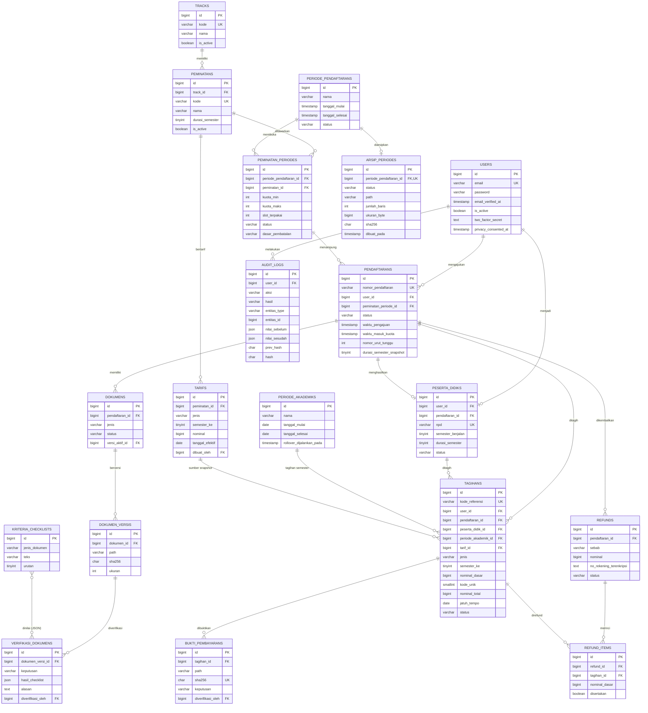

# Entity Relationship Diagram (ERD) & Kamus Data — Polibatam Verify
 
Disusun berdasarkan *FR & BR* (FR-01 s.d. FR-66, BR-01 s.d. BR-69), *NFR*, *Dokumen Arsitektur*, *Dokumen Keamanan Basis Data*, dan *Keputusan Klarifikasi Scope* (K-01 s.d. K-38).
 
**Konvensi:**
- Nama tabel dan kolom memakai `snake_case` Bahasa Indonesia, tabel berbentuk jamak sesuai konvensi Laravel (mis. `peminatans`).
- Semua tabel memiliki `id BIGINT UNSIGNED` (PK, *auto increment*) dan `created_at`/`updated_at`, kecuali disebut lain.
- Uang: `BIGINT UNSIGNED` dalam Rupiah (NFR-29). Waktu: `TIMESTAMP` UTC (NFR-30). Pengecualian: `updated_at` pada `tagihans`, `dokumens`, dan `bukti_pembayarans` memakai `TIMESTAMP(6)` (mikrodetik) karena dipakai sebagai `versi` *optimistic locking* (K-36).
- Kolom status memakai `VARCHAR(30)` yang nilainya dijaga *state machine* (NFR-28), bukan `ENUM` MySQL, agar status baru tidak membutuhkan perubahan skema.
- `[ASUMSI]` menandai detail yang belum pernah dikonfirmasi.
---
 
## 1. Diagram ERD
 

 
Tabel pendukung yang tidak digambar agar diagram tetap terbaca: `pengaturans`, `konten_cms`, serta tabel bawaan *package* (§4).
 
---
 
## 2. Ringkasan Relasi
 
| Relasi | Kardinalitas | Keterangan | Ref |
|---|---|---|---|
| `tracks` → `peminatans` | 1 : N | Satu track punya banyak peminatan | FR-45, FR-46 |
| `peminatans` → `tarifs` | 1 : N | Tarif formulir dan tarif semester 1..D, berversi | BR-25, BR-26 |
| `periode_pendaftarans` ↔ `peminatans` | N : M via `peminatan_periodes` | Peminatan yang dibuka pada satu periode beserta kuota dan status pembatalannya | BR-15, BR-24 |
| `periode_pendaftarans` → `arsip_periodes` | 1 : 0..1 | Satu arsip beku per periode, dibuat saat periode ditutup | BR-69 |
| `peminatan_periodes` → `pendaftarans` | 1 : N | Pendaftar per peminatan per periode | BR-16 |
| `users` → `pendaftarans` | 1 : N | Satu akun bisa mendaftar lagi di periode berbeda | BR-08 |
| `pendaftarans` → `dokumens` | 1 : N | Satu baris per jenis dokumen (slot) | BR-11 |
| `dokumens` → `dokumen_versis` | 1 : N | Riwayat setiap unggahan | FR-17 |
| `dokumen_versis` → `verifikasi_dokumens` | 1 : N | Riwayat keputusan Valid/Ditolak | FR-20, BR-13 |
| `pendaftarans` → `peserta_didiks` | 1 : 0..1 | Peserta Didik terbentuk saat NPD terbit | BR-41 |
| `pendaftarans` → `tagihans` | 1 : N | Tagihan formulir dan semester terkait pendaftaran; Draf belum memiliki tagihan | BR-32, BR-65 |
| `peserta_didiks` → `tagihans` | 1 : N | Maksimal satu tagihan per semester | BR-33 |
| `tagihans` → `bukti_pembayarans` | 1 : N | Riwayat unggahan bukti, termasuk yang ditolak | FR-29, FR-32 |
| `pendaftarans` → `refunds` | 1 : N | Jumlah refund mengikuti banyaknya biaya yang tidak terpakai atau perlu dikembalikan sesuai persyaratan (K-31) | BR-47 |
| `refunds` → `refund_items` → `tagihans` | 1 : N : 1 | Rincian tagihan yang dikembalikan atau dikecualikan | BR-48, BR-49 |
| `users` → `audit_logs` | 1 : N | Pelaku aktivitas krusial | BR-58 |
 
---
 
## 3. Kamus Data
 
### 3.1 `users`
| Kolom | Tipe | Null | Keterangan |
|---|---|---|---|
| `name` | VARCHAR(150) | Tidak | Nama pengguna |
| `email` | VARCHAR(191) | Tidak | **UNIQUE** (BR-01) |
| `password` | VARCHAR(255) | Tidak | *Hash* Argon2id/bcrypt (NFR-02) |
| `email_verified_at` | TIMESTAMP | Ya | Verifikasi email (BR-02) |
| `is_active` | BOOLEAN | Tidak | Default `true`; `false` = akun dinonaktifkan (FR-06) |
| `two_factor_secret` | TEXT | Ya | Rahasia TOTP terenkripsi (Fortify, NFR-09). Wajib terisi untuk akun admin (K-33); kosong untuk peserta. |
| `two_factor_recovery_codes` | TEXT | Ya | Kode cadangan terenkripsi |
| `two_factor_confirmed_at` | TIMESTAMP | Ya | — |
| `privacy_consented_at` | TIMESTAMP | Ya | Persetujuan kebijakan privasi (NFR-11) |
| `remember_token` | VARCHAR(100) | Ya | Bawaan Laravel |
 
*Role* disimpan di tabel `spatie/laravel-permission`. Penguncian login (BR-03) memakai `RateLimiter`/*cache*, bukan kolom.
 
### 3.2 `tracks`
| Kolom | Tipe | Null | Keterangan |
|---|---|---|---|
| `kode` | VARCHAR(20) | Tidak | **UNIQUE** (BR-52) |
| `nama` | VARCHAR(100) | Tidak | — |
| `is_active` | BOOLEAN | Tidak | Nonaktif, bukan dihapus (BR-53) |
 
### 3.3 `peminatans`
| Kolom | Tipe | Null | Keterangan |
|---|---|---|---|
| `track_id` | BIGINT FK → `tracks` | Tidak | `ON DELETE RESTRICT` |
| `kode` | VARCHAR(20) | Tidak | **UNIQUE**; dipakai di format NPD (BR-41) |
| `nama` | VARCHAR(150) | Tidak | — |
| `durasi_semester` | TINYINT UNSIGNED | Tidak | ≥ 1 (BR-52) |
| `is_active` | BOOLEAN | Tidak | — |
 
### 3.4 `tarifs`
| Kolom | Tipe | Null | Keterangan |
|---|---|---|---|
| `peminatan_id` | BIGINT FK → `peminatans` | Tidak | — |
| `jenis` | VARCHAR(20) | Tidak | `formulir` / `semester` (BR-25) |
| `semester_ke` | TINYINT UNSIGNED | Ya | `NULL` untuk jenis `formulir`; 1..D untuk `semester` |
| `nominal` | BIGINT UNSIGNED | Tidak | > 0 |
| `tanggal_efektif` | DATE | Tidak | BR-26, BR-27 |
| `dibuat_oleh` | BIGINT FK → `users` | Tidak | Riwayat pengubah |
 
**Indeks:** UNIQUE (`peminatan_id`, `jenis`, `semester_ke`, `tanggal_efektif`). Baris tarif tidak pernah di-*update*; perubahan = baris baru (BR-26).
 
### 3.5 `periode_pendaftarans`
| Kolom | Tipe | Null | Keterangan |
|---|---|---|---|
| `nama` | VARCHAR(100) | Tidak | Mis. "Periode Ganjil 2027" |
| `tanggal_mulai` | TIMESTAMP | Tidak | — |
| `tanggal_selesai` | TIMESTAMP | Tidak | > `tanggal_mulai`, tidak tumpang-tindih (BR-54) |
| `status` | VARCHAR(30) | Tidak | `dijadwalkan` / `dibuka` / `ditutup` |
| `ditutup_pada` | TIMESTAMP | Ya | Diisi proses `periode:tutup` (FR-25) |
 
### 3.6 `peminatan_periodes`
Peminatan yang dibuka pada satu periode pendaftaran, sekaligus tempat kuota dan pembatalan.
 
| Kolom | Tipe | Null | Keterangan |
|---|---|---|---|
| `periode_pendaftaran_id` | BIGINT FK | Tidak | — |
| `peminatan_id` | BIGINT FK | Tidak | — |
| `kuota_min` | INT UNSIGNED | Tidak | BR-15 |
| `kuota_maks` | INT UNSIGNED | Tidak | ≥ `kuota_min`; boleh dinaikkan selama periode (BR-20) |
| `slot_terpakai` | INT UNSIGNED | Tidak | Penghitung Masuk Kuota + NPD Terbit (BR-16); dikunci dengan `lockForUpdate()` saat penempatan kuota (NFR-27) |
| `status` | VARCHAR(30) | Tidak | `berjalan` / `dibatalkan` |
| `dasar_pembatalan` | VARCHAR(30) | Ya | `kuota_minimum` / `kesepakatan` (BR-24) |
| `alasan_pembatalan` | TEXT | Ya | Wajib jika `kesepakatan` |
| `dibatalkan_oleh` | BIGINT FK → `users` | Ya | Super Admin |
| `dibatalkan_pada` | TIMESTAMP | Ya | — |
 
**Indeks:** UNIQUE (`periode_pendaftaran_id`, `peminatan_id`).
 
### 3.7 `pendaftarans`
| Kolom | Tipe | Null | Keterangan |
|---|---|---|---|
| `nomor_pendaftaran` | VARCHAR(20) | Tidak | **UNIQUE**, format `PV-{TAHUN}-{NO_URUT_6_DIGIT}` (contoh `PV-2026-000418`). Dibangkitkan saat Draf pertama kali disimpan, tidak berubah. Nomor urut per tahun diambil dari penghitung di `pengaturans` (kunci `urut_nomor_pendaftaran_{tahun}`) yang dikunci `FOR UPDATE` dalam transaksi pembuatan (BR-68, K-37). |
| `user_id` | BIGINT FK → `users` | Tidak | — |
| `peminatan_periode_id` | BIGINT FK | Tidak | Terkunci setelah Diajukan (BR-09) |
| `status` | VARCHAR(30) | Tidak | `draf`, `diajukan`, `perlu_revisi`, `masuk_kuota`, `daftar_tunggu`, `npd_terbit`, `tidak_tertampung`, `dibatalkan` |
| `nama_lengkap` | VARCHAR(150) | Ya | Data formulir (K-31) |
| `nik_terenkripsi` | TEXT | Ya | NIK terenkripsi AES-256 (K-31); tampil tersamar (NFR-12) |
| `nik_hash` | CHAR(64) | Ya | HMAC-SHA256 NIK dengan kunci terpisah `NIK_HMAC_KEY` (bukan `APP_KEY`, K-36) untuk pencarian/pengecekan duplikat tanpa mendekripsi. Kunci dipisah agar rotasi `APP_KEY` tidak mengubah nilai `nik_hash`. |
| `tempat_lahir`, `tanggal_lahir` | VARCHAR / DATE | Ya | — |
| `jenis_kelamin` | VARCHAR(10) | Ya | — |
| `no_hp` | VARCHAR(20) | Ya | — |
| `alamat` | TEXT | Ya | — |
| `asal_sekolah` | VARCHAR(150) | Ya | — |
| `tahun_lulus` | YEAR | Ya | *Field* terakhir formulir (K-31) |
| `waktu_pengajuan` | TIMESTAMP | Ya | Dasar FIFO Daftar Tunggu (BR-18); `NULL` selama Draf |
| `waktu_masuk_kuota` | TIMESTAMP | Ya | Dasar batas 7 hari (BR-21) |
| `nomor_urut_tunggu` | INT UNSIGNED | Ya | Ditampilkan di *tracker* (FR-15) |
| `durasi_semester_snapshot` | TINYINT UNSIGNED | Ya | Durasi saat mendaftar (BR-43) |
| `alasan_batal` | VARCHAR(255) | Ya | Mis. "Tidak melunasi formulir dalam 7 hari", "Periode pendaftaran ditutup sebelum formulir diajukan" (BR-65) |
 
**Indeks:** (`peminatan_periode_id`, `status`, `waktu_pengajuan`) untuk antrean, FIFO, dan daftar Data Pendaftaran (FR-63); (`status`, `waktu_masuk_kuota`) untuk proses pembatalan 7 hari; UNIQUE (`nomor_pendaftaran`). Aturan "satu pendaftaran aktif per periode" (BR-08) dijaga di Service layer dalam transaksi.
 
**Visibilitas Draf (BR-64):** seluruh *query* untuk *role* admin (antrean, Data Pendaftaran, laporan, ekspor, arsip periode) wajib menyaring `status <> 'draf'` melalui *query scope* dan *Policy*. Jumlah Draf hanya diambil sebagai agregat `COUNT(*)`.
 
### 3.8 `dokumens`
| Kolom | Tipe | Null | Keterangan |
|---|---|---|---|
| `pendaftaran_id` | BIGINT FK | Tidak | — |
| `jenis` | VARCHAR(40) | Tidak | `ijazah_skl_rapor`, `skhu_nilai`, `ktp`, `bukti_pendaftaran_polibatam` (BR-11) |
| `wajib` | BOOLEAN | Tidak | `false` hanya untuk bukti pendaftaran Polibatam |
| `status` | VARCHAR(30) | Tidak | `menunggu_verifikasi` / `valid` / `ditolak` |
| `versi_aktif_id` | BIGINT FK → `dokumen_versis` | Ya | Versi yang sedang berlaku |
 
**Indeks:** UNIQUE (`pendaftaran_id`, `jenis`).
 
### 3.9 `dokumen_versis`
| Kolom | Tipe | Null | Keterangan |
|---|---|---|---|
| `dokumen_id` | BIGINT FK | Tidak | — |
| `path` | VARCHAR(255) | Tidak | Lokasi di *disk private*, nama acak (NFR-07) |
| `nama_asli` | VARCHAR(255) | Tidak | — |
| `mime` | VARCHAR(50) | Tidak | Hasil deteksi *magic bytes* |
| `ukuran` | INT UNSIGNED | Tidak | Byte, ≤ 2 MB (BR-12) |
| `sha256` | CHAR(64) | Tidak | Integritas file |
| `diunggah_pada` | TIMESTAMP | Tidak | — |
 
### 3.10 `verifikasi_dokumens`
| Kolom | Tipe | Null | Keterangan |
|---|---|---|---|
| `dokumen_versi_id` | BIGINT FK | Tidak | — |
| `keputusan` | VARCHAR(20) | Tidak | `valid` / `ditolak` |
| `hasil_checklist` | JSON | Tidak | `[{kriteria_id, terpenuhi}]` (FR-20) |
| `alasan` | TEXT | Ya | Wajib jika `ditolak` (BR-13) |
| `diverifikasi_oleh` | BIGINT FK → `users` | Tidak | Admin SILAU / Super Admin |
| `kanal` | VARCHAR(10) | Tidak | `web` / `mobile` (K-29) |
 
### 3.11 `kriteria_checklists`
| Kolom | Tipe | Null | Keterangan |
|---|---|---|---|
| `jenis_dokumen` | VARCHAR(40) | Tidak | Sama dengan `dokumens.jenis` |
| `teks` | VARCHAR(255) | Tidak | Mis. "Foto KTP terbaca jelas" |
| `urutan` | TINYINT | Tidak | — |
| `is_active` | BOOLEAN | Tidak | — |
 
### 3.12 `peserta_didiks`
| Kolom | Tipe | Null | Keterangan |
|---|---|---|---|
| `user_id` | BIGINT FK | Tidak | — |
| `pendaftaran_id` | BIGINT FK | Tidak | **UNIQUE** |
| `npd` | VARCHAR(30) | Tidak | **UNIQUE**, tidak dapat diubah (BR-41) |
| `semester_berjalan` | TINYINT UNSIGNED | Tidak | Mulai 1 |
| `durasi_semester` | TINYINT UNSIGNED | Tidak | Salinan `durasi_semester_snapshot` |
| `status` | VARCHAR(30) | Tidak | `belum_aktif`, `aktif`, `tertahan`, `selesai_masa_program`, `dibatalkan` (BR-42, BR-45) |
| `npd_terbit_pada` | TIMESTAMP | Tidak | — |
 
### 3.13 `periode_akademiks`
| Kolom | Tipe | Null | Keterangan |
|---|---|---|---|
| `nama` | VARCHAR(100) | Tidak | Mis. "Semester Genap 2026/2027" |
| `tanggal_mulai` | DATE | Tidak | Jatuh tempo tagihan = tanggal ini − 7 hari (BR-35) |
| `tanggal_selesai` | DATE | Tidak | — |
| `rollover_dijalankan_pada` | TIMESTAMP | Ya | Terisi = *rollover* tidak bisa diulang (BR-44) |
| `rollover_dijalankan_oleh` | BIGINT FK → `users` | Ya | — |
 
### 3.14 `tagihans`
| Kolom | Tipe | Null | Keterangan |
|---|---|---|---|
| `kode_referensi` | VARCHAR(30) | Tidak | **UNIQUE** (BR-31) |
| `user_id` | BIGINT FK | Tidak | Pemilik tagihan |
| `pendaftaran_id` | BIGINT FK | Tidak | — |
| `peserta_didik_id` | BIGINT FK | Ya | `NULL` untuk tagihan formulir |
| `periode_akademik_id` | BIGINT FK | Ya | Diisi untuk tagihan semester |
| `tarif_id` | BIGINT FK → `tarifs` | Tidak | Versi tarif yang dipakai |
| `jenis` | VARCHAR(20) | Tidak | `formulir` / `semester` |
| `semester_ke` | TINYINT UNSIGNED | Ya | — |
| `nominal_dasar` | BIGINT UNSIGNED | Tidak | *Snapshot* tarif (BR-28) |
| `kode_unik` | SMALLINT UNSIGNED | Tidak | 1–999, acak (BR-29) |
| `nominal_total` | BIGINT UNSIGNED | Tidak | `nominal_dasar + kode_unik` |
| `jatuh_tempo` | DATE | Ya | `NULL` = menunggu penetapan manual Super Admin (BR-35) |
| `jatuh_tempo_manual` | BOOLEAN | Tidak | — |
| `status` | VARCHAR(30) | Tidak | `belum_bayar`, `menunggu_verifikasi`, `ditolak`, `lunas`, `dibatalkan` |
| `lunas_pada` | TIMESTAMP | Ya | — |
| `kunci_kode_unik` | VARCHAR(40) | Ya | *Generated column*: `CONCAT(nominal_dasar,'-',kode_unik)` jika status terbuka, selain itu `NULL` |
 
**Indeks:**
- UNIQUE (`kunci_kode_unik`): menjamin kode unik tidak kembar di antara tagihan terbuka dengan nominal dasar yang sama (BR-29).
- UNIQUE (`peserta_didik_id`, `semester_ke`): satu tagihan per semester (BR-33).
- (`status`, `jenis`) untuk antrean Admin Keuangan; (`jatuh_tempo`, `status`) untuk pengingat (BR-57).
Kolom `updated_at` bertipe `TIMESTAMP(6)` dan dipakai sebagai nilai `versi` untuk *optimistic locking* verifikasi dari web dan mobile (§5 dokumen arsitektur). Kondisi `UPDATE` juga memeriksa status (`AND status = 'menunggu_verifikasi'`), sehingga dua keputusan dalam waktu yang sangat berdekatan tetap terdeteksi sebagai konflik (K-36). Ketentuan yang sama berlaku untuk `dokumens` dan `bukti_pembayarans`.
 
### 3.15 `bukti_pembayarans`
| Kolom | Tipe | Null | Keterangan |
|---|---|---|---|
| `tagihan_id` | BIGINT FK | Tidak | — |
| `path` | VARCHAR(255) | Tidak | *Disk private* |
| `mime`, `ukuran` | VARCHAR / INT | Tidak | — |
| `sha256` | CHAR(64) | Tidak | **UNIQUE** — menolak bukti identik (BR-37) |
| `diunggah_pada` | TIMESTAMP | Tidak | — |
| `keputusan` | VARCHAR(20) | Tidak | `menunggu` / `diterima` / `ditolak` |
| `alasan` | TEXT | Ya | Wajib jika `ditolak` (BR-38) |
| `diverifikasi_oleh` | BIGINT FK → `users` | Ya | Admin Keuangan / Super Admin |
| `diverifikasi_pada` | TIMESTAMP | Ya | — |
| `kanal` | VARCHAR(10) | Ya | `web` / `mobile` |
 
### 3.16 `refunds`
| Kolom | Tipe | Null | Keterangan |
|---|---|---|---|
| `pendaftaran_id` | BIGINT FK | Tidak | Satu pendaftaran dapat memiliki lebih dari satu refund (K-31) |
| `user_id` | BIGINT FK | Tidak | Penerima |
| `sebab` | VARCHAR(40) | Tidak | `peminatan_dibatalkan` / `tidak_tertampung` (BR-47); daftar sebab dapat bertambah sesuai persyaratan |
| `nominal` | BIGINT UNSIGNED | Tidak | Jumlah `refund_items` yang disertakan (BR-48) |
| `nama_bank` | VARCHAR(100) | Ya | — |
| `no_rekening_terenkripsi` | TEXT | Ya | AES-256 (BR-50, NFR-06) |
| `nama_pemilik_rekening` | VARCHAR(150) | Ya | — |
| `status` | VARCHAR(30) | Tidak | `menunggu_data_rekening` / `diproses` / `selesai` / `ditolak` (BR-51, K-34) |
| `alasan_ditolak` | TEXT | Ya | Wajib jika `ditolak`: seluruh rincian dikecualikan (K-34) |
| `bukti_transfer_path` | VARCHAR(255) | Ya | Wajib saat `selesai` |
| `diproses_oleh` | BIGINT FK → `users` | Ya | Admin Keuangan |
| `selesai_pada` | TIMESTAMP | Ya | — |
 
### 3.17 `refund_items`
| Kolom | Tipe | Null | Keterangan |
|---|---|---|---|
| `refund_id` | BIGINT FK | Tidak | — |
| `tagihan_id` | BIGINT FK | Tidak | — |
| `nominal_dasar` | BIGINT UNSIGNED | Tidak | Tanpa kode unik (BR-48) |
| `disertakan` | BOOLEAN | Tidak | `false` jika pembayaran tidak ditemukan di mutasi (BR-49) |
| `alasan_dikecualikan` | VARCHAR(255) | Ya | — |
| `dicocokkan_oleh` | BIGINT FK → `users` | Ya | Admin Keuangan |
 
**Indeks:** UNIQUE (`tagihan_id`): satu tagihan hanya boleh masuk ke satu rincian refund, sehingga biaya yang sama tidak dikembalikan dua kali walaupun pendaftaran memiliki beberapa refund.
 
### 3.18 `audit_logs`
| Kolom | Tipe | Null | Keterangan |
|---|---|---|---|
| `user_id` | BIGINT FK | Ya | `NULL` untuk aksi sistem (scheduler) |
| `role` | VARCHAR(30) | Ya | *Role* saat aksi dilakukan |
| `aksi` | VARCHAR(60) | Tidak | Mis. `verifikasi_dokumen`, `ubah_tarif`, `rollover`, `login_gagal`, `totp_gagal`, `akses_ditolak`, `konflik_verifikasi`, `ekspor_data_pendaftaran` (BR-67), `batal_draf_periode_ditutup` (BR-65), `buat_arsip_periode`, `unduh_arsip_periode`, `arsip_checksum_tidak_cocok` (BR-69) |
| `hasil` | VARCHAR(10) | Tidak | `berhasil` / `gagal` / `ditolak`; default `berhasil` (K-36) |
| `entitas_type`, `entitas_id` | VARCHAR / BIGINT | Tidak | Data yang diubah. Untuk ekspor: `entitas_type = 'ekspor'`, `nilai_sesudah` berisi filter, jumlah baris, dan format. Untuk arsip: `entitas_type = 'arsip_periode'`. |
| `nilai_sebelum`, `nilai_sesudah` | JSON | Ya | — |
| `alasan` | TEXT | Ya | — |
| `ip_address`, `user_agent`, `kanal` | VARCHAR | Ya | `web` / `mobile` / `sistem` |
| `prev_hash`, `hash` | CHAR(64) | Tidak | *Hash chain* (NFR-31) |
| `created_at` | TIMESTAMP | Tidak | Tidak ada `updated_at` |
 
**Indeks:** (`aksi`, `hasil`, `created_at`) untuk penelusuran aksi gagal/ditolak.
 
- Akun DB aplikasi (`pv_app`) hanya diberi hak `INSERT` dan `SELECT` pada tabel ini.
- *Trigger* `trg_audit_logs_tolak_update` dan `trg_audit_logs_tolak_delete` menolak `UPDATE`/`DELETE` oleh akun mana pun.
- Entri `berhasil` ditulis di dalam transaksi pemanggil. Entri `gagal`/`ditolak` ditulis setelah *rollback* dalam transaksi terpisah.
- Penulisan *hash chain* diserialkan dengan `GET_LOCK('audit_chain')` (Dokumen Keamanan Basis Data §12).
### 3.19 `pengaturans`
| Kolom | Tipe | Null | Keterangan |
|---|---|---|---|
| `kunci` | VARCHAR(80) | Tidak | **UNIQUE**, mis. `batas_pelunasan_formulir_hari`, `format_npd`, `urut_nomor_pendaftaran_2026`, `masa_berlaku_ekspor_jam` |
| `nilai` | JSON | Tidak | — |
| `keterangan` | VARCHAR(255) | Ya | — |
| `diubah_oleh` | BIGINT FK → `users` | Ya | Super Admin; `NULL` untuk penghitung yang diubah sistem |
 
Menyimpan parameter yang dapat diubah tanpa mengubah kode (NFR-40), termasuk penghitung nomor urut pendaftaran per tahun (BR-68) dan masa berlaku file ekspor (default 24 jam, BR-67).
 
### 3.20 `konten_cms`
| Kolom | Tipe | Null | Keterangan |
|---|---|---|---|
| `bagian` | VARCHAR(40) | Tidak | `jadwal` / `pengumuman` / `alur` / `kontak` |
| `judul` | VARCHAR(200) | Tidak | — |
| `isi` | LONGTEXT | Tidak | — |
| `status` | VARCHAR(20) | Tidak | `draf` / `terbit` (FR-10) |
| `diterbitkan_pada` | TIMESTAMP | Ya | — |
| `diubah_oleh` | BIGINT FK → `users` | Tidak | Super Admin |
 
### 3.21 `arsip_periodes`
Salinan beku data pendaftaran per periode, dibuat otomatis saat periode ditutup dan disimpan permanen (BR-69, K-38).
 
| Kolom | Tipe | Null | Keterangan |
|---|---|---|---|
| `periode_pendaftaran_id` | BIGINT FK → `periode_pendaftarans` | Tidak | **UNIQUE**: satu arsip per periode (idempoten, FR-65). `ON DELETE RESTRICT`. |
| `status` | VARCHAR(20) | Tidak | `diproses` / `tersedia` / `gagal` |
| `path` | VARCHAR(255) | Ya | Lokasi di *disk* `arsip` (privat, *write-once*, NFR-49); terisi saat `tersedia` |
| `nama_file` | VARCHAR(150) | Ya | Mis. `arsip-pendaftaran-periode-ganjil-2027.xlsx` |
| `format` | VARCHAR(10) | Tidak | `xlsx` (A-61) |
| `jumlah_baris` | INT UNSIGNED | Ya | Jumlah pendaftaran yang diarsipkan (tanpa Draf) |
| `ringkasan` | JSON | Ya | Jumlah per peminatan dan per status, termasuk jumlah Draf yang dibatalkan |
| `ukuran_byte` | BIGINT UNSIGNED | Ya | — |
| `sha256` | CHAR(64) | Ya | *Checksum* yang diverifikasi setiap unduhan (FR-66) |
| `percobaan` | TINYINT UNSIGNED | Tidak | Jumlah percobaan pembuatan; default 0 |
| `galat_terakhir` | VARCHAR(255) | Ya | Ringkasan penyebab gagal (tanpa data pribadi) |
| `dibuat_pada` | TIMESTAMP | Ya | Waktu arsip berstatus `tersedia` |
| `diperiksa_pada` | TIMESTAMP | Ya | Pemeriksaan integritas berkala terakhir (NFR-49) |
 
- Akun `pv_app` tidak memiliki `DELETE` pada tabel ini. Kolom `path`, `sha256`, `ukuran_byte`, `jumlah_baris`, dan `dibuat_pada` tidak dapat diubah setelah status `tersedia`; aturan ini dijaga *trigger* `trg_arsip_periodes_kunci` yang menolak `UPDATE` kolom tersebut bila status lama `tersedia`.
- Isi file memakai VIEW `v_data_pendaftaran` (tanpa Draf); NIK tersamar dibentuk di aplikasi. File tidak memuat nomor rekening, alamat, maupun *path* dokumen.
### 3.22 `rekening_institusis`
Ditambahkan di P01 (keputusan pemilik proyek 25-11-2026, temuan T-16). Sumber: `database/paket-db/sql/01b_rekening_institusi.sql`.

| Kolom | Tipe | Null | Keterangan |
|---|---|---|---|
| `jenis_tagihan` | VARCHAR(20) | Tidak | `formulir` / `semester` |
| `nama_bank` | VARCHAR(100) | Tidak | — |
| `nomor_rekening` | VARCHAR(30) | Tidak | Hanya angka, 5–30 digit; tidak dienkripsi (A-62) |
| `atas_nama` | VARCHAR(150) | Tidak | — |
| `status` | VARCHAR(20) | Tidak | `nonaktif` (bawaan) / `aktif` (SRS §4.7) |
| `kunci_aktif` | VARCHAR(20) GENERATED | Ya | = `jenis_tagihan` bila `aktif`, selain itu `NULL`; **UNIQUE** → satu rekening Aktif per jenis (BR-70) |
| `dibuat_oleh` | BIGINT FK → `users` | Tidak | Admin Keuangan / Super Admin |
| `diubah_oleh` | BIGINT FK → `users` | Ya | — |

- Satu baris = satu rekening untuk satu jenis tagihan; rekening yang sama boleh aktif untuk kedua jenis (dua baris, A-62).
- `pv_app`: SELECT, INSERT, UPDATE (tanpa DELETE, BR-70).
- Kaitan ke `tagihans` (`rekening_institusi_id` + *snapshot* bank/nomor/atas nama, BR-71) **belum ada**: ditambahkan di P05.

---
 
## 4. Tabel Bawaan Framework & Package
 
| Tabel | Sumber | Fungsi |
|---|---|---|
| `roles`, `permissions`, `model_has_roles`, `model_has_permissions`, `role_has_permissions` | spatie/laravel-permission | 5 *role* dan izinnya |
| `personal_access_tokens` | Laravel Sanctum | Token aplikasi mobile admin (12 jam, K-30) |
| `notifications` | Laravel | Notifikasi *in-app* (FR-53), termasuk tautan unduhan ekspor besar (FR-64) dan pemberitahuan arsip gagal (FR-65) |
| `password_reset_tokens` | Laravel | Reset password (FR-05) |
| `sessions` | Laravel | Session web |
| `jobs`, `job_batches`, `failed_jobs` | Laravel Queue | Antrean (lokal); produksi memakai Redis |
| `cache`, `cache_locks` | Laravel | *Cache* dan *lock* (lokal) |
 
---
 
## 5. Catatan Desain
 
1. **`peminatan_periodes` sebagai pusat kuota.** Kuota, slot terpakai, dan status pembatalan melekat pada pasangan peminatan–periode, bukan pada peminatan, karena peminatan yang sama bisa dibuka di banyak periode dengan kuota berbeda.
2. **Penghitung `slot_terpakai`.** Kolom ini dikunci baris (`SELECT ... FOR UPDATE`) saat penempatan kuota, promosi Daftar Tunggu, dan pelepasan slot. Hitungan dari `COUNT(*)` dipakai hanya untuk rekonsiliasi berkala.
3. **Riwayat, bukan timpa.** Dokumen, verifikasi, tarif, dan bukti pembayaran disimpan sebagai riwayat baris baru, sehingga keputusan lama tetap dapat ditelusuri (FR-17, BR-26).
4. **Status sebagai VARCHAR.** Nilai status dijaga oleh `spatie/laravel-model-states`, sehingga transisi ilegal ditolak di aplikasi (NFR-28). Transisi baru `draf → dibatalkan` (BR-65) cukup didaftarkan di *state machine* tanpa perubahan skema.
5. **Data sensitif.** Nomor rekening dan NIK disimpan terenkripsi dengan `APP_KEY`. NIK disertai `nik_hash` (HMAC dengan `NIK_HMAC_KEY`) agar tetap bisa dicari tanpa mendekripsi seluruh data.
6. **Refund bisa lebih dari satu.** Satu pendaftaran dapat menghasilkan beberapa refund, misalnya refund formulir saat Tidak Tertampung lalu refund lain sesuai persyaratan. Pengaman terhadap pengembalian ganda ada di indeks unik `refund_items.tagihan_id`.
7. **VIEW untuk laporan.** `v_antrean_verifikasi_berkas`, `v_rekap_pembayaran`, `v_status_refund`, dan `v_data_pendaftaran` dibuat melalui *migration* dan hanya dibaca akun `pv_report`. VIEW ini tidak memuat NIK, nomor rekening, alamat, maupun *path* file (Dokumen Keamanan Basis Data §7). `v_data_pendaftaran` sudah menyaring `status <> 'draf'` (BR-64) dan dipakai untuk ekspor FR-64 dan arsip periode FR-65; NIK tersamar dibentuk di aplikasi.
8. **Hak akses per tabel.** Akun `pv_app` tidak memiliki `DELETE` pada tabel domain dan tidak memiliki `UPDATE` pada tabel riwayat (`tarifs`, `dokumen_versis`, `verifikasi_dokumens`, `audit_logs`). Rincian GRANT ada di Dokumen Keamanan Basis Data §5.
9. **Draf tidak terlihat admin.** Penyaringan Draf diterapkan berlapis: *Policy* Laravel (detail), *query scope* `untukAdmin()` (daftar), dan VIEW `v_data_pendaftaran` (ekspor/laporan/arsip) (BR-64, K-37).
10. **File ekspor sementara vs arsip permanen.** File ekspor (FR-64) tidak dicatat di tabel; jejaknya hanya entri `audit_logs` dan file di *disk* `ekspor` yang dihapus setelah 24 jam. Arsip periode dicatat di `arsip_periodes` dan disimpan di *disk* `arsip` yang terpisah, permanen, dan ikut *backup* (NFR-24, NFR-49, K-38).
---
 
## 6. Status Asumsi
 
| # | Asumsi | Bagian | Status |
|---|---|---|---|
| A-41 | *Field* formulir: nama lengkap, NIK, tempat & tanggal lahir, jenis kelamin, no. HP, alamat, asal sekolah, tahun lulus. | §3.7 | Disetujui (K-31) |
| A-42 | NIK disimpan terenkripsi, dengan `nik_hash` untuk pencarian. | §3.7 | Disetujui (K-31) |
| A-43 | Satu pendaftaran dapat memiliki beberapa refund sesuai biaya yang tidak terpakai/perlu dikembalikan. | §3.16 | Disetujui, direvisi (K-31) |
| A-52 | Kolom `audit_logs.hasil` untuk mencatat aksi berhasil, gagal, dan ditolak. | §3.18 | Disetujui (K-36) |
| A-53 | `nik_hash` memakai kunci terpisah `NIK_HMAC_KEY`. | §3.7 | Disetujui (K-36) |
| A-55 | `updated_at` tabel yang diverifikasi memakai `TIMESTAMP(6)`. | §3.8, §3.14, §3.15 | Disetujui (K-36) |
| A-57 | Kolom `pendaftarans.nomor_pendaftaran` berformat `PV-{TAHUN}-{6 digit}`, dibangkitkan saat Draf pertama kali disimpan. | §3.7, §3.19 · BR-68 | Disetujui (K-37) |
| A-59 | File ekspor berlaku 24 jam; masa berlaku disimpan di `pengaturans`. | §3.19, §5.10 · BR-67 | Disetujui (K-38) |
| A-60 | Tabel `arsip_periodes`, satu arsip permanen per periode. | §3.21 · BR-69 | Disetujui (K-38) |
| A-61 | `[ASUMSI]` Format arsip `.xlsx` saja, berisi status per waktu penutupan. | §3.21 | Menunggu konfirmasi |