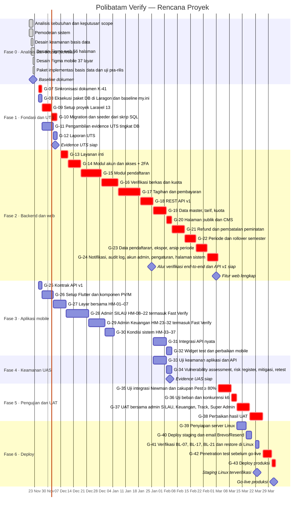

# Gantt Chart Proyek — Polibatam Verify
 
Disusun berdasarkan seluruh dokumen Project: *Pain Points*, *User Personas*, *User Stories* (US-01 s.d. US-32), *FR & BR* (FR-01 s.d. FR-69, BR-01 s.d. BR-74), *NFR* (NFR-01 s.d. NFR-50), *Use Case*, *Activity/Class/Sequence Diagram*, *ERD*, *Dokumen Arsitektur*, *Dokumen Keamanan Basis Data*, *Paket Implementasi Basis Data*, *Daftar Halaman Web* (HW-01 s.d. HW-56), *Daftar Layar Mobile* (HM-01 s.d. HM-37), *Review Desain Figma*, dan *Keputusan Klarifikasi Scope* (K-01 s.d. K-41).
 
**Konvensi:**
- ID tugas `G-xx`, *milestone* `MS-xx`, asumsi melanjutkan nomor terakhir (A-65 dst.).
- Durasi dalam **hari kerja** (Senin–Jumat). Libur yang sudah dikeluarkan: 25 Desember 2026 dan 1 Januari 2027.
- Fase 0 memakai tanggal pembuatan dokumen di Project (20–22 November 2026). Fase 1–6 adalah **rencana**, dimulai 25 November 2026.
- Pelaksana: **Web/Backend** (Laravel + Blade), **Mobile** (Flutter), **Penguji** (pengembang yang menguji keamanan secara lokal, K-36), **QA**, **Deploy**.
- Pada diagram, tugas merah (`crit`) berada di **jalur kritis**: keterlambatan tugas ini langsung menggeser *go-live*.
- `[ASUMSI]` menandai detail yang belum dikonfirmasi.
---
 
## 1. Milestone
 
| ID | Milestone | Tanggal | Penanda selesai |
|---|---|---|---|
| MS-01 | Baseline dokumen dan desain selesai | 22 Nov 2026 | Dokumen G-01–G-06 tersimpan di Project |
| MS-02 | Evidence UTS siap | 4 Des 2026 | TST-01–42 lulus, laporan §18–§19 terisi |
| MS-03 | Alur verifikasi end-to-end dan API v1 siap | 25 Jan 2027 | Pendaftaran → verifikasi berkas → pembayaran → NPD berjalan di web dan API |
| MS-04 | Evidence UAS siap | 4 Feb 2027 | TST-43–67 lulus, risk register dan retest terisi |
| MS-05 | Fitur web lengkap | 1 Mar 2027 | Seluruh HW-01–56 dan FR-01–69 terimplementasi |
| MS-06 | Staging Linux terverifikasi | 23 Mar 2027 | Aplikasi berjalan di Linux, BL-07/17/21 Comply |
| MS-07 | Go-live produksi | 1 Apr 2027 | Produksi aktif, email produksi siap (NFR-45) |
 
Tanggal MS-02 dan MS-04 adalah tanggal **kesiapan evidence** hasil perhitungan durasi, bukan tanggal assessment resmi kelas (A-66).
 
---
 
## 2. Gantt Chart
 

 
---
 
## 3. Rincian Tugas
 
| ID | Tugas | Pelaksana | Mulai | Selesai | Hari kerja | Bergantung pada | Acuan | Status |
|---|---|---|---|---|---|---|---|---|
| G-01 | Analisis kebutuhan dan keputusan scope | — | 20 Nov 2026 | 21 Nov 2026 | — | — | PP, UP, US-01–32, FR/BR, NFR, K-01–K-36 | Selesai |
| G-02 | Pemodelan sistem | — | 20 Nov 2026 | 21 Nov 2026 | — | — | Use case, activity, class, sequence, ERD, arsitektur | Selesai |
| G-03 | Desain keamanan basis data | — | 21 Nov 2026 | 21 Nov 2026 | — | — | keamanan-basis-data.md, K-36 | Selesai |
| G-04 | Desain Figma web 56 halaman | — | 21 Nov 2026 | 22 Nov 2026 | — | — | review-desain-figma.md, daftar-halaman-web.md, K-39, K-40 | Selesai |
| G-05 | Desain Figma mobile 37 layar | — | 22 Nov 2026 | 22 Nov 2026 | — | — | daftar-halaman-mobile.md, K-41 | Selesai |
| G-06 | Paket implementasi basis data dan uji pra-rilis | — | 22 Nov 2026 | 22 Nov 2026 | — | — | implementasi-basis-data.md | Selesai |
| G-07 | Sinkronisasi dokumen K-41 | Web/Backend | 25 Nov 2026 | 26 Nov 2026 | 2 | — | US-30, UC, AD, SD, arsitektur §11 (K-41) | Rencana |
| G-08 | Eksekusi paket DB di Laragon dan baseline my.ini | Penguji | 25 Nov 2026 | 26 Nov 2026 | 2 | G-06 | implementasi §1, keamanan §6 | Rencana |
| G-09 | Setup proyek Laravel 13 (3 koneksi DB, Fortify, Sanctum, spatie, Pint, Larastan, gitleaks) | Web/Backend | 27 Nov 2026 | 1 Des 2026 | 3 | G-07 | arsitektur §3, §8.1 | Rencana |
| G-10 | Migration dan seeder dari skrip SQL | Web/Backend | 2 Des 2026 | 4 Des 2026 | 3 | G-09 | implementasi §4 butir 5, ERD | Rencana |
| G-11 | Pengambilan evidence UTS tingkat DB (TST-01–42, backup/restore) | Penguji | 27 Nov 2026 | 2 Des 2026 | 4 | G-08 | keamanan §3–§13, uji/01–07 | Rencana |
| G-12 | Laporan UTS (CIA mapping, final posture) | Penguji | 3 Des 2026 | 4 Des 2026 | 2 | G-11 | keamanan §18–§19 | Rencana |
| G-13 | Layanan inti (AuditLogger, NikHasher, CekVersiData, state machine, Notifier) | Web/Backend | 7 Des 2026 | 10 Des 2026 | 4 | G-10 | class diagram §3, NFR-28, NFR-31 | Rencana |
| G-14 | Modul akun dan akses + 2FA (HW-05–12) | Web/Backend | 11 Des 2026 | 17 Des 2026 | 5 | G-13 | FR-01–07, FR-59, US-01–03, US-27 | Rencana |
| G-15 | Modul pendaftaran (HW-13–16) | Web/Backend | 18 Des 2026 | 28 Des 2026 | 6 | G-14 | FR-11–17, US-04–07 | Rencana |
| G-16 | Verifikasi berkas dan kuota (HW-25–26) | Web/Backend | 29 Des 2026 | 6 Jan 2027 | 6 | G-15 | FR-18–25, FR-61, US-08–11 | Rencana |
| G-17 | Tagihan dan pembayaran (HW-17–20, HW-28–29, HW-56) | Web/Backend | 7 Jan 2027 | 18 Jan 2027 | 8 | G-16 | FR-26–38, FR-57, FR-67–68, US-12–16 | Rencana |
| G-18 | REST API v1 (auth 2FA, verifikasi, 409, Scribe) | Web/Backend | 19 Jan 2027 | 25 Jan 2027 | 5 | G-17 | arsitektur §6, FR-60–61, FR-69 | Rencana |
| G-19 | Data master, tarif, kuota (HW-33–37) | Web/Backend | 26 Jan 2027 | 1 Feb 2027 | 5 | G-18 | FR-45–49, US-21–24 | Rencana |
| G-20 | Halaman publik dan CMS (HW-01–04, HW-46) | Web/Backend | 2 Feb 2027 | 4 Feb 2027 | 3 | G-19 | FR-08–10 | Rencana |
| G-21 | Refund dan pembatalan peminatan (HW-30–32) | Web/Backend | 5 Feb 2027 | 11 Feb 2027 | 5 | G-20 | FR-39–44, FR-62, US-18–20 | Rencana |
| G-22 | Periode dan rollover semester | Web/Backend | 12 Feb 2027 | 17 Feb 2027 | 4 | G-21 | FR-50–52, FR-58, US-25–26 | Rencana |
| G-23 | Data pendaftaran, ekspor, arsip periode (HW-22–24, HW-27) | Web/Backend | 18 Feb 2027 | 23 Feb 2027 | 4 | G-22 | FR-63–66, US-31–32 | Rencana |
| G-24 | Notifikasi, audit log, akun admin, pengaturan, halaman sistem (HW-44–55) | Web/Backend | 24 Feb 2027 | 1 Mar 2027 | 4 | G-23 | FR-53–56, US-27–29 | Rencana |
| G-25 | Kontrak API v1 (OpenAPI dari arsitektur §6.4) | Mobile | 25 Nov 2026 | 26 Nov 2026 | 2 | — | arsitektur §6 | Rencana |
| G-26 | Setup Flutter dan komponen PV/M | Mobile | 27 Nov 2026 | 2 Des 2026 | 4 | G-25 | daftar-halaman-mobile.md, K-41 | Rencana |
| G-27 | Layar bersama HM-01–07 (login, 2FA, dasbor, notifikasi) | Mobile | 3 Des 2026 | 9 Des 2026 | 5 | G-26 | FR-59–60, FR-53 | Rencana |
| G-28 | Admin SILAU HM-08–22 termasuk Fast Verify | Mobile | 10 Des 2026 | 21 Des 2026 | 8 | G-27 | FR-18–22, FR-69, BR-74 | Rencana |
| G-29 | Admin Keuangan HM-23–32 termasuk Fast Verify | Mobile | 22 Des 2026 | 30 Des 2026 | 6 | G-28 | FR-31–35, FR-69 | Rencana |
| G-30 | Kondisi sistem HM-33–37 | Mobile | 31 Des 2026 | 4 Jan 2027 | 2 | G-29 | FR-61, BR-60 | Rencana |
| G-31 | Integrasi API nyata | Mobile | 26 Jan 2027 | 1 Feb 2027 | 5 | G-18, G-30 | arsitektur §11 | Rencana |
| G-32 | Widget test dan perbaikan mobile | Mobile | 2 Feb 2027 | 4 Feb 2027 | 3 | G-31 | arsitektur §3.4 | Rencana |
| G-33 | Uji keamanan aplikasi dan API (TST-43–67) | Penguji | 26 Jan 2027 | 1 Feb 2027 | 5 | G-18 | keamanan §14–§15, UAS-02–12 | Rencana |
| G-34 | Vulnerability assessment, risk register, mitigasi, retest | Penguji | 2 Feb 2027 | 4 Feb 2027 | 3 | G-33 | keamanan §17, UAS-14–19 | Rencana |
| G-35 | Uji integrasi Newman dan cakupan Pest ≥ 80% | QA | 2 Mar 2027 | 8 Mar 2027 | 5 | G-24 | NFR-41 | Rencana |
| G-36 | Uji beban dan konkurensi k6 | QA | 9 Mar 2027 | 11 Mar 2027 | 3 | G-35 | NFR-14, NFR-20, NFR-27 | Rencana |
| G-37 | UAT bersama admin SILAU, Keuangan, Track, Super Admin | QA | 12 Mar 2027 | 18 Mar 2027 | 5 | G-36, G-32 | US-01–32 | Rencana |
| G-38 | Perbaikan hasil UAT | Web/Backend | 19 Mar 2027 | 25 Mar 2027 | 5 | G-37 | — | Rencana |
| G-39 | Penyiapan server Linux (Nginx, PHP-FPM, MySQL, Redis) | Deploy | 12 Mar 2027 | 16 Mar 2027 | 3 | G-36 | arsitektur §10, A-59 | Rencana |
| G-40 | Deploy staging dan email Brevo/Resend | Deploy | 17 Mar 2027 | 19 Mar 2027 | 3 | G-39 | K-27, NFR-46 | Rencana |
| G-41 | Verifikasi BL-07, BL-17, BL-21 dan restore di Linux | Penguji | 22 Mar 2027 | 23 Mar 2027 | 2 | G-40 | keamanan RSD-06, K-36 | Rencana |
| G-42 | Penetration test sebelum go-live | Penguji | 26 Mar 2027 | 30 Mar 2027 | 3 | G-38 | NFR-05 | Rencana |
| G-43 | Deploy produksi | Deploy | 31 Mar 2027 | 1 Apr 2027 | 2 | G-42 | NFR-45, K-29 | Rencana |
 
---
 
## 4. Catatan Penjadwalan
 
### 4.1 Urutan Modul Backend
 
Modul diurutkan mengikuti alur status pendaftaran (K-01), bukan urutan nomor FR:
 
1. **Layanan inti (G-13)** dibangun pertama karena dipakai semua modul: `AuditLogger` dengan kolom `hasil` dan `GET_LOCK`, `NikHasher`, `CekVersiData`, *state machine*, dan `Notifier` (K-36, class diagram §3).
2. **Akun → Pendaftaran → Verifikasi berkas → Pembayaran (G-14 s.d. G-17)** membentuk alur utama sampai NPD terbit. Data master, periode, dan kuota tersedia dari *seeder* (`04_seed_data_awal.sql`), sehingga halaman pengelolaannya (G-19) dapat dikerjakan belakangan.
3. **REST API v1 (G-18)** dibuat setelah logika verifikasi stabil, karena API memakai Service layer yang sama dengan web (arsitektur §1).
### 4.2 Keterkaitan dengan Checklist Keamanan
 
| Checklist | Kebutuhan sebelum diuji | Tugas |
|---|---|---|
| UTS-01 s.d. UTS-20 (tingkat basis data) | Paket SQL dan baseline `my.ini`; tidak menunggu aplikasi | G-08, G-11, G-12 |
| UAS-02, UAS-03, UAS-09, UAS-10, UAS-11 (autentikasi, otorisasi, token, *ownership*) | Login + 2FA, Sanctum, Policy, API v1 | G-14, G-18 → G-33 |
| UAS-12 (injeksi) | Fitur pencarian/urut antrean | G-16 → G-33 |
| UAS-14 s.d. UAS-20 | Hasil uji G-33 | G-34 |
| RSD-06 (BL-07, BL-17, BL-21) | Server Linux | G-39, G-40 → G-41 |
 
### 4.3 Kelonggaran (*slack*)
 
- **Mobile:** layar G-26 s.d. G-30 selesai 4 Januari 2027 memakai data *mock* dari kontrak API (G-25). Ada jeda ±3 minggu sampai API v1 siap (25 Januari 2027). Jeda ini dapat dipakai untuk menyempurnakan ikon yang masih *placeholder* dan komponen *document viewer* (review desain §4.2).
- **Penguji:** evidence UTS (G-11) tidak bergantung pada Laravel, sehingga dapat berjalan paralel dengan setup proyek (G-09).
- **Deploy:** penyiapan server (G-39) berjalan paralel dengan UAT. Jalur kritis kembali melalui perbaikan UAT (G-38) dan *penetration test* (G-42).
### 4.4 Risiko Jadwal
 
| ID | Risiko | Dampak | Antisipasi |
|---|---|---|---|
| RJ-01 | Libur Natal–Tahun Baru dan cuti bersama di luar 25 Des / 1 Jan | G-15 s.d. G-17 mundur | Tambahkan hari libur aktual ke tabel, geser jalur kritis |
| RJ-02 | Ramadan dan Idulfitri 1448 H (sekitar Februari–Maret 2027) belum diperhitungkan | Fase 5–6 mundur ±1 minggu | Tetapkan tanggal cuti bersama resmi, perbarui G-35 s.d. G-43 |
| RJ-03 | Server Linux dan lokasi *hosting* belum tersedia (K-26, A-59) | G-39 s.d. G-43 tertahan | Siapkan VPS sementara untuk staging |
| RJ-04 | Layanan email produksi belum tersedia (NFR-45) | *Go-live* tertahan | Ajukan SMTP Polibatam sejak Fase 2; staging memakai Brevo/Resend (K-27) |
| RJ-05 | Format NPD resmi belum ada (K-23) | Data NPD produksi perlu migrasi | Format diatur di `pengaturans` (NFR-40), cukup diubah sebelum MS-07 |
| RJ-06 | Asumsi terbuka A-61 (format arsip) dan A-64 (alasan penolakan baku) | G-23 dan G-28 berubah | Konfirmasi sebelum tugas tersebut dimulai |
 
---
 
## 5. Status Asumsi
 
| # | Asumsi | Dipakai di | Status |
|---|---|---|---|
| A-65 | Tim terdiri atas 1 pengembang web/backend dan 1 pengembang mobile yang bekerja paralel; pengujian keamanan dilakukan pengembang sendiri (K-36). | Seluruh fase | Menunggu konfirmasi |
| A-66 | Tanggal assessment UTS dan UAS belum diketahui; MS-02 dan MS-04 adalah tanggal kesiapan evidence hasil perhitungan durasi. | MS-02, MS-04 | Menunggu konfirmasi |
| A-67 | Target *go-live* mengikuti hasil perhitungan (1 April 2027), belum dikaitkan dengan tanggal pembukaan periode pendaftaran pertama. | MS-07 | Menunggu konfirmasi |
| A-68 | Estimasi durasi tiap modul berdasarkan jumlah FR, halaman HW/HM, dan kompleksitas aturan bisnis pada dokumen. | G-07 s.d. G-43 | Standar awal |
 
---
 
## Pertanyaan Klarifikasi
 
1. **A-66:** Kapan tanggal assessment UTS dan UAS mata kuliah basis data? Jika lebih awal dari MS-02 (4 Desember 2026) atau MS-04 (4 Februari 2027), urutan modul perlu disesuaikan.
2. **A-67:** Apakah ada target tanggal pembukaan periode pendaftaran pertama atau tanggal *go-live* dari Polibatam?
3. **A-65:** Berapa orang yang mengerjakan proyek ini? Jika hanya satu orang, Fase 3 (mobile) berjalan setelah Fase 2 dan *go-live* mundur ±7 minggu.