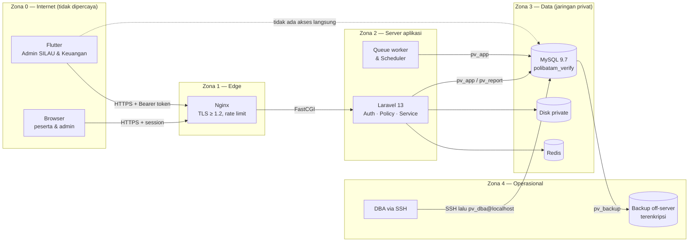

# Dokumen Keamanan Basis Data — Polibatam Verify
 
Disusun berdasarkan *Checklist Luaran Keamanan Proyek Basis Data* (Bagian 1 Assessment Tengah Semester dan Bagian 2 Assessment Akhir Semester), *ERD & Kamus Data*, *Dokumen Arsitektur*, *SKPPL* (FR-01 s.d. FR-62, BR-01 s.d. BR-63, NFR-01 s.d. NFR-48), dan *Keputusan Klarifikasi Scope* (K-01 s.d. K-36).
 
**Konvensi:**
- Butir checklist ditulis **UTS-xx** (Bagian 1) dan **UAS-xx** (Bagian 2).
- ID baru di dokumen ini: **DBC-xx** (kontrol keamanan basis data), **BL-xx** (*security baseline* MySQL), **TRX-xx** (transaksi), **CC-xx** (skenario konkurensi), **TST-xx** (kasus uji), **TMN-xx** (temuan), dan **RSK-xx** (risiko).
- Nama basis data: `polibatam_verify`. Basis data uji *restore*: `polibatam_verify_restore`.
- `[ASUMSI]` menandai detail yang belum dikonfirmasi.
- **Status dokumen:** basis data belum dibangun. Seluruh kontrol di sini berstatus **Dirancang**. Kolom *evidence* menjelaskan bukti yang harus diambil saat implementasi dan pengujian. Hasil uji diisi setelah skrip dijalankan (§17–§19).
- **Lingkungan pengujian (K-36):** seluruh pengujian dan pengambilan *evidence* dilakukan **di lingkungan lokal (Laragon, Windows) oleh pengembang** sebelum *deploy* ke server Linux. Kontrol yang hanya relevan untuk server terpisah (BL-07, BL-17, BL-21) berstatus **N/A di lokal** dan diverifikasi ulang oleh pengembang setelah *deploy* ke Linux. Perintah untuk Linux dan Laragon dicantumkan berdampingan bila berbeda.
---
 
## 0. Peta Checklist ke Dokumen
 
| Checklist | Luaran | Bagian |
|---|---|---|
| UTS-01, UAS-01 | *Security scope*, aset data, *security requirements* | §1 |
| UTS-02, UAS-08 | Arsitektur akses, *trust boundary*, eksposur DB/API | §2 |
| UTS-03, UTS-07, UAS-06 | Pemisahan akun, *host restriction*, keamanan kredensial | §3 |
| UTS-04, UAS-04 | *Access Control Matrix* | §4 |
| UTS-05, UAS-05 | *Least privilege*, `SHOW GRANTS` | §5 |
| UTS-06, UAS-03 | Uji akses *allowed* vs *forbidden* | §5.4, §14.2 |
| UTS-08 | *Security baseline* MySQL | §6 |
| UTS-09, UAS-07 | Pembatasan data dengan VIEW | §7 |
| UTS-10, UTS-11, UAS-07 | Perlindungan password, *hashing* & *salting* | §8 |
| UTS-12, UAS-07 | Enkripsi data sensitif | §9 |
| UTS-13, UTS-14 | Transaksi, COMMIT & ROLLBACK | §10 |
| UTS-15 | Akses bersamaan & *locking* | §11 |
| UTS-16, UAS-13 | *Audit trail* | §12 |
| UTS-17, UTS-18, UAS-18 | *Backup* & verifikasi *restore* | §13 |
| UAS-02, UAS-03, UAS-09, UAS-10, UAS-11 | Autentikasi, otorisasi, REST API, token, *ownership* | §14 |
| UAS-12 | Pencegahan injeksi | §15 |
| — | Katalog kasus uji | §16 |
| UAS-14, UAS-15, UAS-16, UAS-17, UAS-19 | *Vulnerability assessment*, *risk register*, mitigasi, *retest*, risiko sisa | §17 |
| UTS-19 | *CIA Control Mapping* | §18 |
| UTS-20, UAS-20 | *Final Security Posture* | §19 |
 
---
 
## 1. Ruang Lingkup & Identifikasi Aset Data (UTS-01, UAS-01)
 
### 1.1 Ruang Lingkup
 
| Termasuk | Tidak termasuk |
|---|---|
| Basis data MySQL `polibatam_verify` beserta seluruh tabel domain dan tabel *framework* | Isi file dokumen dan bukti bayar di *disk private* (hanya *path* dan `sha256` yang disimpan di DB). Perlindungan file diatur NFR-07. |
| Akun MySQL, *privilege*, konfigurasi server MySQL | Keamanan sistem operasi server secara umum |
| Lapisan Laravel yang mengakses DB: koneksi, transaksi, enkripsi kolom, *audit log* | Keamanan perangkat Android/iOS admin |
| REST API `/api/v1` sebagai *access boundary* aplikasi mobile | Redis dan antrean (hanya disebut sebagai komponen pendukung) |
| *Backup* dan *restore* basis data | — |
 
### 1.2 Skala Klasifikasi
 
**Kelas data**
 
| Kelas | Arti | Contoh |
|---|---|---|
| **Rahasia** | Kebocoran menimbulkan kerugian langsung atau penyalahgunaan identitas/keuangan | NIK, nomor rekening, *hash* password, rahasia 2FA, token |
| **Terbatas** | Data pribadi yang hanya boleh dilihat pemilik dan admin terkait | Nama, tanggal lahir, alamat, no. HP, email, *path* dokumen |
| **Internal** | Data operasional, tidak untuk publik | Kuota, riwayat tarif, *audit log*, pengaturan |
| **Publik** | Boleh ditampilkan di *landing page* | Katalog track/peminatan, tarif berlaku, konten CMS terbit |
 
**Tingkat C/I/A**: **H** (*High*), **M** (*Medium*), **L** (*Low*).
- **C (*Confidentiality*)**: dampak jika data terbaca pihak tidak berhak.
- **I (*Integrity*)**: dampak jika data berubah tanpa izin.
- **A (*Availability*)**: dampak jika data tidak dapat diakses.
### 1.3 Tabel Aset Data
 
| No | Tabel | Isi | Kelas | C | I | A | Kolom sensitif | Diakses oleh (*role* aplikasi) |
|---|---|---|---|---|---|---|---|---|
| 1 | `users` | Akun semua pengguna | Rahasia | H | H | H | `password`, `two_factor_secret`, `two_factor_recovery_codes`, `email` | Semua (akun sendiri); Super Admin (kelola admin) |
| 2 | `pendaftarans` | Formulir pendaftaran | Rahasia | H | H | M | `nik_terenkripsi`, `nik_hash`, `tanggal_lahir`, `alamat`, `no_hp` | Pemilik; Admin SILAU, Admin Keuangan, Admin Track, Super Admin (R) |
| 3 | `refunds` | Pengembalian dana | Rahasia | H | H | M | `no_rekening_terenkripsi`, `nama_pemilik_rekening` | Pemilik (tersamar); Admin Keuangan, Super Admin (lengkap) |
| 4 | `personal_access_tokens` | Token mobile Sanctum | Rahasia | H | H | M | `token` (*hash* SHA-256) | Sistem (Admin SILAU/Keuangan via login) |
| 5 | `password_reset_tokens` | Token reset password | Rahasia | H | H | L | `token` (*hash*) | Sistem |
| 6 | `sessions` | Session web | Rahasia | H | M | M | `payload`, `ip_address` | Sistem |
| 7 | `tagihans` | Tagihan formulir & semester | Terbatas | M | **H** | H | `nominal_total`, `kode_unik`, `status` | Pemilik; Admin Keuangan, Super Admin |
| 8 | `bukti_pembayarans` | Riwayat bukti transfer | Terbatas | M | H | M | `path`, `sha256` | Pemilik; Admin Keuangan, Super Admin |
| 9 | `refund_items` | Rincian refund per tagihan | Terbatas | M | H | M | `nominal_dasar`, `disertakan` | Admin Keuangan, Super Admin |
| 10 | `peserta_didiks` | Peserta aktif & NPD | Terbatas | M | H | H | `npd`, `status` | Pemilik; semua admin (R) |
| 11 | `dokumens`, `dokumen_versis` | Metadata dokumen | Terbatas | M | H | M | `path`, `nama_asli` | Pemilik; Admin SILAU, Super Admin |
| 12 | `verifikasi_dokumens` | Keputusan verifikasi | Internal | M | H | M | `alasan`, `diverifikasi_oleh` | Admin SILAU, Super Admin |
| 13 | `audit_logs` | Jejak audit (*hash chain*) | Internal | M | **H** | M | `nilai_sebelum`, `nilai_sesudah`, `ip_address` | Super Admin (R) |
| 14 | `peminatan_periodes` | Kuota & slot | Internal | L | **H** | H | `slot_terpakai`, `kuota_maks` | Admin Track, Super Admin; Admin SILAU (R) |
| 15 | `tarifs` | Tarif berversi | Internal | L | **H** | H | `nominal` | Admin Track, Super Admin (CRU); Admin Keuangan (R) |
| 16 | `periode_pendaftarans`, `periode_akademiks` | Periode & *rollover* | Internal | L | H | H | `rollover_dijalankan_pada` | Super Admin |
| 17 | `pengaturans` | Parameter bisnis | Internal | L | H | M | `nilai` (mis. format NPD) | Super Admin |
| 18 | `notifications` | Notifikasi *in-app* | Terbatas | M | M | L | `data` | Pemilik notifikasi |
| 19 | `roles`, `permissions`, `model_has_roles`, `role_has_permissions`, `model_has_permissions` | RBAC | Internal | L | **H** | H | Pemetaan *role* | Super Admin (via aplikasi) |
| 20 | `tracks`, `peminatans`, `kriteria_checklists` | Data master | Publik/Internal | L | M | H | — | Admin Track, Super Admin |
| 21 | `konten_cms` | Konten *landing page* | Publik | L | M | M | — | Super Admin |
| 22 | `jobs`, `job_batches`, `failed_jobs`, `cache`, `cache_locks` | Infrastruktur antrean & *cache* | Internal | M | L | M | `payload` (dapat memuat data) | Sistem |
 
**Aset non-tabel yang memengaruhi keamanan DB:**
 
| Aset | Kelas | Lokasi | Catatan |
|---|---|---|---|
| `APP_KEY` | Rahasia | `.env` server aplikasi | Kunci enkripsi NIK, rekening, rahasia 2FA. Hilang berarti data terenkripsi tidak dapat dipulihkan. |
| `NIK_HMAC_KEY` | Rahasia | `.env` server aplikasi | Kunci HMAC `nik_hash`, terpisah dari `APP_KEY` (§9.3, K-36) |
| Kredensial akun MySQL | Rahasia | `.env`, file `*.cnf` operasional | §3.5 |
| File *backup* | Rahasia | Penyimpanan *backup* | Berisi salinan seluruh data (§13) |
 
### 1.4 Aktor yang Mengakses Data
 
| Aktor | Jalur akses ke data | Akun MySQL yang dipakai |
|---|---|---|
| Calon Peserta / Peserta Didik | Browser → Laravel (web) | `pv_app` (tidak langsung) |
| Admin SILAU, Admin Keuangan | Browser atau Flutter → Laravel (web/API) | `pv_app`, `pv_report` (tidak langsung) |
| Admin Track, Super Admin | Browser → Laravel (web) | `pv_app`, `pv_report` (tidak langsung) |
| Scheduler & queue worker | Proses Laravel di server aplikasi | `pv_app` |
| Proses *deploy* (migrasi) | Pipeline/CLI di server aplikasi | `pv_migrator` |
| DBA / tim teknis | SSH ke server DB | `pv_dba` |
| Skrip *backup* | Cron di server DB | `pv_backup` |
 
Tidak ada pengguna akhir yang memiliki akun MySQL. Seluruh otorisasi per pengguna dilakukan di Laravel (§4.1).
 
### 1.5 Kebutuhan Keamanan Basis Data
 
| ID | Kebutuhan | CIA | Ref |
|---|---|---|---|
| DBC-01 | Aplikasi tidak memakai akun `root`. Akun DBA, migrasi, aplikasi, laporan, dan *backup* dipisah. | C, I | NFR-48 |
| DBC-02 | Setiap akun MySQL hanya diberi *privilege* minimum per tabel. | C, I | NFR-04, NFR-48 |
| DBC-03 | Akun MySQL hanya dapat terhubung dari *host* yang ditentukan. Port 3306 tidak terbuka ke internet. | C | NFR-05 |
| DBC-04 | Aplikasi mobile tidak pernah terhubung langsung ke DB. Satu-satunya jalur adalah REST API. | C, I | K-29 |
| DBC-05 | Password disimpan sebagai *hash* bcrypt (*cost* 12) ber-*salt*. | C | NFR-02 |
| DBC-06 | NIK, nomor rekening, dan rahasia 2FA dienkripsi AES-256 di tingkat aplikasi. Kuncinya tidak disimpan di DB. | C | NFR-06, BR-62 |
| DBC-07 | Laporan dan ekspor membaca data melalui VIEW yang tidak memuat kolom Rahasia. | C | NFR-12 |
| DBC-08 | Operasi multi-langkah dijalankan dalam transaksi atomik. | I | NFR-27 |
| DBC-09 | Akses bersamaan dicegah dari *lost update* melalui *locking* pesimistis/optimistis dan indeks unik. | I | NFR-27, FR-61 |
| DBC-10 | *Audit log* bersifat *append-only*, ber-*hash chain*, dan mencatat aksi berhasil, gagal, maupun ditolak. | I | NFR-31, BR-58 |
| DBC-11 | *Backup* harian terenkripsi dan *restore* diuji. | A, C | NFR-24 |
| DBC-12 | Kredensial DB dan kunci enkripsi tidak ada di kode sumber, log, maupun laporan. | C | NFR-10, NFR-32 |
| DBC-13 | Seluruh *query* memakai *parameter binding*. Kolom urut dan filter dinamis memakai *whitelist*. | C, I | NFR-05 |
| DBC-14 | Konfigurasi MySQL memenuhi *baseline* §6. | C, I, A | — |
 
---
 
## 2. Arsitektur Akses Basis Data & Trust Boundary (UTS-02, UAS-08)
 
### 2.1 Diagram
 

 
### 2.2 Trust Boundary & Titik Kontrol
 
| Batas | Antara | Kontrol keamanan | Ref |
|---|---|---|---|
| **TB-1** | Internet → Nginx | HTTPS/TLS ≥ 1.2, HSTS, *rate limit* | NFR-01, NFR-08 |
| **TB-2** | Nginx → Laravel | Autentikasi (session + CSRF untuk web; Sanctum untuk API), 2FA admin, *middleware role*, Policy per data, validasi Form Request, *state machine* | NFR-03, NFR-04, NFR-09, NFR-47 |
| **TB-3** | Laravel → MySQL | Akun khusus aplikasi (bukan `root`), *least privilege*, *host restriction*, *parameter binding*, transaksi, enkripsi kolom sebelum disimpan | DBC-01 s.d. DBC-03, DBC-06, DBC-13 |
| **TB-4** | Operasional → MySQL | SSH dengan kunci, `pv_dba` hanya dari `localhost`, penguncian setelah gagal login | BL-05, BL-17 |
| **TB-5** | MySQL → penyimpanan *backup* | `pv_backup` hanya-baca, file dienkripsi, *checksum* | §13 |
 
### 2.3 Penjelasan Alur
 
1. **Mobile tidak pernah menyentuh MySQL.** Aplikasi Flutter tidak menyimpan *connection string* dan hanya mengenal URL `https://{domain}/api/v1`. Seluruh akses data melewati Laravel, sehingga REST API menjadi *access boundary* (UAS-08).
2. **Laravel adalah satu-satunya klien DB untuk pengguna.** Pengguna aplikasi tidak memiliki akun MySQL. Satu akun `pv_app` dipakai bersama, sedangkan pembatasan per pengguna dilakukan oleh Policy dan *middleware role* di TB-2.
3. **Server DB berada di jaringan privat.** MySQL hanya mendengarkan `127.0.0.1` jika satu server dengan aplikasi. Jika server terpisah, MySQL mendengarkan IP privat dan *firewall* hanya mengizinkan IP server aplikasi ke port 3306 (BL-06).
4. **Lingkungan lokal (Laragon).** Aplikasi dan MySQL berada di satu mesin, sehingga *host* akun memakai `127.0.0.1`/`localhost`. Kontrol jaringan antar-server (TLS ke DB, *firewall*) berstatus N/A di lokal, tetapi wajib di produksi.
---
 
## 3. Pemisahan Akun Basis Data (UTS-03, UTS-07, UAS-06)
 
### 3.1 Daftar Akun
 
| Akun | Host | Fungsi | Dipakai oleh | Kunci akun |
|---|---|---|---|---|
| `root` | `localhost` saja | *Break-glass*: pemulihan darurat | Tidak dipakai harian | Password kuat. Di Linux memakai `auth_socket` [ASUMSI]. |
| `pv_dba` | Linux: `localhost` · Laragon: `127.0.0.1` | Administrasi skema, akun, *restore* | DBA melalui SSH (Linux) / terminal lokal (Laragon) | `FAILED_LOGIN_ATTEMPTS 5 PASSWORD_LOCK_TIME 1` |
| `pv_migrator` | IP server aplikasi | Menjalankan *migration* & *seeder* (DDL + DML) | `php artisan migrate --database=mysql_migrator` | Dikunci (`ACCOUNT LOCK`) di luar jendela *deploy* [Should] |
| `pv_app` | IP server aplikasi | Operasi aplikasi web, API, *queue*, *scheduler* | Koneksi `mysql` Laravel | — |
| `pv_report` | IP server aplikasi | Baca VIEW untuk dasbor dan ekspor laporan | Koneksi `mysql_report` Laravel | — |
| `pv_backup` | Linux: `localhost` · Laragon: `127.0.0.1` | `mysqldump` | Cron *backup* (Linux) / skrip PowerShell (Laragon) | — |
 
**IP server aplikasi:** `127.0.0.1` di Laragon. Di produksi diisi IP privat server aplikasi, mis. `10.10.1.20` [ASUMSI].
 
**Host `localhost` vs `127.0.0.1`.** Di Linux, `localhost` berarti koneksi lewat *socket*. Di Laragon (Windows), klien `mysql.exe`/`mysqldump.exe` terhubung lewat TCP, dan dengan `skip_name_resolve=ON` (BL-14) koneksi TCP dicocokkan berdasarkan IP. Karena itu, di Laragon akun `pv_dba` dan `pv_backup` dibuat dengan host `127.0.0.1`. Pada skrip §3.2, ganti `'localhost'` menjadi `'127.0.0.1'` untuk kedua akun tersebut saat dijalankan di Laragon.
 
Pemisahan ini memenuhi syarat minimum checklist, yaitu akun administrator (`pv_dba`) terpisah dari akun aplikasi (`pv_app`). Pemisahan `pv_migrator` membuat akun yang dipakai aplikasi setiap hari tidak memiliki hak DDL, sehingga celah di aplikasi tidak bisa dipakai untuk `DROP`/`ALTER` tabel.
 
### 3.2 Skrip Pembuatan Akun
 
Dijalankan sekali oleh `root` saat *provisioning*. `<...>` diganti nilai rahasia yang dihasilkan *password manager* (≥ 24 karakter acak) dan **tidak disimpan di repositori**.
 
```sql
-- 0. Basis data
CREATE DATABASE polibatam_verify
  CHARACTER SET utf8mb4 COLLATE utf8mb4_0900_ai_ci;
 
-- 1. DBA (hanya dari server DB itu sendiri)
CREATE USER 'pv_dba'@'localhost' IDENTIFIED BY '<RAHASIA_DBA>'
  PASSWORD HISTORY 5
  FAILED_LOGIN_ATTEMPTS 5 PASSWORD_LOCK_TIME 1;
GRANT ALL PRIVILEGES ON polibatam_verify.*         TO 'pv_dba'@'localhost' WITH GRANT OPTION;
GRANT ALL PRIVILEGES ON polibatam_verify_restore.* TO 'pv_dba'@'localhost' WITH GRANT OPTION;
GRANT CREATE USER, SHOW DATABASES, SET_ANY_DEFINER ON *.* TO 'pv_dba'@'localhost';
 
-- 2. Migrator (DDL + DML pada skema aplikasi saja, tanpa GRANT OPTION)
CREATE USER 'pv_migrator'@'127.0.0.1' IDENTIFIED BY '<RAHASIA_MIGRATOR>';
GRANT ALL PRIVILEGES ON polibatam_verify.* TO 'pv_migrator'@'127.0.0.1';
 
-- 3. Aplikasi: hak per tabel, lihat §5.2
CREATE USER 'pv_app'@'127.0.0.1' IDENTIFIED BY '<RAHASIA_APP>';
 
-- 4. Laporan: hanya VIEW, lihat §7
CREATE USER 'pv_report'@'127.0.0.1' IDENTIFIED BY '<RAHASIA_REPORT>';
 
-- 5. Backup (hanya-baca + objek yang perlu di-dump)
CREATE USER 'pv_backup'@'localhost' IDENTIFIED BY '<RAHASIA_BACKUP>';
GRANT SELECT, SHOW VIEW, TRIGGER ON polibatam_verify.* TO 'pv_backup'@'localhost';
 
-- 6. Kunci migrator di luar jendela deploy (dibuka lagi saat deploy)
ALTER USER 'pv_migrator'@'127.0.0.1' ACCOUNT LOCK;
```
 
Catatan:
- `SET_ANY_DEFINER` (MySQL 8.2 ke atas) diperlukan `pv_dba` saat *restore*, karena file dump memuat VIEW dan *trigger* dengan `DEFINER` milik `pv_migrator` (§13.3).
- VIEW dan *trigger* dibuat melalui *migration*, sehingga `DEFINER`-nya adalah `pv_migrator`. VIEW dengan `SQL SECURITY DEFINER` tetap berjalan walaupun akun `pv_migrator` sedang dikunci.
### 3.3 Host Restriction (UTS-07)
 
| Pemeriksaan | Query | Hasil yang diharapkan |
|---|---|---|
| Daftar akun dan *host* | `SELECT user, host, account_locked, plugin FROM mysql.user ORDER BY user;` | Hanya akun di §3.1 dan akun sistem `mysql.*`. Tidak ada `host = '%'`. |
| Akun anonim | `SELECT user, host FROM mysql.user WHERE user = '';` | 0 baris |
| `root` dari luar | `SELECT host FROM mysql.user WHERE user = 'root';` | Hanya `localhost` |
| Akun tanpa password | `SELECT user, host FROM mysql.user WHERE authentication_string = '' AND plugin NOT IN ('auth_socket');` | 0 baris |
| Akun bawaan tidak terpakai | Tinjau hasil query pertama | Akun selain §3.1 dan `mysql.session`, `mysql.sys`, `mysql.infoschema` dihapus dengan `DROP USER` |
 
**Uji koneksi dari host lain (TST-07):** dari mesin selain server aplikasi, jalankan `mysql -h <ip_db> -u pv_app -p`. Hasil yang diharapkan: `ERROR 1130 (HY000): Host '...' is not allowed to connect to this MySQL server` (jika port dapat dijangkau) atau koneksi *timeout* karena *firewall*.
 
### 3.4 Konfigurasi Koneksi Laravel (tersanitasi)
 
**`.env` (server aplikasi, tidak masuk repositori):**
 
```dotenv
APP_ENV=production
APP_DEBUG=false
APP_KEY=base64:****************************************
NIK_HMAC_KEY=base64:****************************************
 
DB_CONNECTION=mysql
DB_HOST=127.0.0.1
DB_PORT=3306
DB_DATABASE=polibatam_verify
DB_USERNAME=pv_app
DB_PASSWORD=********
 
DB_MIGRATOR_USERNAME=pv_migrator
DB_MIGRATOR_PASSWORD=********
 
DB_REPORT_USERNAME=pv_report
DB_REPORT_PASSWORD=********
```
 
**`config/database.php` (cuplikan):**
 
```php
'connections' => [
    'mysql' => [ // dipakai aplikasi: pv_app
        'driver'   => 'mysql',
        'host'     => env('DB_HOST', '127.0.0.1'),
        'port'     => env('DB_PORT', '3306'),
        'database' => env('DB_DATABASE'),
        'username' => env('DB_USERNAME'),
        'password' => env('DB_PASSWORD'),
        'charset'  => 'utf8mb4',
        'collation'=> 'utf8mb4_0900_ai_ci',
        'strict'   => true,
    ],
    'mysql_migrator' => [ // hanya untuk php artisan migrate --database=mysql_migrator
        // sama dengan 'mysql', kecuali:
        'username' => env('DB_MIGRATOR_USERNAME'),
        'password' => env('DB_MIGRATOR_PASSWORD'),
    ],
    'mysql_report' => [ // hanya-baca VIEW untuk dasbor & ekspor
        'username' => env('DB_REPORT_USERNAME'),
        'password' => env('DB_REPORT_PASSWORD'),
    ],
],
```
 
### 3.5 Keamanan Kredensial (UAS-06)
 
| Kontrol | Ketentuan | Evidence |
|---|---|---|
| `.env` tidak masuk Git | `.env` ada di `.gitignore`; repositori hanya berisi `.env.example` tanpa nilai | Isi `.gitignore` + `git log --all -- .env` kosong |
| Pemindaian *secret* | `gitleaks detect` dijalankan di CI sebelum *merge* | Laporan gitleaks tanpa temuan |
| Hak akses file | `.env` milik user aplikasi, `chmod 640`; file `*.cnf` operasional `chmod 600` | `ls -l` tersanitasi |
| Tidak tampil di layar *error* | `APP_DEBUG=false` di staging dan produksi, sehingga halaman *error* tidak membocorkan variabel lingkungan | Tangkapan layar halaman 500 generik |
| Tidak tampil di log | Telescope hanya di lokal. Log tidak memuat password, token, atau isi `.env` (NFR-32). | `grep -i "DB_PASSWORD\|pv_app" storage/logs/*` kosong |
| Tidak tampil di *command line* | Skrip operasional memakai `--defaults-extra-file`, bukan `-p<password>`, agar password tidak terlihat di `ps` atau *shell history* | Isi skrip *backup* |
| Kredensial *config cache* | `php artisan config:cache` di produksi; folder `bootstrap/cache` tidak dapat diakses web | Konfigurasi Nginx `root` ke `/public` |
| Rotasi | Password akun MySQL dirotasi jika ada indikasi bocor atau anggota tim keluar. Rotasi `pv_app`: buat password baru, perbarui `.env`, jalankan `config:cache`, lalu restart PHP-FPM dan *queue*. | Catatan rotasi |
| Laporan | Laporan dan *evidence* hanya menampilkan `********` untuk password | Seluruh *evidence* tersanitasi |
 
---
 
## 4. Access Control Matrix (UTS-04, UAS-04)
 
Otorisasi berlapis dua: **lapisan aplikasi** membatasi apa yang boleh dilakukan setiap *role* pengguna, dan **lapisan basis data** membatasi apa yang boleh dilakukan setiap akun MySQL.
 
### 4.1 Lapisan Aplikasi: Role → Resource → Operasi
 
Diturunkan dari Matriks RBAC (SRS §3). **C** = Create, **R** = Read, **U** = Update, **V** = Verifikasi, **X** = Eksekusi, **—** = ditolak. "Sendiri" = hanya baris miliknya (dijaga Policy).
 
| Resource (tabel utama) | Calon Peserta / Peserta Didik | Admin SILAU | Admin Keuangan | Admin Track | Super Admin |
|---|---|---|---|---|---|
| `users` (akun sendiri) | RU sendiri | RU sendiri | RU sendiri | RU sendiri | CRU admin |
| `pendaftarans` | CRU sendiri | R | R | R | R |
| `pendaftarans.nik_terenkripsi` (didekripsi) | R sendiri | R (tersamar di antrean) | — | — | R |
| `dokumens`, `dokumen_versis` | CR sendiri | R | — | — | R |
| `verifikasi_dokumens` | R sendiri | CV | — | — | CV |
| `tagihans` | R sendiri | — | RV | — | RU |
| `bukti_pembayarans` | CR sendiri | — | RV | — | RV |
| `refunds.no_rekening_terenkripsi` (didekripsi) | CRU sendiri, tersamar | — | R lengkap (dicatat audit) | — | R lengkap (dicatat audit) |
| `refunds`, `refund_items` | R status sendiri | — | X | — | X |
| `peminatan_periodes` (kuota) | — | R | — | CRU | CRU |
| `tarifs` | R (berlaku, publik) | — | R | CR | CR |
| `tracks`, `peminatans` | R (publik) | R | R | CRU | CRU |
| `periode_pendaftarans`, `periode_akademiks` | — | — | — | — | CRU, X *rollover* |
| `model_has_roles` | — | — | — | — | CRU admin |
| `audit_logs` | — | — | — | — | R |
| `pengaturans`, `konten_cms` | R konten terbit | — | — | — | CRU |
| API `/api/v1` | — | Verifikasi berkas | Verifikasi pembayaran | — | — |
 
### 4.2 Lapisan Basis Data: Akun → Objek → Privilege
 
| Objek | `pv_app` | `pv_report` | `pv_migrator` | `pv_backup` | `pv_dba` |
|---|---|---|---|---|---|
| Tabel domain baca-tulis (16 tabel, §5.2-A) | SELECT, INSERT, UPDATE | — | ALL | SELECT | ALL |
| Tabel riwayat *append-only*: `tarifs`, `dokumen_versis`, `verifikasi_dokumens` | SELECT, INSERT | — | ALL | SELECT | ALL |
| `audit_logs` | SELECT, INSERT | — | ALL | SELECT | ALL (diblokir *trigger*) |
| Tabel referensi: `kriteria_checklists`, `roles`, `permissions`, `role_has_permissions`, `model_has_permissions` | SELECT | — | ALL | SELECT | ALL |
| `model_has_roles`, `password_reset_tokens` | SELECT, INSERT, DELETE | — | ALL | SELECT | ALL |
| Tabel infrastruktur: `sessions`, `cache`, `cache_locks`, `jobs`, `job_batches`, `failed_jobs`, `personal_access_tokens` | SELECT, INSERT, UPDATE, DELETE | — | ALL | SELECT | ALL |
| VIEW `v_*` (§7) | — | SELECT | ALL | SELECT, SHOW VIEW | ALL |
| `migrations` | — | — | ALL | SELECT | ALL |
| DDL (CREATE, ALTER, DROP, INDEX, TRIGGER) | — | — | ✓ | — | ✓ |
| Administrasi (CREATE USER, GRANT OPTION) | — | — | — | — | ✓ |
| `mysql.*`, FILE, SUPER, PROCESS | — | — | — | — | — |
 
---
 
## 5. Least Privilege (UTS-05, UAS-05)
 
### 5.1 Prinsip
 
- Tidak ada `GRANT ALL ON *.*` untuk akun selain `root`.
- `pv_app` **tidak memiliki DELETE** pada tabel domain. Sistem tidak pernah menghapus data domain: akun dinonaktifkan (`is_active`), track dinonaktifkan, dan dokumen, verifikasi, serta tarif disimpan sebagai riwayat (BR-26, BR-53, FR-17).
- `pv_app` tidak memiliki UPDATE pada tabel riwayat, sehingga keputusan lama tidak dapat ditimpa walaupun ada *bug* atau injeksi.
- *Privilege* diberikan per tabel, bukan `polibatam_verify.*`. Setiap *migration* yang menambah tabel wajib menambah GRANT pada skrip `database/grants.sql`. Skrip ini dijalankan oleh `pv_dba` setelah `migrate` di *pipeline deploy*.
### 5.2 Skrip GRANT `pv_app`
 
```sql
-- A. Tabel domain baca-tulis, tanpa DELETE (16 tabel)
GRANT SELECT, INSERT, UPDATE ON polibatam_verify.users                TO 'pv_app'@'127.0.0.1';
GRANT SELECT, INSERT, UPDATE ON polibatam_verify.tracks               TO 'pv_app'@'127.0.0.1';
GRANT SELECT, INSERT, UPDATE ON polibatam_verify.peminatans           TO 'pv_app'@'127.0.0.1';
GRANT SELECT, INSERT, UPDATE ON polibatam_verify.periode_pendaftarans TO 'pv_app'@'127.0.0.1';
GRANT SELECT, INSERT, UPDATE ON polibatam_verify.peminatan_periodes   TO 'pv_app'@'127.0.0.1';
GRANT SELECT, INSERT, UPDATE ON polibatam_verify.pendaftarans         TO 'pv_app'@'127.0.0.1';
GRANT SELECT, INSERT, UPDATE ON polibatam_verify.dokumens             TO 'pv_app'@'127.0.0.1';
GRANT SELECT, INSERT, UPDATE ON polibatam_verify.peserta_didiks       TO 'pv_app'@'127.0.0.1';
GRANT SELECT, INSERT, UPDATE ON polibatam_verify.periode_akademiks    TO 'pv_app'@'127.0.0.1';
GRANT SELECT, INSERT, UPDATE ON polibatam_verify.tagihans             TO 'pv_app'@'127.0.0.1';
GRANT SELECT, INSERT, UPDATE ON polibatam_verify.bukti_pembayarans    TO 'pv_app'@'127.0.0.1';
GRANT SELECT, INSERT, UPDATE ON polibatam_verify.refunds              TO 'pv_app'@'127.0.0.1';
GRANT SELECT, INSERT, UPDATE ON polibatam_verify.refund_items         TO 'pv_app'@'127.0.0.1';
GRANT SELECT, INSERT, UPDATE ON polibatam_verify.pengaturans          TO 'pv_app'@'127.0.0.1';
GRANT SELECT, INSERT, UPDATE ON polibatam_verify.konten_cms           TO 'pv_app'@'127.0.0.1';
GRANT SELECT, INSERT, UPDATE ON polibatam_verify.notifications        TO 'pv_app'@'127.0.0.1';
 
-- B. Riwayat append-only
GRANT SELECT, INSERT ON polibatam_verify.tarifs              TO 'pv_app'@'127.0.0.1';
GRANT SELECT, INSERT ON polibatam_verify.dokumen_versis      TO 'pv_app'@'127.0.0.1';
GRANT SELECT, INSERT ON polibatam_verify.verifikasi_dokumens TO 'pv_app'@'127.0.0.1';
GRANT SELECT, INSERT ON polibatam_verify.audit_logs          TO 'pv_app'@'127.0.0.1';
 
-- C. Referensi (diisi seeder oleh pv_migrator)
GRANT SELECT ON polibatam_verify.kriteria_checklists   TO 'pv_app'@'127.0.0.1';
GRANT SELECT ON polibatam_verify.roles                 TO 'pv_app'@'127.0.0.1';
GRANT SELECT ON polibatam_verify.permissions           TO 'pv_app'@'127.0.0.1';
GRANT SELECT ON polibatam_verify.role_has_permissions  TO 'pv_app'@'127.0.0.1';
GRANT SELECT ON polibatam_verify.model_has_permissions TO 'pv_app'@'127.0.0.1';
 
-- D. Perlu DELETE karena perilaku package
GRANT SELECT, INSERT, DELETE ON polibatam_verify.model_has_roles       TO 'pv_app'@'127.0.0.1';
GRANT SELECT, INSERT, DELETE ON polibatam_verify.password_reset_tokens TO 'pv_app'@'127.0.0.1';
 
-- E. Infrastruktur (session, cache, antrean, token)
GRANT SELECT, INSERT, UPDATE, DELETE ON polibatam_verify.sessions               TO 'pv_app'@'127.0.0.1';
GRANT SELECT, INSERT, UPDATE, DELETE ON polibatam_verify.cache                  TO 'pv_app'@'127.0.0.1';
GRANT SELECT, INSERT, UPDATE, DELETE ON polibatam_verify.cache_locks            TO 'pv_app'@'127.0.0.1';
GRANT SELECT, INSERT, UPDATE, DELETE ON polibatam_verify.jobs                   TO 'pv_app'@'127.0.0.1';
GRANT SELECT, INSERT, UPDATE, DELETE ON polibatam_verify.job_batches            TO 'pv_app'@'127.0.0.1';
GRANT SELECT, INSERT, UPDATE, DELETE ON polibatam_verify.failed_jobs            TO 'pv_app'@'127.0.0.1';
GRANT SELECT, INSERT, UPDATE, DELETE ON polibatam_verify.personal_access_tokens TO 'pv_app'@'127.0.0.1';
```
 
### 5.3 Alasan Setiap Privilege
 
| Privilege | Diberikan pada | Alasan kebutuhan | Fitur terkait |
|---|---|---|---|
| SELECT | Semua tabel aplikasi | Membaca data untuk halaman, API, Policy, dan perhitungan | Semua FR |
| INSERT | Tabel domain, riwayat, `audit_logs` | Registrasi, formulir, unggah, keputusan verifikasi, tagihan, refund, entri audit | FR-01, FR-11, FR-14, FR-20, FR-27, FR-42, FR-55 |
| UPDATE | Tabel domain (bukan riwayat) | Perubahan status melalui *state machine*, `slot_terpakai`, data rekening, pengaturan | NFR-28 |
| DELETE | `model_has_roles` | `syncRoles()` menghapus *role* lama saat Calon Peserta menjadi Peserta Didik (BR-06) atau *role* admin diubah | FR-06 |
| DELETE | `password_reset_tokens` | Token reset dihapus setelah dipakai atau diganti | FR-05 |
| DELETE | `personal_access_tokens` | Mencabut token saat logout, akun nonaktif, atau *role* berubah | FR-60, NFR-47 |
| DELETE | `sessions`, `cache*`, `jobs*` | Pembersihan session/cache dan pengambilan *job* dari antrean | — |
| **Tidak diberikan:** UPDATE/DELETE `audit_logs` | — | *Audit log append-only* | NFR-31 |
| **Tidak diberikan:** UPDATE `tarifs` | — | Perubahan tarif = baris baru | BR-26 |
| **Tidak diberikan:** DDL, FILE, PROCESS, SUPER, GRANT OPTION | — | Aplikasi tidak pernah mengubah skema atau membaca file server | — |
 
**Catatan teknis.** `SELECT ... FOR UPDATE` di MySQL membutuhkan SELECT ditambah salah satu dari UPDATE, DELETE, atau LOCK TABLES pada tabel tersebut. `pv_app` memiliki UPDATE pada `peminatan_periodes`, `tagihans`, dan `periode_akademiks`, sehingga penguncian baris di §11 dapat berjalan. Karena `pv_app` sengaja tidak memiliki UPDATE pada `audit_logs`, penguncian *hash chain* memakai `GET_LOCK()` (CC-05).
 
### 5.4 Evidence `SHOW GRANTS` & Uji Allowed vs Forbidden (UTS-05, UTS-06)
 
**Perintah evidence:**
 
```sql
SHOW GRANTS FOR 'pv_app'@'127.0.0.1';
SHOW GRANTS FOR 'pv_report'@'127.0.0.1';
SHOW GRANTS FOR 'pv_backup'@'localhost';
SHOW GRANTS FOR 'pv_migrator'@'127.0.0.1';
SHOW GRANTS FOR 'pv_dba'@'localhost';
```
 
**Contoh keluaran yang diharapkan untuk `pv_app` (dipotong):**
 
```text
GRANT USAGE ON *.* TO `pv_app`@`127.0.0.1`
GRANT SELECT, INSERT, UPDATE ON `polibatam_verify`.`users` TO `pv_app`@`127.0.0.1`
GRANT SELECT, INSERT ON `polibatam_verify`.`audit_logs` TO `pv_app`@`127.0.0.1`
GRANT SELECT, INSERT, DELETE ON `polibatam_verify`.`model_has_roles` TO `pv_app`@`127.0.0.1`
...
```
 
`USAGE ON *.*` berarti akun tidak memiliki hak global apa pun.
 
**Uji akses (login sebagai `pv_app`):**
 
```bash
mysql -h 127.0.0.1 -u pv_app -p polibatam_verify
```
 
| ID | Operasi | Query | Hasil yang diharapkan |
|---|---|---|---|
| TST-01 | ALLOW | `SELECT COUNT(*) FROM tagihans;` | Berhasil |
| TST-02 | ALLOW | `INSERT INTO audit_logs (...) VALUES (...);` | Berhasil (1 baris) |
| TST-03 | DENY | `UPDATE audit_logs SET aksi = 'x' WHERE id = 1;` | `ERROR 1142 (42000): UPDATE command denied to user 'pv_app'@'127.0.0.1' for table 'audit_logs'` |
| TST-04 | DENY | `DELETE FROM pendaftarans WHERE id = 1;` | `ERROR 1142 ... DELETE command denied ...` |
| TST-05 | DENY | `DROP TABLE tagihans;` | `ERROR 1142 ... DROP command denied ...` |
| TST-06 | DENY | `SELECT user, authentication_string FROM mysql.user;` | `ERROR 1142 ... SELECT command denied ... table 'user'` |
| TST-08 | DENY | `UPDATE tarifs SET nominal = 1 WHERE id = 1;` | `ERROR 1142 ... UPDATE command denied ...` |
| TST-09 | DENY | `CREATE USER 'x'@'%' IDENTIFIED BY 'x';` | `ERROR 1227 (42000): Access denied; you need (at least one of) the CREATE USER privilege(s)` |
 
**Uji aplikasi tetap berjalan (positif):** setelah GRANT diterapkan, jalankan *feature test* Pest (`php artisan test`) dan alur utama Postman. Semua harus lulus. Ini membuktikan *privilege* yang dicabut memang tidak dibutuhkan (UAS-05).
 
---
 
## 6. Security Baseline MySQL (UTS-08)
 
**Status desain:** status yang diharapkan setelah konfigurasi diterapkan. Kolom **Status hasil cek** diisi dari keluaran query saat pengujian: *Comply* / *Partially Comply* / *Not Comply* / *N/A*.
 
| ID | Kontrol | Konfigurasi target | Cara cek | Status desain | Status hasil cek |
|---|---|---|---|---|---|
| BL-01 | Versi MySQL didukung & ter-*patch* | MySQL 9.7 LTS, rilis *patch* terbaru | `SELECT VERSION();` | Comply | |
| BL-02 | `root` tidak dipakai aplikasi | `DB_USERNAME=pv_app` | `.env` tersanitasi + `SELECT CURRENT_USER();` via tinker | Comply | |
| BL-03 | `root` hanya dari `localhost` dan berpassword | Laragon: password `root` **wajib diisi** (bawaannya kosong) | `SELECT user, host, plugin FROM mysql.user WHERE user='root';` | Comply | |
| BL-04 | Tidak ada akun anonim/tanpa password | `DROP USER ''@'localhost'` jika ada | Query §3.3 | Comply | |
| BL-05 | Tidak ada akun dengan host `%` | Host spesifik (§3.1) | `SELECT user, host FROM mysql.user WHERE host='%';` | Comply | |
| BL-06 | *Network binding* | Lokal: `bind-address=127.0.0.1`. Produksi: IP privat + *firewall* hanya dari server aplikasi. Bawaan MySQL 8.0 ke atas adalah `*`, sehingga wajib diubah. | `SHOW VARIABLES LIKE 'bind_address';` | Comply | |
| BL-07 | Port 3306 tidak terbuka ke internet | *Firewall* `ufw`/*security group* | `nmap -p 3306 <ip_publik>` dari luar → *filtered/closed* | N/A di lokal; Comply di produksi | |
| BL-08 | Plugin autentikasi kuat | `caching_sha2_password` | Kolom `plugin` pada `mysql.user` | Comply | |
| BL-09 | Kebijakan password | Komponen `validate_password`, `policy=MEDIUM`, `length=12` | `SHOW VARIABLES LIKE 'validate_password%';` | Comply | |
| BL-10 | Penguncian akun setelah gagal login | `FAILED_LOGIN_ATTEMPTS 5 PASSWORD_LOCK_TIME 1` untuk `pv_dba` | `SHOW CREATE USER 'pv_dba'@'localhost';` | Comply | |
| BL-11 | Baca file lokal dimatikan | `local_infile=OFF` | `SHOW VARIABLES LIKE 'local_infile';` | Comply | |
| BL-12 | Direktori impor/ekspor dibatasi | `secure_file_priv` = direktori khusus atau `NULL` | `SHOW VARIABLES LIKE 'secure_file_priv';` | Comply | |
| BL-13 | Tidak ada FILE/SUPER/PROCESS untuk akun aplikasi | Lihat §4.2 | `SELECT * FROM information_schema.USER_PRIVILEGES WHERE GRANTEE LIKE '%pv_%';` | Comply | |
| BL-14 | Host dicocokkan berdasarkan IP | `skip_name_resolve=ON` | `SHOW VARIABLES LIKE 'skip_name_resolve';` | Comply | |
| BL-15 | Mode SQL ketat | `STRICT_TRANS_TABLES`, `NO_ZERO_DATE`, `ERROR_FOR_DIVISION_BY_ZERO` (Laravel `strict=true`) | `SELECT @@GLOBAL.sql_mode;` | Comply | |
| BL-16 | Mesin & *charset* | InnoDB (transaksional), `utf8mb4` | `SELECT table_name, engine FROM information_schema.tables WHERE table_schema='polibatam_verify';` | Comply | |
| BL-17 | Koneksi terenkripsi ke DB | Produksi beda server: `require_secure_transport=ON` + TLS | `SHOW VARIABLES LIKE 'require_secure_transport';` | N/A jika satu server; Comply jika beda server | |
| BL-18 | *Error log* aktif | `log_error` terisi, `log_error_verbosity=3` agar percobaan login gagal tercatat | `SHOW VARIABLES LIKE 'log_error%';` | Comply | |
| BL-19 | *General log* mati | `general_log=OFF` (dapat merekam isi query yang memuat data pribadi) | `SHOW VARIABLES LIKE 'general_log';` | Comply | |
| BL-20 | *Binary log* untuk *point-in-time recovery* | `log_bin=ON`, `binlog_expire_logs_seconds=604800` | `SHOW VARIABLES LIKE 'log_bin';` | Comply | |
| BL-21 | Hak akses direktori data | `datadir` milik user `mysql`, `chmod 750` | `ls -ld /var/lib/mysql` | N/A di Laragon (Windows); Comply di produksi | |
| BL-22 | Tidak ada basis data `test` | — | `SHOW DATABASES;` | Comply | |
| BL-23 | *Backup* terjadwal & *restore* teruji | §13 | Laporan uji *restore* | Comply | |
| BL-24 | Audit tingkat DBMS | MySQL Community tidak memiliki *audit plugin* Enterprise. Digantikan *audit log* aplikasi (§12) + *error log* (BL-18). | — | Partially Comply | |
 
**Konfigurasi `my.cnf` / `my.ini` (Laragon) yang relevan:**
 
```ini
[mysqld]
bind-address              = 127.0.0.1
local_infile              = OFF
secure_file_priv          = "C:/laragon/data/mysql-secure"   ; Linux: /var/lib/mysql-files
skip_name_resolve         = ON
sql_mode                  = STRICT_TRANS_TABLES,NO_ZERO_IN_DATE,NO_ZERO_DATE,ERROR_FOR_DIVISION_BY_ZERO,NO_ENGINE_SUBSTITUTION
default_storage_engine    = InnoDB
character_set_server      = utf8mb4
collation_server          = utf8mb4_0900_ai_ci
log_error_verbosity       = 3
general_log               = OFF
log_bin                   = ON
binlog_expire_logs_seconds = 604800
```
 
```sql
INSTALL COMPONENT 'file://component_validate_password';
SET PERSIST validate_password.policy = 'MEDIUM';
SET PERSIST validate_password.length = 12;
```
 
---
 
## 7. Pembatasan Data dengan VIEW (UTS-09, UAS-07)
 
### 7.1 Kebutuhan
 
Dasbor dan ekspor laporan (FR-18, FR-31, FR-38, FR-39) hanya membutuhkan data ringkas. Data dibaca melalui koneksi `mysql_report` (`pv_report`) yang **hanya memiliki SELECT pada VIEW**. Dengan begitu, *bug* pada fitur ekspor tidak dapat membocorkan NIK, nomor rekening, alamat, atau *hash* password, karena kolom tersebut tidak ada di VIEW dan `pv_report` tidak berhak membaca tabel dasarnya.
 
### 7.2 Definisi VIEW
 
Dibuat melalui *migration* (`DB::statement`), sehingga `DEFINER` = `pv_migrator`.
 
```sql
-- V1. Antrean verifikasi berkas tanpa data identitas sensitif
CREATE OR REPLACE SQL SECURITY DEFINER VIEW v_antrean_verifikasi_berkas AS
SELECT  p.id                 AS pendaftaran_id,
        p.nama_lengkap,
        p.asal_sekolah,
        p.status,
        p.waktu_pengajuan,
        pm.kode              AS kode_peminatan,
        pm.nama              AS peminatan,
        pr.nama              AS periode,
        (SELECT COUNT(*) FROM dokumens d
          WHERE d.pendaftaran_id = p.id
            AND d.status = 'menunggu_verifikasi') AS dokumen_menunggu
FROM pendaftarans p
JOIN peminatan_periodes   pp ON pp.id = p.peminatan_periode_id
JOIN peminatans           pm ON pm.id = pp.peminatan_id
JOIN periode_pendaftarans pr ON pr.id = pp.periode_pendaftaran_id
WHERE p.status = 'diajukan';
 
-- V2. Rekap pembayaran untuk Admin Keuangan (tanpa identitas & path bukti)
CREATE OR REPLACE SQL SECURITY DEFINER VIEW v_rekap_pembayaran AS
SELECT  t.kode_referensi, t.jenis, t.semester_ke,
        t.nominal_dasar, t.kode_unik, t.nominal_total,
        t.status, t.jatuh_tempo, t.lunas_pada,
        pm.kode AS kode_peminatan, pr.nama AS periode
FROM tagihans t
JOIN pendaftarans         p  ON p.id  = t.pendaftaran_id
JOIN peminatan_periodes   pp ON pp.id = p.peminatan_periode_id
JOIN peminatans           pm ON pm.id = pp.peminatan_id
JOIN periode_pendaftarans pr ON pr.id = pp.periode_pendaftaran_id;
 
-- V3. Status refund tanpa nomor rekening & nama pemilik rekening
CREATE OR REPLACE SQL SECURITY DEFINER VIEW v_status_refund AS
SELECT  r.id AS refund_id, r.pendaftaran_id, r.sebab, r.nominal,
        r.nama_bank, r.status, r.selesai_pada
FROM refunds r;
```
 
```sql
GRANT SELECT ON polibatam_verify.v_antrean_verifikasi_berkas TO 'pv_report'@'127.0.0.1';
GRANT SELECT ON polibatam_verify.v_rekap_pembayaran          TO 'pv_report'@'127.0.0.1';
GRANT SELECT ON polibatam_verify.v_status_refund             TO 'pv_report'@'127.0.0.1';
```
 
### 7.3 Kolom yang Disembunyikan
 
| VIEW | Tabel dasar | Kolom yang **tidak** ditampilkan |
|---|---|---|
| `v_antrean_verifikasi_berkas` | `pendaftarans` | `nik_terenkripsi`, `nik_hash`, `tanggal_lahir`, `tempat_lahir`, `alamat`, `no_hp`, `user_id`; baris selain status `diajukan` |
| `v_rekap_pembayaran` | `tagihans` | `user_id`, data pribadi pemilik, `path` bukti pembayaran |
| `v_status_refund` | `refunds` | `no_rekening_terenkripsi`, `nama_pemilik_rekening`, `bukti_transfer_path` |
 
### 7.4 Pembuktian (login sebagai `pv_report`)
 
| ID | Query | Hasil yang diharapkan |
|---|---|---|
| TST-10 | `SELECT * FROM v_antrean_verifikasi_berkas LIMIT 5;` | Berhasil, kolom sesuai §7.2 |
| TST-11 | `SELECT nik_terenkripsi FROM v_antrean_verifikasi_berkas;` | `ERROR 1054 (42S22): Unknown column 'nik_terenkripsi'` |
| TST-12 | `SELECT * FROM pendaftarans LIMIT 1;` | `ERROR 1142 ... SELECT command denied ... table 'pendaftarans'` |
| TST-13 | `SELECT no_rekening_terenkripsi FROM refunds;` | `ERROR 1142` |
| TST-14 | Bandingkan `SELECT COUNT(*) FROM v_antrean_verifikasi_berkas` dengan `SELECT COUNT(*) FROM pendaftarans WHERE status='diajukan'` (sebagai `pv_dba`) | Jumlah sama, membuktikan pembatasan baris |
 
---
 
## 8. Perlindungan Password: Hashing & Salting (UTS-10, UTS-11, UAS-07)
 
### 8.1 Mekanisme
 
| Aspek | Ketentuan |
|---|---|
| Algoritma | **bcrypt**, *driver* bawaan Laravel (`config/hashing.php`, `'driver' => 'bcrypt'`) |
| *Cost* | `BCRYPT_ROUNDS=12` (NFR-02) |
| *Salt* | 128-bit acak, dibuat otomatis untuk setiap *hash* dan disimpan di dalam string *hash* itu sendiri |
| Format kolom | `users.password VARCHAR(255)`, isi 60 karakter: `$2y$12$` + 22 karakter *salt* + 31 karakter *hash* |
| Penyimpanan | Model `User` memakai *cast* `'password' => 'hashed'`, sehingga password di-*hash* sebelum `INSERT`/`UPDATE` |
| Verifikasi login | `Hash::check($input, $user->password)`, perbandingan waktu konstan |
| *Rehash* | `Hash::needsRehash()` saat login berhasil, jika *cost* dinaikkan di masa depan |
| Batas panjang | bcrypt hanya memproses 72 *byte* pertama, sehingga validasi password memakai `max:72` |
| Token lain | Token Sanctum dan token reset password juga disimpan sebagai *hash* SHA-256, bukan teks asli |
 
Laravel memakai bcrypt dengan *salt* per pengguna. Akibatnya, dua pengguna dengan password sama memiliki *hash* berbeda, dan serangan *rainbow table* tidak efektif.
 
### 8.2 Evidence Tanpa Membuka Password
 
```sql
-- Struktur kolom
SHOW COLUMNS FROM users LIKE 'password';
 
-- Bentuk hash tersanitasi: hanya prefiks & panjang, tidak menampilkan hash utuh
SELECT id,
       CONCAT(LEFT(email, 3), '***') AS email_tersamar,
       LEFT(password, 7)             AS algoritma_dan_cost,   -- '$2y$12$'
       CHAR_LENGTH(password)         AS panjang               -- 60
FROM users
LIMIT 5;
 
-- Bukti salting: dua akun uji dibuat dengan password SAMA ('Uji12345!')
SELECT a.email, b.email,
       a.password = b.password AS hash_identik                -- 0
FROM users a JOIN users b
  ON a.email = 'uji1@contoh.test' AND b.email = 'uji2@contoh.test';
 
-- Tidak ada password teks asli
SELECT COUNT(*) AS bukan_bcrypt
FROM users
WHERE password NOT LIKE '$2y$%' OR CHAR_LENGTH(password) <> 60;  -- 0
```
 
```php
// php artisan tinker: verifikasi berjalan tanpa mendekripsi
Hash::check('Uji12345!', User::where('email','uji1@contoh.test')->value('password')); // true
Hash::check('salah',     User::where('email','uji1@contoh.test')->value('password')); // false
```
 
| ID | Uji | Hasil yang diharapkan |
|---|---|---|
| TST-15 | Registrasi akun baru lalu periksa kolom `password` | Diawali `$2y$12$`, panjang 60 |
| TST-16 | Dua akun dengan password sama | `hash_identik = 0` |
| TST-17 | `bukan_bcrypt` | 0 |
 
---
 
## 9. Enkripsi Data Sensitif (UTS-12, UAS-07)
 
### 9.1 Data yang Dienkripsi
 
Data ini harus dapat dibaca kembali (*reversible*) oleh pihak berwenang, sehingga tidak bisa di-*hash*.
 
| Kolom | Alasan perlu dibaca kembali | Mekanisme | Siapa yang boleh mendekripsi |
|---|---|---|---|
| `pendaftarans.nik_terenkripsi` | Dicocokkan Admin SILAU dengan KTP; ditampilkan ke pemilik | `encrypted` *cast* Laravel | Pemilik, Admin SILAU, Super Admin. Di antrean/daftar hanya tampil tersamar, mis. `3201********0001` (NFR-12). |
| `refunds.no_rekening_terenkripsi` | Admin Keuangan mentransfer refund | `encrypted` *cast* | Admin Keuangan dan Super Admin (lengkap, akses dicatat BR-58); pemilik melihat tersamar |
| `users.two_factor_secret`, `two_factor_recovery_codes` | Memverifikasi kode TOTP | Enkripsi bawaan Fortify | Sistem saja |
 
### 9.2 Algoritma & Kunci
 
| Aspek | Ketentuan |
|---|---|
| Algoritma | **AES-256-CBC** dengan IV acak per nilai dan MAC HMAC-SHA256 (Laravel `Crypt`). Nilai yang sama menghasilkan *ciphertext* berbeda. |
| Format tersimpan | *Base64* dari JSON `{"iv":…, "value":…, "mac":…, "tag":…}`, kolom `TEXT` |
| Kunci | `APP_KEY` di `.env` server aplikasi; tidak pernah di DB, repositori, atau *backup* DB |
| Rotasi kunci | Kunci lama dimasukkan ke `APP_PREVIOUS_KEYS`, lalu data dienkripsi ulang bertahap |
| Kegagalan MAC | Data yang diubah langsung di DB akan gagal didekripsi (`DecryptException`), sehingga perubahan tidak sah terdeteksi |
 
### 9.3 Pencarian NIK Tanpa Dekripsi
 
`nik_hash` = HMAC-SHA256(NIK, `NIK_HMAC_KEY`). Kolom ini dipakai untuk cek duplikat dan pencarian `WHERE nik_hash = ?`, sehingga tidak perlu mendekripsi seluruh tabel.
 
**Keputusan K-36:** kunci HMAC NIK **dipisah** dari `APP_KEY` dan disimpan sebagai `NIK_HMAC_KEY` di `.env`.
 
| Aspek | Ketentuan |
|---|---|
| Alasan | Jika memakai `APP_KEY`, rotasi `APP_KEY` mengubah seluruh nilai `nik_hash`, sehingga pencarian dan cek duplikat NIK berhenti berfungsi sampai semua data di-*hash* ulang. |
| Pembuatan kunci | `php -r "echo 'base64:'.base64_encode(random_bytes(32)).PHP_EOL;"` (32 *byte* acak), lalu diisi ke `NIK_HMAC_KEY` |
| Pemakaian | Kelas `NikHasher`: `hash_hmac('sha256', $nikNormal, $kunci)`, NIK dinormalisasi (hanya angka) sebelum di-*hash* |
| Penyimpanan | `.env` server aplikasi (bukan repositori), dicadangkan bersama `APP_KEY` di *password manager* tim, **terpisah** dari *backup* DB (§13.1) |
| Rotasi | Jarang dilakukan. Jika dirotasi, perintah `nik:rehash` mendekripsi NIK (dengan `APP_KEY`) lalu menghitung ulang `nik_hash` dengan kunci baru. |
| Evidence | `.env` tersanitasi menampilkan `NIK_HMAC_KEY=base64:****` terpisah dari `APP_KEY`; `nik_hash` 64 karakter heksadesimal; dua pendaftaran dengan NIK sama menghasilkan `nik_hash` sama (cek duplikat berjalan) |
 
### 9.4 Evidence
 
```sql
-- Ciphertext di DB (sebagai pv_dba), dipotong agar tetap tersanitasi
SELECT id, LEFT(nik_terenkripsi, 30) AS nik_ciphertext, LEFT(nik_hash, 12) AS nik_hash
FROM pendaftarans LIMIT 3;
-- nik_ciphertext: 'eyJpdiI6IjR3c...'  (tidak mengandung angka NIK)
```
 
```php
// Dekripsi berwenang melalui aplikasi (tinker di server aplikasi yang memiliki APP_KEY)
Pendaftaran::find(1)->nik;   // '3201xxxxxxxx0001' (ditampilkan tersamar di laporan)
```
 
| ID | Uji | Hasil yang diharapkan |
|---|---|---|
| TST-18 | Baca kolom `nik_terenkripsi` langsung di DB | *Ciphertext*, tidak ada pola 16 digit |
| TST-19 | Admin SILAU membuka detail pendaftar | NIK tampil (dekripsi berwenang) |
| TST-20 | Admin Keuangan membuka detail pendaftar | NIK tidak tampil / tersamar |
| TST-21 | Ubah 1 karakter *ciphertext* di DB uji, lalu buka di aplikasi | `DecryptException` → data ditandai rusak, tidak tampil |
| TST-22 | Mendekripsi di mesin tanpa `APP_KEY` yang benar | Gagal (`The MAC is invalid`) |
 
### 9.5 Data Pribadi yang Tidak Dienkripsi
 
`nama_lengkap`, `tanggal_lahir`, `alamat`, `no_hp`, dan `email` tidak dienkripsi karena dipakai untuk pencarian, pengurutan, dan tampilan rutin. Data ini dilindungi kontrol akses (§4), VIEW (§7), dan enkripsi *backup* (§13). Risiko sisanya dicatat sebagai RSK-13.
 
---
 
## 10. Transaksi, COMMIT & ROLLBACK (UTS-13, UTS-14)
 
### 10.1 Proses yang Wajib Atomik
 
Semua proses memakai `DB::transaction(fn () => ..., attempts: 3)`. Laravel menjalankan `START TRANSACTION`, lalu `COMMIT` jika *closure* selesai, atau `ROLLBACK` jika terjadi *exception*. Notifikasi dikirim **setelah commit** (`afterCommit`).
 
| ID | Proses (Action) | Perubahan data dalam satu transaksi | Ref |
|---|---|---|---|
| TRX-01 | `TempatkanKuota` | Kunci `peminatan_periodes` → `slot_terpakai + 1` → `pendaftarans.status = masuk_kuota` (atau `daftar_tunggu` + nomor urut) → `INSERT tagihans` formulir → `INSERT audit_logs` | FR-22, BR-16 |
| TRX-02 | `VerifikasiPembayaran` + `TerbitkanNpd` | `tagihans.status = lunas` → `bukti_pembayarans.keputusan = diterima` → `INSERT peserta_didiks` (NPD) → `pendaftarans.status = npd_terbit` → ganti *role* di `model_has_roles` → `INSERT audit_logs` | FR-32, FR-34, BR-06, BR-41 |
| TRX-03 | `BatalkanKedaluwarsa` + `PromosikanDaftarTunggu` | `pendaftarans.status = dibatalkan` → `tagihans.status = dibatalkan` → `slot_terpakai − 1` → promosi antrean pertama → `INSERT audit_logs` | FR-24, BR-21 |
| TRX-04 | `BatalkanPeminatan` | `peminatan_periodes.status = dibatalkan` → semua `pendaftarans` & `peserta_didiks` terkait `dibatalkan` → tagihan terbuka `dibatalkan` → `INSERT refunds` + `refund_items` → `INSERT audit_logs` | FR-41, BR-24, K-34 |
| TRX-05 | `ProsesRefund` | `refund_items.disertakan` → `refunds.nominal` & `status` → `INSERT audit_logs` | FR-44, FR-62 |
| TRX-06 | `JalankanRollover` | Kunci `periode_akademiks` → `peserta_didiks.semester_berjalan + 1` / `selesai_masa_program` → `INSERT tagihans` semester → `rollover_dijalankan_pada` → `INSERT audit_logs` | FR-52, BR-44 |
| TRX-07 | `SimpanVersiTarif` | `INSERT tarifs` → `INSERT audit_logs` | FR-47, BR-26 |
 
### 10.2 Skenario Uji COMMIT & ROLLBACK (TRX-02)
 
**Data awal (fixture uji):**
 
| Tabel | Kondisi |
|---|---|
| `tagihans` (`TG-UJI-0001`) | `status = menunggu_verifikasi` |
| `pendaftarans` (id 45) | `status = masuk_kuota` |
| `peserta_didiks` untuk pendaftaran 45 | 0 baris |
| `audit_logs` | N baris |
 
**TST-23 — Jalur sukses → COMMIT.** Admin Keuangan menandai `TG-UJI-0001` Lunas.
 
| Tabel | Sebelum | Sesudah |
|---|---|---|
| `tagihans.status` | `menunggu_verifikasi` | `lunas` |
| `pendaftarans.status` | `masuk_kuota` | `npd_terbit` |
| `peserta_didiks` | 0 baris | 1 baris, NPD terisi |
| `audit_logs` | N | N + 1 (`hasil = berhasil`) |
 
**TST-24 — Jalur gagal → ROLLBACK.** Di lingkungan uji, NPD yang akan dibuat generator sudah dipakai baris lain, sehingga `INSERT peserta_didiks` melanggar UNIQUE `npd`.
 
| Tabel | Sebelum | Sesudah |
|---|---|---|
| `tagihans.status` | `menunggu_verifikasi` | `menunggu_verifikasi` (tidak berubah) |
| `pendaftarans.status` | `masuk_kuota` | `masuk_kuota` |
| `peserta_didiks` | 0 baris | 0 baris |
| `audit_logs` | N | N + 1, entri `hasil = gagal` ditulis **setelah** rollback (§12.3) |
 
**Demonstrasi manual di klien MySQL** (untuk *evidence* tingkat DB):
 
```sql
-- Jalur gagal
START TRANSACTION;
UPDATE tagihans SET status = 'lunas', lunas_pada = UTC_TIMESTAMP()
 WHERE kode_referensi = 'TG-UJI-0001' AND status = 'menunggu_verifikasi';      -- 1 row affected
UPDATE pendaftarans SET status = 'npd_terbit' WHERE id = 45;                     -- 1 row affected
INSERT INTO peserta_didiks (user_id, pendaftaran_id, npd, semester_berjalan, durasi_semester, status, npd_terbit_pada, created_at, updated_at)
VALUES (12, 45, 'MC-TRPL-2026-0001', 1, 2, 'belum_aktif', UTC_TIMESTAMP(), UTC_TIMESTAMP(), UTC_TIMESTAMP());
-- ERROR 1062 (23000): Duplicate entry 'MC-TRPL-2026-0001' for key 'peserta_didiks.npd_unique'
ROLLBACK;
 
SELECT status FROM tagihans     WHERE kode_referensi = 'TG-UJI-0001';  -- menunggu_verifikasi
SELECT status FROM pendaftarans WHERE id = 45;                          -- masuk_kuota
 
-- Jalur sukses: ulangi dengan NPD yang belum dipakai, akhiri dengan COMMIT
```
 
Catatan: di klien MySQL, *error* hanya membatalkan pernyataan yang gagal, bukan seluruh transaksi. `ROLLBACK` harus dipanggil eksplisit. Di Laravel, `DB::transaction` memanggil `ROLLBACK` otomatis saat ada *exception*.
 
**Uji otomatis (Pest):** *feature test* untuk TRX-01 s.d. TRX-06 memaksa *exception* di langkah terakhir, lalu memastikan semua tabel kembali ke kondisi awal (`assertDatabaseHas`/`assertDatabaseMissing`).
 
---
 
## 11. Akses Bersamaan & Locking (UTS-15)
 
| ID | Data yang diakses bersamaan | Risiko | Strategi | Uji |
|---|---|---|---|---|
| CC-01 | `peminatan_periodes.slot_terpakai` (slot terakhir kuota) | Dua admin memverifikasi bersamaan, slot melebihi kuota | **Pesimistis:** transaksi + `SELECT ... FOR UPDATE` pada baris kuota. Transaksi kedua menunggu sampai yang pertama *commit*, lalu membaca slot terbaru. | TST-25, TST-26 |
| CC-02 | Keputusan verifikasi `tagihans` / `dokumens` dari web dan mobile | Dua admin memutus data yang sama (*lost update*) | **Optimistis:** klien mengirim `versi` (`updated_at`). `UPDATE ... WHERE id = ? AND status = 'menunggu_verifikasi' AND updated_at = ?`. Jika 0 baris berubah → `409 SUDAH_DIVERIFIKASI` (FR-61). | TST-27 |
| CC-03 | `tagihans.kode_unik` | Dua tagihan terbuka mendapat nominal total sama | Indeks UNIQUE `kunci_kode_unik` + *retry* hingga 3 kali saat `1062 Duplicate entry` | TST-28 |
| CC-04 | `refund_items.tagihan_id` | Tagihan yang sama dikembalikan dua kali | Indeks UNIQUE `tagihan_id` | TST-29 |
| CC-05 | *Hash chain* `audit_logs` | Dua transaksi membaca `prev_hash` yang sama, rantai bercabang | `GET_LOCK('audit_chain', 5)` sebelum membaca *hash* terakhir; dilepas setelah *commit* | TST-30 |
| CC-06 | `periode_akademiks.rollover_dijalankan_pada` | *Rollover* dijalankan dua kali | `SELECT ... FOR UPDATE` pada baris periode + cek kolom masih `NULL` di dalam transaksi | TST-31 |
| CC-07 | Nomor urut NPD | Dua NPD dengan nomor sama | Nomor urut diambil dalam transaksi TRX-02 dengan kunci baris penghitung + UNIQUE `npd` sebagai pengaman terakhir | TST-24 |
 
### 11.1 Demonstrasi CC-01 (dua sesi MySQL)
 
Kondisi awal: `peminatan_periodes` id 3, `kuota_maks = 30`, `slot_terpakai = 29`.
 
| Langkah | Sesi A | Sesi B |
|---|---|---|
| 1 | `START TRANSACTION;` | |
| 2 | `SELECT slot_terpakai, kuota_maks FROM peminatan_periodes WHERE id = 3 FOR UPDATE;` → 29 / 30 | |
| 3 | | `START TRANSACTION;` |
| 4 | | `SELECT ... WHERE id = 3 FOR UPDATE;` → **menunggu (terkunci)** |
| 5 | `UPDATE peminatan_periodes SET slot_terpakai = 30 WHERE id = 3;` | (masih menunggu) |
| 6 | `COMMIT;` | Kunci terlepas → membaca **30 / 30** |
| 7 | | Aplikasi memutuskan `daftar_tunggu`; `COMMIT;` |
 
**TST-26 (uji beban):** k6 mengirim 50 permintaan selesai-verifikasi bersamaan untuk peminatan dengan sisa 1 slot. Hasil yang diharapkan: tepat 1 pendaftaran `masuk_kuota`, sisanya `daftar_tunggu`, dan query berikut mengembalikan 0 baris:
 
```sql
SELECT id FROM peminatan_periodes WHERE slot_terpakai > kuota_maks;
```
 
### 11.2 Catatan CC-02
 
Kolom `updated_at` Laravel berpresisi detik. Jika dua perubahan terjadi pada detik yang sama, nilai `versi` lama dapat sama dengan nilai baru, sehingga konflik tidak terdeteksi. Karena itu, kondisi `UPDATE` **juga memeriksa status** (`AND status = 'menunggu_verifikasi'`), dan kolom `updated_at` tabel `tagihans`, `dokumens`, serta `bukti_pembayarans` memakai `TIMESTAMP(6)` (TMN-05, K-36). Di *migration*: `$table->timestamps(6);`.
 
**TST-27:** buka tagihan yang sama di web (admin A) dan mobile (admin B). A menandai Lunas lebih dulu, lalu B menolak. Hasil yang diharapkan: B mendapat `409 SUDAH_DIVERIFIKASI`, status tetap `lunas`, dan *audit log* mencatat konflik dengan `hasil = ditolak`.
 
---
 
## 12. Audit Trail (UTS-16, UAS-13)
 
### 12.1 Pemetaan Atribut Checklist
 
| Atribut checklist | Kolom `audit_logs` |
|---|---|
| *Actor* | `user_id`, `role` (`NULL` + `kanal = sistem` untuk *scheduler*) |
| *Action* | `aksi` |
| *Object* | `entitas_type`, `entitas_id` |
| *Timestamp* | `created_at` (UTC, server NTP) |
| *Result* | **`hasil`** (`berhasil` / `gagal` / `ditolak`) (K-36) |
| Konteks | `nilai_sebelum`, `nilai_sesudah`, `alasan`, `ip_address`, `user_agent`, `kanal` |
| Integritas | `prev_hash`, `hash` (SHA-256 dari isi entri + `prev_hash`) |
 
Kolom `hasil VARCHAR(10) NOT NULL DEFAULT 'berhasil'` sudah ditambahkan ke ERD §3.18 (K-36).
 
### 12.2 Event yang Dicatat
 
| Kelompok | Event (`aksi`) | `hasil` |
|---|---|---|
| Aktivitas krusial (BR-58) | `verifikasi_dokumen`, `verifikasi_pembayaran`, `terbit_npd`, `ubah_tarif`, `ubah_kuota`, `rollover`, `batal_peminatan`, `koreksi_lunas`, `ubah_role`, `akses_rekening_lengkap`, `tetapkan_jatuh_tempo`, `ubah_cms` | `berhasil` |
| Kegagalan proses | Transaksi TRX-xx yang di-*rollback* | `gagal` |
| Autentikasi | `login_gagal` (akun admin), `totp_gagal`, `akun_terkunci`, `token_dicabut` | `gagal` / `berhasil` |
| Penolakan akses | `akses_ditolak` (403 pada *endpoint* admin/API), `konflik_verifikasi` (409) | `ditolak` |
 
Untuk mencegah tabel membengkak, `login_gagal` hanya dicatat untuk akun admin dan email yang terdaftar. Email yang tidak terdaftar cukup ditangani *rate limiter* (NFR-08).
 
### 12.3 Aturan Penulisan
 
1. Entri `berhasil` ditulis **di dalam** transaksi yang sama dengan perubahan data, sehingga ikut *commit* atau *rollback*.
2. Entri `gagal` dan `ditolak` ditulis **setelah** *rollback*, dalam transaksi pendek terpisah. Dengan begitu, catatan kegagalan tidak ikut terhapus.
3. `AuditLogger` mengambil `GET_LOCK('audit_chain', 5)`, membaca `hash` entri terakhir, menghitung *hash* baru, lalu `INSERT`. Kunci dilepas setelah *commit* (CC-05).
4. Nilai sensitif di `nilai_sebelum`/`nilai_sesudah` (NIK, rekening, password, token) **tidak dicatat**. Cukup ditulis `"[disamarkan]"` (NFR-32).
### 12.4 Perlindungan Append-Only
 
| Lapisan | Kontrol |
|---|---|
| *Privilege* | `pv_app` hanya SELECT, INSERT (§5.2-B) |
| *Trigger* | Memblokir UPDATE/DELETE, termasuk oleh DBA yang tidak sengaja |
| *Hash chain* | `php artisan audit:verifikasi-hash` harian 02.00 mendeteksi entri yang diubah/dihapus (NFR-31) |
| *Backup* | Salinan *off-server* menjadi pembanding jika DBA berniat jahat menghapus *trigger* |
 
```sql
CREATE TRIGGER trg_audit_logs_tolak_update BEFORE UPDATE ON audit_logs
FOR EACH ROW SIGNAL SQLSTATE '45000' SET MESSAGE_TEXT = 'audit_logs bersifat append-only';
 
CREATE TRIGGER trg_audit_logs_tolak_delete BEFORE DELETE ON audit_logs
FOR EACH ROW SIGNAL SQLSTATE '45000' SET MESSAGE_TEXT = 'audit_logs bersifat append-only';
```
 
Konsekuensi: penghapusan entri yang melewati masa retensi (A-28) memerlukan prosedur khusus DBA yang menonaktifkan *trigger* sementara dan dicatat di berita acara.
 
### 12.5 Skenario Uji
 
| ID | Langkah | Hasil yang diharapkan |
|---|---|---|
| TST-32 | Admin Keuangan menandai tagihan Lunas | 1 entri: `aksi = verifikasi_pembayaran`, `user_id` & `role` admin, `entitas_type = tagihan`, `hasil = berhasil`, waktu UTC |
| TST-33 | Admin SILAU memanggil `POST /api/v1/verifikasi-pembayaran/{kode}/lunas` | HTTP 403 + entri `aksi = akses_ditolak`, `hasil = ditolak` |
| TST-34 | TRX-02 gagal (TST-24) | Entri `hasil = gagal`, data bisnis tidak berubah |
| TST-35 | Sebagai `pv_dba`: `UPDATE audit_logs SET aksi='x' WHERE id=1;` | `ERROR 1644 (45000): audit_logs bersifat append-only` |
| TST-36 | Di DB uji: hapus *trigger*, ubah 1 entri, jalankan `audit:verifikasi-hash` | Laporan "rantai putus pada id N" |
 
**Query evidence (tersanitasi):**
 
```sql
SELECT id, user_id, role, aksi, entitas_type, entitas_id, hasil, kanal,
       created_at, LEFT(hash, 12) AS hash
FROM audit_logs
ORDER BY id DESC
LIMIT 10;
```
 
---
 
## 13. Backup & Restore (UTS-17, UTS-18, UAS-18)
 
### 13.1 Kebijakan
 
| Aspek | Ketentuan |
|---|---|
| Jenis | *Logical backup* `mysqldump --single-transaction` (konsisten tanpa mengunci tabel InnoDB) + *binary log* untuk *point-in-time recovery* (NFR-24) |
| Jadwal | Harian 01.00 WIB (sebelum `audit:verifikasi-hash` 02.00) |
| Retensi | 7 harian + 4 mingguan [ASUMSI] |
| Lokasi | Disk lokal server DB + salinan *off-server* |
| Perlindungan | Dikompresi lalu dienkripsi (GPG/age), `chmod 600`, disertai file `.sha256` |
| Kunci aplikasi | `APP_KEY` dan `NIK_HMAC_KEY` disimpan **terpisah** dari *backup* DB (mis. *password manager* tim). Tanpa kunci ini, NIK dan rekening hasil *restore* tidak dapat dibaca. |
| Uji *restore* | Setiap rilis besar dan minimal sekali per semester (NFR-24) |
 
### 13.2 Prosedur Backup
 
**File kredensial** `/etc/polibatam-verify/backup.cnf` (`chmod 600`, milik user *backup*):
 
```ini
[mysqldump]
user     = pv_backup
password = ********
host     = localhost
```
 
**Skrip `backup-db.sh`:**
 
```bash
#!/usr/bin/env bash
set -euo pipefail
TS=$(date -u +%Y%m%dT%H%M%SZ)
OUT=/var/backups/polibatam-verify/polibatam_verify_${TS}.sql.gz
 
mysqldump --defaults-extra-file=/etc/polibatam-verify/backup.cnf \
  --single-transaction --triggers --no-tablespaces --set-gtid-purged=OFF \
  polibatam_verify | gzip > "$OUT"
 
sha256sum "$OUT" > "$OUT.sha256"
gpg --encrypt --recipient backup@polibatam-verify "$OUT" && rm "$OUT"   # menghasilkan .gz.gpg
echo "$(date -u +%FT%TZ) backup selesai: $OUT.gpg" >> /var/log/polibatam-verify/backup.log
```
 
Catatan:
- Tanpa opsi `--databases`, file dump tidak memuat `CREATE DATABASE`/`USE`, sehingga dapat dipulihkan ke basis data dengan nama lain (§13.3).
**Prosedur Laragon (Windows, lingkungan pengujian K-36).** File kredensial `C:\laragon\etc\pv\backup.cnf` (hak baca hanya untuk akun Windows pengembang):
 
```ini
[mysqldump]
user     = pv_backup
password = ********
host     = 127.0.0.1
```
 
```powershell
# backup-db.ps1
$bin = "C:\laragon\bin\mysql\mysql-9.7.0-winx64\bin"   # sesuaikan dengan folder versi MySQL di Laragon
$ts  = (Get-Date).ToUniversalTime().ToString("yyyyMMddTHHmmssZ")
$out = "C:\backup\polibatam-verify\polibatam_verify_$ts.sql"
 
& "$bin\mysqldump.exe" --defaults-extra-file="C:\laragon\etc\pv\backup.cnf" `
  --single-transaction --triggers --no-tablespaces --set-gtid-purged=OFF `
  --result-file="$out" polibatam_verify
 
Get-FileHash $out -Algorithm SHA256 | Format-List          # evidence checksum
Get-Item $out | Select-Object Name, Length, LastWriteTime  # evidence ukuran & waktu
```
 
- Gunakan `--result-file`, bukan redirect `>`. Redirect di Windows PowerShell 5.1 menyimpan file dalam UTF-16, sehingga dump gagal dipulihkan.
- Di lokal, enkripsi GPG boleh dilewati karena datanya *dummy*. Kompresi juga opsional.
**Evidence UTS-17:** nama file + ukuran + waktu (`ls -l`), isi `.sha256`, potongan baris log, dan isi skrip (tersanitasi).
 
### 13.3 Prosedur Restore ke Basis Data Uji
 
```bash
# 1. Verifikasi integritas file
gpg --decrypt polibatam_verify_20261121T180000Z.sql.gz.gpg > /tmp/r.sql.gz
sha256sum -c polibatam_verify_20261121T180000Z.sql.gz.sha256
 
# 2. Buat DB uji dan restore (sebagai pv_dba)
mysql --defaults-extra-file=/etc/polibatam-verify/dba.cnf \
  -e "CREATE DATABASE polibatam_verify_restore CHARACTER SET utf8mb4 COLLATE utf8mb4_0900_ai_ci;"
gunzip -c /tmp/r.sql.gz | mysql --defaults-extra-file=/etc/polibatam-verify/dba.cnf polibatam_verify_restore
shred -u /tmp/r.sql.gz
```
 
**Restore di Laragon (PowerShell):**
 
```powershell
$dba = "C:\laragon\etc\pv\dba.cnf"   # [client] user=pv_dba, host=127.0.0.1
& "$bin\mysql.exe" --defaults-extra-file=$dba -e "CREATE DATABASE polibatam_verify_restore CHARACTER SET utf8mb4 COLLATE utf8mb4_0900_ai_ci;"
& "$bin\mysql.exe" --defaults-extra-file=$dba polibatam_verify_restore -e "source C:/backup/polibatam-verify/polibatam_verify_20261121T180000Z.sql"
```
 
Catatan teknis:
- File dump memuat VIEW dan *trigger* dengan `DEFINER=pv_migrator`. `pv_dba` memerlukan *privilege* `SET_ANY_DEFINER` (§3.2) agar *restore* tidak gagal.
- VIEW di DB uji dijalankan dengan hak `pv_migrator`, yang hanya berhak atas `polibatam_verify`. Agar VIEW di DB uji dapat dibaca, berikan sementara `GRANT SELECT ON polibatam_verify_restore.* TO 'pv_migrator'@'127.0.0.1';`, lalu cabut setelah verifikasi.
### 13.4 Verifikasi Restore
 
Dilakukan di Laragon lokal (K-36) dengan data yang tidak berubah selama proses: hentikan `queue:work` dan `schedule:work` sebelum *backup* sampai verifikasi selesai, atau bandingkan dengan jumlah baris yang dicatat saat *backup*.
 
```sql
-- a. Jumlah baris tabel kunci
SELECT 'pendaftarans' tabel, (SELECT COUNT(*) FROM polibatam_verify.pendaftarans) asal,
                             (SELECT COUNT(*) FROM polibatam_verify_restore.pendaftarans) pulih
UNION ALL SELECT 'tagihans',   (SELECT COUNT(*) FROM polibatam_verify.tagihans),
                               (SELECT COUNT(*) FROM polibatam_verify_restore.tagihans)
UNION ALL SELECT 'audit_logs', (SELECT COUNT(*) FROM polibatam_verify.audit_logs),
                               (SELECT COUNT(*) FROM polibatam_verify_restore.audit_logs);
 
-- b. Checksum isi tabel
CHECKSUM TABLE polibatam_verify.tagihans, polibatam_verify_restore.tagihans;
 
-- c. Objek keamanan ikut terpulihkan
SHOW TRIGGERS FROM polibatam_verify_restore LIKE 'audit_logs';
SHOW FULL TABLES FROM polibatam_verify_restore WHERE Table_type = 'VIEW';
```
 
| ID | Verifikasi | Hasil yang diharapkan |
|---|---|---|
| TST-37 | Jumlah baris asal vs pulih | Sama untuk semua tabel |
| TST-38 | `CHECKSUM TABLE` | Nilai sama |
| TST-39 | *Trigger* & VIEW | 2 *trigger* `audit_logs` dan 3 VIEW ada |
| TST-40 | `audit:verifikasi-hash` diarahkan ke DB pulih | Rantai utuh |
| TST-41 | Aplikasi lokal diarahkan sementara ke DB pulih (`DB_DATABASE=polibatam_verify_restore`, kredensial `pv_dba` sementara karena `pv_app` hanya berhak atas `polibatam_verify`) dengan `APP_KEY` yang sama, lalu buka detail pendaftar. Kembalikan `.env` setelah uji. | NIK terdekripsi benar, membuktikan data terenkripsi dapat dipulihkan |
| TST-42 | Login akun uji di aplikasi yang memakai DB pulih | Berhasil, membuktikan *hash* password utuh |
 
---
 
## 14. Keamanan Lapisan Aplikasi & REST API (UAS-02, UAS-03, UAS-09, UAS-10, UAS-11)
 
Kasus uji dijalankan dengan Postman/Newman. Lampirkan tangkapan permintaan & respons (token disamarkan).
 
### 14.1 Autentikasi (UAS-02)
 
| ID | Skenario | Hasil yang diharapkan |
|---|---|---|
| TST-43 | `POST /api/v1/auth/login` email & password admin benar | 200, `challenge_token` (belum ada token akses) |
| TST-44 | `POST /api/v1/auth/two-factor` kode TOTP benar | 200, token Sanctum |
| TST-45 | Password salah | 401/422, pesan umum "Email atau password salah" (FR-03) |
| TST-46 | Kode TOTP salah | 422, token tidak diterbitkan; *audit log* `totp_gagal` |
| TST-47 | `GET /api/v1/me` tanpa header `Authorization` | 401 |
| TST-48 | Akun DB teridentifikasi: `php artisan tinker` → `DB::select('SELECT CURRENT_USER() u')` | `pv_app@127.0.0.1` |
 
### 14.2 Otorisasi & Role (UAS-03)
 
| ID | Skenario | Hasil yang diharapkan |
|---|---|---|
| TST-49 | Token Admin SILAU → `GET /api/v1/verifikasi-berkas` | **ALLOW** 200 |
| TST-50 | Token Admin SILAU → `GET /api/v1/verifikasi-pembayaran` | **DENY** 403 |
| TST-51 | Token Admin Keuangan → `POST /api/v1/verifikasi-pembayaran/{kode}/lunas` | **ALLOW** 200 |
| TST-52 | Akun peserta mencoba login API | 403, peserta tidak memiliki akses API (BR-60) |
| TST-53 | Web: Admin Track membuka halaman *audit log* | 403 |
 
### 14.3 Token (UAS-10)
 
| ID | Kondisi token | Langkah | Hasil yang diharapkan |
|---|---|---|---|
| TST-54 | *Valid* | `GET /api/v1/me` dengan token baru | 200 |
| TST-55 | *Invalid* | Token diubah 1 karakter | 401 |
| TST-56 | *Revoked* | `POST /auth/logout`, lalu pakai token yang sama | 401 |
| TST-57 | *Revoked* oleh admin | Super Admin menonaktifkan akun, lalu token lama dipakai | 401 |
| TST-58 | *Expired* | `config/sanctum.php` `'expiration' => 720` (12 jam). Di DB uji, `created_at` token dimundurkan 13 jam. | 401 |
| TST-59 | Penyimpanan | `SELECT LEFT(token, 12), CHAR_LENGTH(token) FROM personal_access_tokens;` | 64 karakter heksadesimal (*hash* SHA-256), bukan token asli |
 
Catatan: nilai bawaan `expiration` Sanctum adalah `null` (token tidak kedaluwarsa), sehingga wajib diubah (TMN-14).
 
### 14.4 Object / Ownership Authorization (UAS-11)
 
| ID | Pelaku | Objek | Hasil yang diharapkan |
|---|---|---|---|
| TST-60 | Peserta A (web) | `/tagihan/{kode milik B}` | 403 (`TagihanPolicy::view`) |
| TST-61 | Peserta A (web) | `/tagihan/{kode milik A}` | 200 |
| TST-62 | Peserta A (web) | Unduh dokumen KTP milik B | 403 |
| TST-63 | Admin SILAU A (API) | `PATCH /notifikasi/{id milik admin B}/dibaca` | 404/403 |
| TST-64 | Admin SILAU A (API) | `PATCH /notifikasi/{id milik A}/dibaca` | 200 |
| TST-65 | Admin Keuangan (API) | `GET /berkas/{id dokumen KTP}/tautan` | 403 (Admin Keuangan hanya berhak atas bukti bayar, NFR-12) |
 
---
 
## 15. Pencegahan Injeksi (UAS-12)
 
### 15.1 Titik Rawan
 
Eloquent dan *Query Builder* Laravel otomatis memakai *parameter binding*. Celah biasanya muncul pada: `DB::select()` dengan interpolasi string, `whereRaw`/`orderByRaw`/`DB::raw` berisi input pengguna, dan **nama kolom dinamis** (parameter urut/filter), karena nama kolom tidak bisa di-*bind*.
 
### 15.2 Alur Uji: Vulnerable → Test → Parameterized → Retest → Secure
 
**(1) Kode rentan** — dibuat hanya di *branch* uji `uji/injeksi-rentan` dan tidak pernah di-*merge*:
 
```php
// RENTAN: input langsung disisipkan ke SQL
$cari = $request->query('cari', '');
$urut = $request->query('urut', 'waktu_pengajuan');
$rows = DB::select(
    "SELECT id, nama_lengkap FROM pendaftarans
     WHERE status = 'diajukan' AND nama_lengkap LIKE '%$cari%'
     ORDER BY $urut"
);
```
 
**(2) Uji (TST-66):**
 
| Payload | Parameter | Hasil pada kode rentan |
|---|---|---|
| `' OR '1'='1' -- ` | `cari` | Seluruh pendaftaran tampil, termasuk yang bukan `diajukan` |
| `%' UNION SELECT id, email FROM users -- ` | `cari` | Email pengguna bocor |
| `%' UNION SELECT 1, authentication_string FROM mysql.user -- ` | `cari` | **Gagal** `ERROR 1142`, karena `pv_app` tidak berhak atas `mysql.user`. Ini bukti *least privilege* membatasi dampak (*defense in depth*). |
| `(SELECT SLEEP(3))` | `urut` | Respons tertunda ±3 detik per baris (*time-based*) |
 
**(3) Perbaikan:**
 
```php
$data = $request->validate([
    'cari' => ['nullable', 'string', 'max:100'],
    'urut' => ['nullable', 'in:waktu_pengajuan,nama_lengkap'],   // whitelist kolom
]);
 
$rows = Pendaftaran::query()
    ->select('id', 'nama_lengkap')
    ->where('status', 'diajukan')
    ->when($data['cari'] ?? null, fn ($q, $cari) =>
        $q->where('nama_lengkap', 'like', '%' . addcslashes($cari, '%_\\') . '%'))  // parameter binding
    ->orderBy($data['urut'] ?? 'waktu_pengajuan')
    ->get();
```
 
**(4) Retest dengan payload yang sama (TST-67):**
 
| Payload | Hasil yang diharapkan |
|---|---|
| `' OR '1'='1' -- ` | Diperlakukan sebagai teks biasa: 0 hasil, tidak ada *error* SQL |
| `%' UNION SELECT ...` | 0 hasil |
| `urut=(SELECT SLEEP(3))` | 422 "Pilihan urutan tidak valid", tanpa penundaan |
| `cari=Budi`, `urut=nama_lengkap` (positif) | Hasil benar |
 
**(5) Pencegahan berkelanjutan:**
- Pencarian NIK selalu memakai `nik_hash`, tidak pernah `LIKE` pada kolom terenkripsi.
- *Review* PR menolak `DB::raw`, `*Raw()`, dan `DB::select("...$var...")` berisi input pengguna. CI menjalankan `grep -rnE "(whereRaw|orderByRaw|selectRaw|DB::raw)\(" app/` dan setiap temuan wajib diberi justifikasi.
- Larastan level ≥ 6 (A-38).
---
 
## 16. Katalog Kasus Uji & Evidence
 
**Struktur folder evidence yang disarankan:**
 
```text
evidence/
├── UTS-01_aset-data.md
├── UTS-02_diagram-arsitektur.png
├── UTS-03_daftar-akun.png, UTS-03_env-tersanitasi.png
├── UTS-05_show-grants-pv_app.png ...
├── UTS-06_TST-01..09.png
└── UAS-12_injeksi-before.png, UAS-12_injeksi-after.png
```
 
| ID | Checklist | Ringkas | Bagian |
|---|---|---|---|
| TST-01 s.d. TST-09 | UTS-06, UAS-05 | *Allowed vs forbidden* akun `pv_app`, *host restriction* | §5.4, §3.3 |
| TST-10 s.d. TST-14 | UTS-09 | Pembatasan VIEW | §7.4 |
| TST-15 s.d. TST-17 | UTS-10, UTS-11 | *Hash* & *salt* password | §8.2 |
| TST-18 s.d. TST-22 | UTS-12 | Enkripsi & dekripsi berwenang | §9.4 |
| TST-23, TST-24 | UTS-13, UTS-14 | COMMIT & ROLLBACK | §10.2 |
| TST-25 s.d. TST-31 | UTS-15 | Konkurensi | §11 |
| TST-32 s.d. TST-36 | UTS-16, UAS-13 | *Audit trail* | §12.5 |
| TST-37 s.d. TST-42 | UTS-18, UAS-18 | Verifikasi *restore* | §13.4 |
| TST-43 s.d. TST-48 | UAS-02 | Autentikasi | §14.1 |
| TST-49 s.d. TST-53 | UAS-03 | Otorisasi | §14.2 |
| TST-54 s.d. TST-59 | UAS-10 | Token | §14.3 |
| TST-60 s.d. TST-65 | UAS-11 | *Ownership* | §14.4 |
| TST-66, TST-67 | UAS-12 | Injeksi | §15.2 |
 
Rincian tambahan konkurensi: TST-25 (demonstrasi dua sesi §11.1), TST-26 (k6 50 permintaan), TST-27 (409 web vs mobile), TST-28 (kode unik bentrok → *retry*), TST-29 (INSERT `refund_items` ganda → `1062`), TST-30 (100 entri audit paralel → rantai tetap utuh), TST-31 (*rollover* dipicu dua kali → yang kedua ditolak).
 
---
 
## 17. Vulnerability Assessment, Risk Register, Mitigasi & Retest (UAS-14 s.d. UAS-17, UAS-19)
 
### 17.1 Metode Penilaian (K-36)
 
**Likelihood** (L) dan **Impact** (I) dinilai 1–5. **Skor = L × I.**
 
| Skor | Level |
|---|---|
| 1–4 | Low |
| 5–9 | Medium |
| 10–16 | High |
| 20–25 | Critical |
 
Matriks 5×5 dipakai sesuai keputusan K-36. Jika kelas kemudian menetapkan metode lain, skor disesuaikan tanpa mengubah daftar temuan.
 
### 17.2 Temuan Awal (Tinjauan Desain & Konfigurasi Bawaan)
 
Temuan berikut berasal dari tinjauan desain dan konfigurasi bawaan Laragon/Laravel/MySQL sebelum kontrol diterapkan. *Evidence* "sebelum" diambil dari instalasi baru tanpa perubahan.
 
| ID | Aset | Kerentanan | Kontrol yang sudah ada | Evidence sebelum |
|---|---|---|---|---|
| TMN-01 | Akun MySQL | `root` Laragon tanpa password dan `.env` bawaan Laravel `DB_USERNAME=root`, sehingga aplikasi berjalan sebagai `root` | Tidak ada | `SELECT CURRENT_USER()` = `root@localhost` |
| TMN-02 | Server MySQL | `bind-address` bawaan `*`, server menerima koneksi dari semua antarmuka | Tidak ada | `SHOW VARIABLES LIKE 'bind_address'` |
| TMN-03 | `audit_logs` | Tidak ada kolom hasil; event gagal/ditolak tidak tercatat | *Hash chain* (NFR-31) | Struktur tabel di ERD |
| TMN-04 | `audit_logs` | *Hash chain* dapat bercabang saat INSERT bersamaan | Tidak ada | Uji TST-30 sebelum `GET_LOCK` |
| TMN-05 | `tagihans`, `dokumens` | `versi` berbasis `updated_at` berpresisi detik | *Optimistic lock* (FR-61) | Analisis desain |
| TMN-06 | `nik_hash` | HMAC memakai `APP_KEY`; rotasi kunci memutus pencarian NIK | — | ERD §3.7 |
| TMN-07 | File *backup* | Belum terenkripsi; memuat data pribadi; `APP_KEY` tidak dicadangkan terpisah | — | Kebijakan *backup* belum ada |
| TMN-08 | Query filter/urut | Potensi injeksi pada kolom urut dinamis | Eloquent *binding* | TST-66 |
| TMN-09 | Kredensial DB | `.env` berisiko ter-*commit* atau tampil saat `APP_DEBUG=true` | `.gitignore` bawaan | Halaman *error* debug |
| TMN-10 | Server MySQL | `local_infile`/FILE dapat dipakai membaca file server | — | `SHOW VARIABLES LIKE 'local_infile'` |
| TMN-11 | Ketersediaan | *Restore* belum pernah diuji | — | Tidak ada laporan uji |
| TMN-12 | Akun aplikasi | *Privilege* `ALL` pada skema jika memakai satu akun | — | `SHOW GRANTS` sebelum |
| TMN-13 | `pendaftarans` | Nama, alamat, no. HP, tanggal lahir tersimpan *plaintext* | Kontrol akses aplikasi | Struktur tabel |
| TMN-14 | Token mobile | `expiration` Sanctum bawaan `null`, token tidak pernah kedaluwarsa | Logout mencabut token | `config/sanctum.php` |
 
### 17.3 Security Risk Register
 
| ID | Temuan | L | I | Skor | Level awal | Mitigasi (berdasarkan akar masalah) | L' | I' | Skor' | Level akhir | Retest |
|---|---|---|---|---|---|---|---|---|---|---|---|
| RSK-01 | TMN-01 | 4 | 5 | 20 | Critical | Password `root`, buat `pv_app`, ganti `.env` | 1 | 5 | 5 | Medium | TST-48, BL-02, BL-03 |
| RSK-02 | TMN-02 | 3 | 5 | 15 | High | `bind-address`, host spesifik, *firewall* | 1 | 5 | 5 | Medium | BL-05 s.d. BL-07, TST-07 |
| RSK-03 | TMN-03 | 4 | 3 | 12 | High | Kolom `hasil` + pencatatan event gagal/ditolak | 1 | 3 | 3 | Low | TST-33, TST-34 |
| RSK-04 | TMN-04 | 3 | 3 | 9 | Medium | `GET_LOCK('audit_chain')` | 1 | 3 | 3 | Low | TST-30 |
| RSK-05 | TMN-05 | 2 | 4 | 8 | Medium | Kondisi status di `UPDATE` + `TIMESTAMP(6)` | 1 | 4 | 4 | Low | TST-27 |
| RSK-06 | TMN-06 | 2 | 3 | 6 | Medium | `NIK_HMAC_KEY` terpisah | 1 | 3 | 3 | Low | Inspeksi `.env` |
| RSK-07 | TMN-07 | 3 | 4 | 12 | High | Enkripsi *backup*, kunci aplikasi dicadangkan terpisah | 1 | 4 | 4 | Low | §13.2, TST-41 |
| RSK-08 | TMN-08 | 3 | 5 | 15 | High | *Parameter binding*, *whitelist* kolom, aturan CI | 1 | 5 | 5 | Medium | TST-67 |
| RSK-09 | TMN-09 | 2 | 5 | 10 | High | `APP_DEBUG=false`, gitleaks, `chmod 640` | 1 | 5 | 5 | Medium | §3.5 |
| RSK-10 | TMN-10 | 2 | 4 | 8 | Medium | `local_infile=OFF`, `secure_file_priv`, tanpa FILE | 1 | 4 | 4 | Low | BL-11 s.d. BL-13 |
| RSK-11 | TMN-11 | 3 | 4 | 12 | High | Prosedur & uji *restore* terjadwal | 1 | 4 | 4 | Low | TST-37 s.d. TST-42 |
| RSK-12 | TMN-12 | 3 | 5 | 15 | High | GRANT per tabel (§5.2), `REVOKE` hak berlebih | 1 | 5 | 5 | Medium | TST-03 s.d. TST-09 |
| RSK-13 | TMN-13 | 2 | 3 | 6 | Medium | VIEW untuk laporan, kontrol akses, enkripsi *backup* (risiko diterima) | 2 | 3 | 6 | Medium | TST-10 s.d. TST-13 |
| RSK-14 | TMN-14 | 3 | 4 | 12 | High | `expiration = 720` menit | 1 | 4 | 4 | Low | TST-58 |
 
L', I', dan Skor' adalah **target** setelah mitigasi. Nilai akhir ditetapkan berdasarkan hasil *retest*.
 
### 17.4 Contoh Mitigasi Tingkat DB (RSK-12)
 
```sql
-- Sebelum: akun aplikasi memiliki ALL
SHOW GRANTS FOR 'pv_app'@'127.0.0.1';
-- GRANT ALL PRIVILEGES ON `polibatam_verify`.* TO `pv_app`@`127.0.0.1`
 
REVOKE ALL PRIVILEGES ON polibatam_verify.* FROM 'pv_app'@'127.0.0.1';
SOURCE database/grants.sql;   -- GRANT per tabel §5.2
 
-- Retest negatif: TST-03 s.d. TST-09 harus ERROR 1142/1227
-- Retest positif: php artisan test + koleksi Newman harus lulus
```
 
### 17.5 Format Laporan Retest
 
| Temuan | Uji negatif (sebelum) | Uji negatif (sesudah) | Uji positif (sesudah) | Status |
|---|---|---|---|---|
| TMN-12 | `DELETE FROM pendaftarans` berhasil | `ERROR 1142` | Alur pendaftaran Newman lulus | Diisi saat uji |
| TMN-08 | Payload `' OR '1'='1` membocorkan data | 0 hasil | Pencarian "Budi" benar | Diisi saat uji |
| TMN-14 | Token 13 jam masih diterima | 401 | Token baru diterima | Diisi saat uji |
| ... | ... | ... | ... | ... |
 
### 17.6 Risiko Sisa (UAS-19)
 
| ID | Risiko sisa | Level | Alasan diterima / rencana |
|---|---|---|---|
| RSD-01 | Penyalahgunaan oleh DBA (`pv_dba` dapat menghapus *trigger* dan mengubah data) | Medium | Dideteksi *hash chain* harian dan pembanding *backup off-server*. Jumlah pemegang akun DBA dibatasi. |
| RSD-02 | Data pribadi non-Rahasia tersimpan *plaintext* (RSK-13) | Medium | Dibutuhkan untuk pencarian/tampilan. Dilindungi kontrol akses, VIEW, dan enkripsi *backup*. |
| RSD-03 | Kompromi server aplikasi membuka `APP_KEY` sekaligus kredensial `pv_app` | Medium | Dibatasi *least privilege* (tanpa DDL/DELETE domain), *audit log*, dan pemantauan. Rekomendasi lanjutan: *secret manager*. |
| RSD-04 | MySQL Community tanpa *audit plugin* tingkat DBMS | Low | Digantikan *audit log* aplikasi dan *error log* MySQL |
| RSD-05 | Akun admin bersama `pv_app` sehingga DB tidak membedakan pengguna aplikasi | Low | Pembedaan dilakukan di Laravel dan dicatat per pengguna di `audit_logs` |
| RSD-06 | Pengujian dilakukan di lokal (Laragon), sehingga BL-07, BL-17, BL-21 belum terverifikasi di server Linux | Medium | Pengembang memverifikasi ulang setelah *deploy* ke Linux (K-26, K-36) |
 
---
 
## 18. CIA Control Mapping (UTS-19)
 
| Kontrol | Risiko yang ditangani | CIA | Evidence | Result |
|---|---|---|---|---|
| DBC-01 Pemisahan akun | Aplikasi berjalan sebagai `root` (RSK-01) | C, I | Daftar akun, `.env` tersanitasi | Menunggu uji |
| DBC-02 *Least privilege* | Hak berlebih, penghapusan/perubahan data via celah aplikasi (RSK-12) | C, I | `SHOW GRANTS`, TST-03 s.d. TST-09 | Menunggu uji |
| DBC-03 *Host restriction* & *binding* | Akses DB dari jaringan lain (RSK-02) | C | `mysql.user`, `bind_address`, TST-07 | Menunggu uji |
| DBC-04 API sebagai *boundary* | Mobile mengakses DB langsung | C, I | Diagram §2, tidak ada *connection string* di Flutter | Menunggu uji |
| DBC-05 *Hash* bcrypt + *salt* | Password bocor saat DB dicuri | C | TST-15 s.d. TST-17 | Menunggu uji |
| DBC-06 Enkripsi kolom | NIK/rekening terbaca dari dump/DB | C | TST-18 s.d. TST-22 | Menunggu uji |
| DBC-07 VIEW | Ekspor/laporan membocorkan kolom Rahasia | C | TST-10 s.d. TST-14 | Menunggu uji |
| DBC-08 Transaksi | Data setengah jadi (NPD tanpa Lunas, slot tanpa tagihan) | I | TST-23, TST-24 | Menunggu uji |
| DBC-09 *Locking* & UNIQUE | *Lost update*, slot melebihi kuota, refund ganda | I | TST-25 s.d. TST-31 | Menunggu uji |
| DBC-10 *Audit trail append-only* | Aksi tidak dapat ditelusuri/dimanipulasi (RSK-03, RSK-04) | I | TST-32 s.d. TST-36 | Menunggu uji |
| DBC-11 *Backup* terenkripsi + uji *restore* | Kehilangan data, kebocoran *backup* (RSK-07, RSK-11) | A, C | File *backup*, TST-37 s.d. TST-42 | Menunggu uji |
| DBC-12 Keamanan kredensial | Kredensial bocor di repo/log (RSK-09) | C | §3.5 | Menunggu uji |
| DBC-13 *Parameter binding* | Injeksi SQL (RSK-08) | C, I | TST-66, TST-67 | Menunggu uji |
| DBC-14 *Baseline* MySQL | Miskonfigurasi server (RSK-10) | C, I, A | Tabel §6 | Menunggu uji |
| Token 12 jam & *revoke* | Token dicuri dipakai lama (RSK-14) | C | TST-54 s.d. TST-59 | Menunggu uji |
| *Ownership* (Policy) | IDOR antarpengguna | C | TST-60 s.d. TST-65 | Menunggu uji |
| *Binary log* | Kehilangan data di antara dua *backup* harian | A | BL-20 | Menunggu uji |
 
---
 
## 19. Final Security Posture (UTS-20, UAS-20)
 
**Kondisi saat ini:** seluruh kontrol **Dirancang**, belum diimplementasi dan diuji. Tabel ini diisi ulang setelah §16 dijalankan.
 
### 19.1 Rekap Temuan → Mitigasi → Retest
 
| Temuan awal | Mitigasi | Hasil retest | Status akhir |
|---|---|---|---|
| TMN-01 Aplikasi memakai `root` | Akun `pv_app` + password `root` | — | Dirancang |
| TMN-02 MySQL mendengarkan semua antarmuka | `bind-address`, *firewall* | — | Dirancang |
| TMN-03 Audit tanpa hasil/event gagal | Kolom `hasil` + event baru (K-36) | — | Dirancang |
| TMN-04 *Hash chain* bercabang | `GET_LOCK` | — | Dirancang |
| TMN-05 Presisi `versi` | Kondisi status + `TIMESTAMP(6)` | — | Dirancang |
| TMN-06 Kunci HMAC NIK | `NIK_HMAC_KEY` (K-36) | — | Dirancang |
| TMN-07 *Backup* tidak terenkripsi | GPG + kunci terpisah | — | Dirancang |
| TMN-08 Injeksi kolom dinamis | *Binding* + *whitelist* | — | Dirancang |
| TMN-09 Kredensial terekspos | `APP_DEBUG=false`, gitleaks | — | Dirancang |
| TMN-10 `local_infile` | *Baseline* BL-11 s.d. BL-13 | — | Dirancang |
| TMN-11 *Restore* belum diuji | Prosedur §13.3–13.4 | — | Dirancang |
| TMN-12 *Privilege* berlebih | GRANT per tabel | — | Dirancang |
| TMN-13 PII *plaintext* | VIEW + kontrol akses (diterima) | — | Risiko diterima |
| TMN-14 Token tanpa kedaluwarsa | `expiration = 720` | — | Dirancang |
 
### 19.2 Ringkasan Akhir (diisi setelah pengujian)
 
| Kategori | Isi |
|---|---|
| Kontrol efektif | (daftar DBC-xx yang lulus *retest* negatif dan positif) |
| Kontrol parsial | (mis. BL-24 audit tingkat DBMS) |
| Kontrol gagal | — |
| *Open finding* | — |
| Risiko sisa | RSD-01 s.d. RSD-06 |
| Rekomendasi | *Secret manager* untuk `APP_KEY`; verifikasi ulang BL-07/BL-17/BL-21 di server produksi; uji penetrasi sebelum *go-live* (NFR-05) |
 
---
 
## 20. Dampak ke Dokumen Lain (diterapkan, K-36)
 
| Dokumen | Perubahan | Asumsi |
|---|---|---|
| `erd.md` §3.18 | Kolom `audit_logs.hasil`, indeks (`aksi`, `hasil`, `created_at`), *trigger append-only*, aturan penulisan | A-52 |
| `erd.md` §3.7 | `nik_hash` memakai `NIK_HMAC_KEY` terpisah | A-53 |
| `erd.md` konvensi, §3.14 | `updated_at` `TIMESTAMP(6)` pada `tagihans`, `dokumens`, `bukti_pembayarans` + kondisi status di `UPDATE` | A-55 |
| `erd.md` §5 | Catatan VIEW laporan dan hak akses per tabel | A-56 |
| `arsitektur-teknologi.md` §8, §8.1, §9.1, §10, §12 | Akun & koneksi DB, `NIK_HMAC_KEY`, VIEW, jadwal *backup*, pengujian lokal, NFR-48 | A-52, A-53, A-56 |
| `srs-nfr.md` | NFR-06 (kunci HMAC terpisah), NFR-24 (backup terenkripsi & prosedur restore), NFR-31 (hasil & event gagal/ditolak), **NFR-48 baru** (akun DB *least privilege*); total 48 NFR (39 *Must*) | A-52, A-53 |
| `class-diagram.md` | `AuditLog.hasil`, enum `HasilAudit`, `AuditLogger.catatGagal()` + `GET_LOCK`, kelas `NikHasher`, `CekVersiData` memeriksa status | A-52, A-53, A-55 |
 
---
 
## 21. Status Asumsi
 
| # | Asumsi | Bagian | Status |
|---|---|---|---|
| A-52 | `audit_logs` ditambah kolom `hasil` dan mencatat aksi berhasil, gagal, dan ditolak. | §12 | Disetujui (K-36) |
| A-53 | Kunci HMAC `nik_hash` dipisah dari `APP_KEY` (`NIK_HMAC_KEY`) dan dicantumkan di dokumen. | §9.3 | Disetujui (K-36) |
| A-54 | Metode risiko memakai matriks 5×5 (L × I). | §17.1 | Disetujui (K-36) |
| A-55 | `updated_at` tabel yang diverifikasi memakai `TIMESTAMP(6)`. | §11.2 | Disetujui, diterapkan bersama §20 (K-36) |
| A-56 | Ekspor laporan dan dasbor membaca VIEW melalui akun `pv_report`. | §7 | Disetujui, diterapkan bersama §20 (K-36) |
| A-57 | Retensi *backup* 7 harian + 4 mingguan, jadwal 01.00 WIB. | §13.1 | Standar awal |
| A-58 | Data master `kriteria_checklists` diisi melalui *seeder*, sehingga `pv_app` cukup SELECT. | §5.2 | Standar awal |
| A-59 | IP privat server aplikasi produksi (contoh `10.10.1.20`) dan `auth_socket` untuk `root` di Linux. | §3.1 | Menunggu server Linux (K-26) |
 
---
 
## Pertanyaan Klarifikasi
 
Tidak ada pertanyaan yang menghalangi implementasi. Butir berikut menunggu server Linux dan tidak memengaruhi pengujian lokal:
 
1. **A-59:** IP privat server aplikasi dan server DB setelah *deploy* ke Linux, untuk mengganti host `127.0.0.1` pada akun `pv_app`, `pv_report`, dan `pv_migrator`.
2. Apakah server aplikasi dan MySQL di Linux berada di **satu mesin** atau terpisah? Ini menentukan apakah BL-17 (TLS ke DB) wajib.