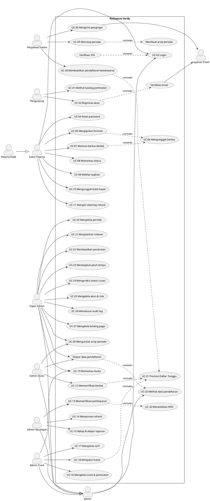
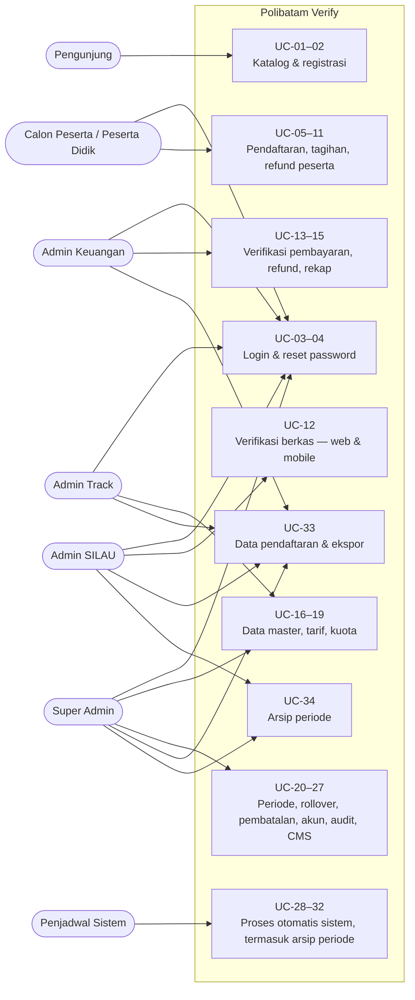

# Use Case Diagram & Use Case Scenario — Polibatam Verify
 
Disusun berdasarkan *User Stories* (US-01 s.d. US-32), *FR & BR* (FR-01 s.d. FR-66, BR-01 s.d. BR-69), *Dokumen Arsitektur*, dan *Keputusan Klarifikasi Scope* (K-01 s.d. K-38).
 
---
 
## 1. Aktor
 
| Aktor | Jenis | Deskripsi | Kanal |
|---|---|---|---|
| **Pengunjung** | Primer | Orang yang belum login | Web |
| **Calon Peserta** | Primer | Pemilik akun yang mendaftar, belum memiliki NPD | Web |
| **Peserta Didik** | Primer | Pemilik akun yang sudah memiliki NPD. Mewarisi seluruh *use case* Calon Peserta. | Web |
| **Admin SILAU** | Primer | Memverifikasi berkas pendaftaran | Web + Mobile (K-29) |
| **Admin Keuangan** | Primer | Memverifikasi pembayaran, memproses refund, rekap | Web + Mobile (verifikasi saja, K-30) |
| **Admin Track** | Primer | Mengelola data master, tarif, kuota | Web |
| **Super Admin** | Primer | Mengelola konfigurasi, periode, *rollover*, akun, audit, CMS. Dapat menjalankan *use case* verifikasi admin lain (Matriks RBAC). | Web |
| **Penjadwal Sistem** | Sekunder | Proses terjadwal Laravel Scheduler | — |
| **Layanan Email** | Sekunder (eksternal) | Mailpit / Brevo / SMTP Polibatam (K-27) | — |
 
**Generalisasi:** Peserta Didik → Calon Peserta; Admin SILAU, Admin Keuangan, Admin Track, Super Admin → **Admin** (aktor abstrak untuk *use case* Login dengan 2FA dan Melihat Data Pendaftaran).
 
---
 
## 2. Daftar Use Case
 
| ID | Use Case | Aktor Utama | Kanal | US | Prioritas |
|---|---|---|---|---|---|
| UC-01 | Melihat katalog peminatan | Pengunjung | Web | US-01 | Must |
| UC-02 | Registrasi akun | Pengunjung | Web | US-02 | Must |
| UC-03 | Login | Semua pengguna | Web, Mobile (admin verifikasi) | US-03 | Must |
| UC-04 | Reset password | Semua pengguna | Web | US-03 | Must |
| UC-05 | Mengisi & mengajukan formulir pendaftaran | Calon Peserta | Web | US-04 | Must |
| UC-06 | Mengunggah berkas persyaratan | Calon Peserta | Web | US-05 | Must |
| UC-07 | Merevisi berkas yang ditolak | Calon Peserta | Web | US-08 | Must |
| UC-08 | Memantau status pendaftaran & notifikasi | Calon Peserta | Web | US-07 | Must |
| UC-09 | Melihat tagihan | Calon Peserta, Peserta Didik | Web | US-15 | Must |
| UC-10 | Mengunggah bukti pembayaran | Calon Peserta, Peserta Didik | Web | US-06 | Must |
| UC-11 | Mengisi data rekening refund | Calon Peserta, Peserta Didik | Web | US-19 | Must |
| UC-12 | Memverifikasi berkas pendaftaran | Admin SILAU | Web, Mobile | US-09, US-10, US-11, US-30 | Must |
| UC-13 | Memverifikasi pembayaran | Admin Keuangan | Web, Mobile | US-12, US-13, US-16, US-30 | Must |
| UC-14 | Memproses refund | Admin Keuangan | Web | US-20 | Must |
| UC-15 | Melihat rekap & mengekspor laporan keuangan | Admin Keuangan | Web | US-17 | Should |
| UC-16 | Mengelola track & peminatan | Admin Track | Web | US-21 | Must |
| UC-17 | Mengelola tarif berversi | Admin Track | Web | US-22 | Must |
| UC-18 | Mengatur kuota peminatan | Admin Track | Web | US-23 | Must |
| UC-19 | Memantau keterisian kuota | Admin Track, Super Admin | Web | US-24 | Should |
| UC-20 | Mengelola periode pendaftaran & akademik | Super Admin | Web | US-25 | Must |
| UC-21 | Menjalankan *rollover* semester | Super Admin | Web | US-26 | Must |
| UC-22 | Mengevaluasi kuota & membatalkan peminatan | Super Admin | Web | US-18 | Must |
| UC-23 | Menetapkan jatuh tempo manual | Super Admin | Web | US-14, US-15 | Must |
| UC-24 | Mengoreksi status Lunas | Super Admin | Web | US-13 | Must |
| UC-25 | Mengelola akun & *role* | Super Admin | Web | US-27 | Must |
| UC-26 | Menelusuri *audit log* | Super Admin | Web | US-28 | Must |
| UC-27 | Mengelola konten *landing page* | Super Admin | Web | US-29 | Should |
| UC-28 | Membatalkan pendaftaran kedaluwarsa | Penjadwal Sistem | — | US-11 | Must |
| UC-29 | Menutup periode pendaftaran | Penjadwal Sistem | — | US-04, US-11, US-32 | Must |
| UC-30 | Mengirim pengingat & peringatan | Penjadwal Sistem | — | US-15, US-26 | Must |
| UC-31 | Mempromosikan Daftar Tunggu | Sistem (*included*) | — | US-11 | Must |
| UC-32 | Menerbitkan NPD & tagihan Semester 1 | Sistem (*included*) | — | US-12, US-14 | Must |
| UC-33 | Melihat & mengekspor data pendaftaran | Admin (lihat); Admin SILAU, Super Admin (ekspor) | Web | US-31 | Should |
| UC-34 | Mengunduh arsip periode | Admin SILAU, Super Admin | Web | US-32 | Should |
 
---
 
## 3. Relasi Antar Use Case
 
| Relasi | Jenis | Keterangan |
|---|---|---|
| UC-05 → UC-06 | `<<include>>` | Formulir tidak dapat diajukan tanpa berkas wajib |
| UC-02 → Verifikasi email | `<<include>>` | Bagian dari registrasi (BR-02) |
| UC-03 ← Verifikasi 2FA | `<<extend>>` | Wajib untuk seluruh aktor Admin (NFR-09, K-33) |
| UC-07 → UC-06 | `<<extend>>` | Revisi memakai alur unggah, terbatas pada dokumen Ditolak |
| UC-12 → UC-31 | `<<include>>` | Setelah berkas valid, sistem menempatkan kuota / Daftar Tunggu |
| UC-18 → UC-31 | `<<include>>` | Penambahan kuota maksimum memicu promosi Daftar Tunggu |
| UC-28 → UC-31 | `<<include>>` | Slot yang dilepas memicu promosi Daftar Tunggu |
| UC-13 → UC-32 | `<<include>>` | Tagihan formulir Lunas memicu penerbitan NPD |
| UC-21 → penerbitan tagihan semester | `<<include>>` | Peserta yang naik semester menerima tagihan baru |
| UC-22 → pembuatan refund | `<<include>>` | Pembatalan peminatan membuat refund |
| UC-29 → pembuatan refund | `<<include>>` | Tidak Tertampung yang sudah membayar mendapat refund |
| UC-29 → pembatalan Draf | Bagian alur | Draf pada periode yang ditutup menjadi Dibatalkan (BR-65) |
| UC-29 → Membuat arsip periode | `<<include>>` | Salinan beku dibuat setelah penutupan selesai (BR-69) |
| UC-33 ← Ekspor data pendaftaran | `<<extend>>` | Hanya Admin SILAU dan Super Admin (BR-67) |
| Semua UC perubahan status → Layanan Email | Asosiasi | Notifikasi email + *in-app* (BR-56) |
 
---
 
## 4. Use Case Diagram
 
### 4.1 Notasi UML (PlantUML)
 

 
### 4.2 Versi Ringkas (Mermaid)
 

 
---
 
## 5. Use Case Scenario
 
Format setiap skenario: aktor, tujuan, prasyarat, pemicu, alur utama, alur alternatif/eksepsi (diberi kode langkah), pascakondisi, dan rujukan.
 
### UC-01 — Melihat Katalog Peminatan
| Aspek | Keterangan |
|---|---|
| Aktor | Pengunjung |
| Tujuan | Mengetahui peminatan, tarif, durasi, dan sisa kuota sebelum mendaftar |
| Prasyarat | — |
| Pascakondisi | Pengunjung melihat informasi terbaru |
| Rujukan | US-01 · FR-08, FR-09 · BR-07, BR-17, BR-27, BR-55 |
 
**Alur utama**
1. Pengunjung membuka halaman katalog.
2. Sistem mengambil periode pendaftaran yang sedang dibuka.
3. Sistem menampilkan peminatan aktif per track: durasi semester, tarif formulir, tarif per semester (versi yang berlaku), dan sisa kuota.
4. Pengunjung memilih peminatan untuk melihat rinciannya.
**Alur alternatif / eksepsi**
- **A1 (langkah 2):** Tidak ada periode yang dibuka → sistem menampilkan jadwal periode berikutnya (jika ada) dan menonaktifkan tombol daftar.
- **A2 (langkah 3):** Kuota maksimum peminatan sudah penuh → peminatan diberi label "Kuota Penuh – Daftar Tunggu", tombol daftar tetap aktif (BR-17).
### UC-02 — Registrasi Akun
| Aspek | Keterangan |
|---|---|
| Aktor | Pengunjung; Layanan Email |
| Tujuan | Memiliki akun Calon Peserta |
| Prasyarat | Email belum terdaftar |
| Pascakondisi | Akun ber-*role* Calon Peserta dibuat, email terverifikasi |
| Rujukan | US-02 · FR-01, FR-02 · BR-01, BR-02 · NFR-02, NFR-11 |
 
**Alur utama**
1. Pengunjung membuka halaman registrasi.
2. Pengunjung mengisi nama, email, password, konfirmasi password, dan menyetujui kebijakan privasi.
3. Sistem memvalidasi data dan memastikan email belum terdaftar.
4. Sistem membuat akun ber-*role* Calon Peserta dan mencatat waktu persetujuan privasi.
5. Sistem mengirim tautan verifikasi melalui Layanan Email.
6. Pengguna membuka tautan verifikasi.
7. Sistem menandai email terverifikasi dan mengarahkan pengguna ke dasbor.
**Alur alternatif / eksepsi**
- **E1 (langkah 3):** Email sudah terdaftar → sistem menolak dengan pesan "Email sudah terdaftar".
- **E2 (langkah 3):** Password tidak memenuhi kebijakan → sistem menampilkan syarat password.
- **E3 (langkah 6):** Tautan kedaluwarsa → pengguna meminta kirim ulang tautan.
- **A1 (setelah langkah 5):** Pengguna login sebelum verifikasi → sistem memblokir akses formulir dan menawarkan kirim ulang tautan.
### UC-03 — Login
| Aspek | Keterangan |
|---|---|
| Aktor | Semua pengguna terdaftar |
| Tujuan | Masuk ke sistem sesuai *role* |
| Prasyarat | Akun aktif |
| Pascakondisi | Sesi (web) atau token 12 jam (mobile) diterbitkan |
| Rujukan | US-03, US-30 · FR-03, FR-04, FR-59, FR-60 · BR-03, BR-04, BR-59, BR-60 · NFR-03, NFR-09, NFR-47 · K-30, K-33 |
 
**Alur utama**
1. Pengguna memasukkan email dan password (di web, atau di aplikasi mobile untuk Admin SILAU/Keuangan).
2. Sistem memvalidasi kredensial dan status akun.
3. **[Extend: Verifikasi 2FA]** Jika pengguna adalah Admin, sistem **wajib** meminta kode TOTP dan memvalidasinya (K-33).
4. Sistem membuat sesi web atau token Sanctum per perangkat (mobile, berlaku 12 jam).
5. Sistem mengarahkan pengguna ke dasbor sesuai *role*.
**Alur alternatif / eksepsi**
- **E1 (langkah 2):** Kredensial salah → pesan umum "Email atau password salah".
- **E2 (langkah 2):** 5 kali gagal berturut-turut → akun dikunci 15 menit.
- **E3 (langkah 2):** Akun dinonaktifkan → login ditolak.
- **E4 (langkah 3):** Kode TOTP salah → token/sesi tidak diterbitkan.
- **E5 (langkah 1, mobile):** *Role* selain Admin SILAU/Keuangan login di aplikasi mobile → ditolak (HTTP 403).
### UC-04 — Reset Password
| Aspek | Keterangan |
|---|---|
| Aktor | Semua pengguna terdaftar; Layanan Email |
| Prasyarat | Email terdaftar |
| Pascakondisi | Password baru tersimpan, seluruh sesi/token lama dicabut |
| Rujukan | US-03 · FR-05 · BR-03 · NFR-08 · K-32 |
 
**Alur utama**
1. Pengguna memilih "Lupa password" dan memasukkan email.
2. Sistem mengirim tautan reset yang berlaku 60 menit dan sekali pakai.
3. Pengguna membuka tautan dan mengisi password baru.
4. Sistem menyimpan password baru dan mencabut sesi/token aktif.
**Alur alternatif / eksepsi**
- **E2 (langkah 1):** Email tidak terdaftar → sistem menampilkan pesan "Email tidak terdaftar" agar pengguna dapat memperbaiki salah ketik (K-32). Permintaan dibatasi *rate limit* (NFR-08).
- **E1 (langkah 3):** Tautan kedaluwarsa atau sudah dipakai → pengguna diminta mengulang.
### UC-05 — Mengisi & Mengajukan Formulir Pendaftaran
| Aspek | Keterangan |
|---|---|
| Aktor | Calon Peserta |
| Tujuan | Mendaftar pada satu peminatan |
| Prasyarat | Login, email terverifikasi, periode pendaftaran dibuka, tidak ada pendaftaran aktif lain di periode yang sama |
| Pascakondisi | Pendaftaran berstatus **Diajukan**; tagihan formulir terbit |
| Rujukan | US-04, US-06 · FR-11, FR-12, FR-13, FR-26, FR-28 · BR-07, BR-08, BR-09, BR-11, BR-29, BR-32, BR-62, BR-64, BR-65, BR-68 |
 
**Alur utama**
1. Calon Peserta memilih track dan peminatan.
2. Calon Peserta mengisi formulir: nama lengkap, NIK, tempat & tanggal lahir, jenis kelamin, no. HP, alamat, asal sekolah, tahun lulus (K-31).
3. Calon Peserta menyimpan formulir sebagai Draf. Pada penyimpanan pertama sistem membangkitkan nomor pendaftaran `PV-{TAHUN}-{6 digit}` (BR-68). Draf hanya dapat diakses pemiliknya (BR-64).
4. **[Include UC-06]** Calon Peserta mengunggah berkas wajib.
5. Calon Peserta mengajukan formulir.
6. Sistem memvalidasi kelengkapan *field* dan dokumen wajib.
7. Sistem mengubah status menjadi Diajukan, mencatat waktu pengajuan, dan mengunci pilihan track/peminatan.
8. Sistem menerbitkan tagihan formulir: kode referensi, nominal = tarif formulir peminatan + kode unik acak.
9. Sistem mengirim notifikasi berisi instruksi pembayaran.
**Alur alternatif / eksepsi**
- **A1 (langkah 1):** Kuota peminatan penuh → sistem tetap menerima dan menginformasikan bahwa pendaftaran akan masuk Daftar Tunggu setelah berkas valid.
- **A2 (antara langkah 3 dan 5):** Periode ditutup sebelum formulir diajukan → Draf otomatis Dibatalkan oleh UC-29 dan formulir terkunci (BR-65).
- **E1 (langkah 6):** Ada *field*/dokumen wajib kosong → pengajuan ditolak, bagian yang belum lengkap ditandai.
- **E2 (prasyarat):** Sudah ada pendaftaran aktif di periode yang sama → pembuatan pendaftaran baru ditolak.
- **E3 (langkah 8):** Tarif formulir belum diatur → pengajuan ditolak dan Admin Track diberi peringatan (BR-07).
### UC-06 — Mengunggah Berkas Persyaratan
| Aspek | Keterangan |
|---|---|
| Aktor | Calon Peserta |
| Prasyarat | Pendaftaran berstatus Draf, atau dokumen berstatus Ditolak (melalui UC-07) |
| Pascakondisi | Versi dokumen baru tersimpan di penyimpanan *private* |
| Rujukan | US-05 · FR-14 · BR-11, BR-12 · NFR-07 |
 
**Alur utama**
1. Calon Peserta memilih slot dokumen (Ijazah/SKL/Rapor, SKHU/Nilai, KTP, atau Bukti Pendaftaran Polibatam).
2. Calon Peserta memilih file.
3. Sistem memeriksa tipe file berdasarkan isi (PDF/JPG/PNG) dan ukuran (≤ 2 MB).
4. Sistem menyimpan file dengan nama acak dan mencatat versi baru dokumen.
5. Sistem menampilkan pratinjau.
**Alur alternatif / eksepsi**
- **E1 (langkah 3):** Format atau ukuran tidak sesuai → unggahan ditolak dengan pesan format/ukuran yang diizinkan.
- **A1 (langkah 1):** Slot sudah berisi file dan status masih Draf → file lama digantikan sebagai versi baru.
### UC-07 — Merevisi Berkas yang Ditolak
| Aspek | Keterangan |
|---|---|
| Aktor | Calon Peserta |
| Prasyarat | Pendaftaran berstatus **Perlu Revisi** |
| Pascakondisi | Pendaftaran kembali berstatus **Diajukan** |
| Rujukan | US-08 · FR-16, FR-17 · BR-14 |
 
**Alur utama**
1. Calon Peserta membuka detail berkas.
2. Sistem menampilkan dokumen Ditolak beserta alasan penolakannya.
3. **[Extend UC-06]** Calon Peserta mengunggah ulang dokumen yang ditolak.
4. Sistem mengubah status dokumen tersebut menjadi Menunggu Verifikasi.
5. Setelah semua dokumen Ditolak diunggah ulang, sistem mengubah status pendaftaran menjadi Diajukan dan memasukkannya kembali ke antrean SILAU.
**Alur alternatif / eksepsi**
- **E1 (langkah 3):** Calon Peserta mencoba mengganti dokumen berstatus Valid → ditolak.
### UC-08 — Memantau Status Pendaftaran & Notifikasi
| Aspek | Keterangan |
|---|---|
| Aktor | Calon Peserta / Peserta Didik |
| Prasyarat | Login |
| Rujukan | US-07 · FR-15, FR-53 · BR-17, BR-18, BR-22, BR-56, BR-65 |
 
**Alur utama**
1. Pengguna membuka dasbor.
2. Sistem menampilkan *progress tracker*: Formulir Diajukan → Verifikasi Berkas → Masuk Kuota / Daftar Tunggu (dengan nomor urut) → Verifikasi Pembayaran Formulir → NPD Terbit.
3. Sistem menampilkan daftar notifikasi *in-app*.
4. Pengguna membuka notifikasi; sistem menandainya sudah dibaca.
**Alur alternatif / eksepsi**
- **A1 (langkah 2):** Status Tidak Tertampung atau Dibatalkan → sistem menampilkan penjelasan dan instruksi refund (jika ada).
- **A2 (langkah 2):** Pengguna sudah Peserta Didik → sistem menampilkan NPD dan status semester (Belum Aktif / Aktif / Tertahan / Selesai Masa Program).
- **A3 (langkah 2):** Status masih Draf → tahap pertama disorot sebagai tahap berjalan, disertai tanggal penutupan periode dan pengingat bahwa Draf akan dibatalkan bila tidak diajukan (BR-65).
### UC-09 — Melihat Tagihan
| Aspek | Keterangan |
|---|---|
| Aktor | Calon Peserta, Peserta Didik |
| Prasyarat | Login; memiliki minimal satu tagihan |
| Rujukan | US-15 · FR-37 · BR-35, BR-57 |
 
**Alur utama**
1. Pengguna membuka menu Tagihan.
2. Sistem menampilkan tagihan milik pengguna: jenis (Formulir / Semester *N*), kode referensi, nominal total (dengan kode unik), jatuh tempo, status, tanggal pelunasan.
3. Pengguna memilih satu tagihan untuk melihat instruksi pembayaran dan riwayat bukti.
**Alur alternatif / eksepsi**
- **A1 (langkah 2):** Jatuh tempo belum ditetapkan (tagihan terbit setelah H-7) → kolom jatuh tempo menampilkan "Menunggu penetapan".
- **E1:** Pengguna mencoba membuka tagihan milik akun lain → ditolak (HTTP 403).
### UC-10 — Mengunggah Bukti Pembayaran
| Aspek | Keterangan |
|---|---|
| Aktor | Calon Peserta, Peserta Didik |
| Prasyarat | Tagihan berstatus **Belum Bayar** atau **Ditolak** |
| Pascakondisi | Tagihan berstatus **Menunggu Verifikasi**; unggahan dikunci |
| Rujukan | US-06 · FR-29, FR-30 · BR-36, BR-37 |
 
**Alur utama**
1. Pengguna mentransfer sesuai nominal total tagihan (di luar sistem).
2. Pengguna memilih tagihan dan mengunggah bukti transfer.
3. Sistem memvalidasi format dan ukuran file, lalu menghitung *hash* file.
4. Sistem memastikan *hash* belum pernah tercatat.
5. Sistem menyimpan bukti, menautkannya ke tagihan, dan mengubah status tagihan menjadi Menunggu Verifikasi.
6. Tagihan muncul di antrean Admin Keuangan (web dan mobile).
**Alur alternatif / eksepsi**
- **E1 (langkah 4):** *Hash* sudah pernah dipakai → unggahan ditolak dengan pesan "Bukti sudah pernah digunakan".
- **E2 (prasyarat):** Tagihan berstatus Menunggu Verifikasi atau Lunas → tombol unggah tidak tersedia.
### UC-11 — Mengisi Data Rekening Refund
| Aspek | Keterangan |
|---|---|
| Aktor | Calon Peserta, Peserta Didik |
| Prasyarat | Ada refund berstatus **Menunggu Data Rekening** |
| Pascakondisi | Refund berstatus **Diproses**; nomor rekening tersimpan terenkripsi |
| Rujukan | US-19 · FR-43, FR-62 · BR-50, BR-51, BR-63 · K-31 |
 
**Alur utama**
1. Pengguna membuka menu Refund; sistem menampilkan setiap refund beserta sebab dan nominalnya.
2. Pengguna memilih refund dan mengisi nama bank, nomor rekening, nama pemilik rekening.
3. Sistem memvalidasi data.
4. Sistem menyimpan nomor rekening terenkripsi dan mengubah status menjadi Diproses.
5. Sistem menampilkan nomor rekening tersamar (4 digit terakhir) beserta status refund.
**Alur alternatif / eksepsi**
- **E1 (langkah 3):** Nomor rekening berisi karakter non-angka atau *field* wajib kosong → ditolak.
- **A1 (langkah 1):** Pengguna memiliki lebih dari satu refund → setiap refund diisi dan dilacak terpisah.
### UC-12 — Memverifikasi Berkas Pendaftaran
| Aspek | Keterangan |
|---|---|
| Aktor | Admin SILAU (Super Admin juga dapat) |
| Kanal | Web dan aplikasi mobile |
| Prasyarat | Login (2FA); ada pendaftaran berstatus Diajukan |
| Pascakondisi | Pendaftaran berstatus Perlu Revisi, Masuk Kuota, atau Daftar Tunggu; keputusan tercatat di *audit log* |
| Rujukan | US-09, US-10, US-11, US-30 · FR-18–FR-22, FR-60, FR-61 · BR-13, BR-16, BR-17, BR-61, BR-64, BR-66 · NFR-27 · K-29, K-37 |
 
**Alur utama**
1. Admin SILAU membuka antrean verifikasi berkas (urut dari pengajuan terlama, dapat difilter). Draf tidak pernah tampil (BR-64).
2. Admin memilih satu pendaftaran.
3. Sistem menampilkan data pendaftar, dokumen dalam *document viewer* (tautan bertanda tangan ≤ 15 menit), *checklist* per jenis dokumen, dan sisa kuota peminatan.
4. Admin mengisi *checklist* dan memberi keputusan Valid atau Ditolak per dokumen.
5. Admin menyelesaikan verifikasi.
6. Sistem memastikan data belum diputuskan admin lain (*optimistic locking*).
7. **[Include UC-31]** Jika semua dokumen wajib Valid, sistem mengunci baris kuota dan menempatkan pendaftar: Masuk Kuota (slot tersedia) atau Daftar Tunggu dengan nomor urut (slot penuh).
8. Sistem mencatat keputusan (verifikator, waktu, kanal, alasan) ke *audit log* dan mengirim notifikasi ke pendaftar.
**Alur alternatif / eksepsi**
- **A1 (langkah 5):** Ada dokumen Ditolak → status menjadi Perlu Revisi, pendaftar menerima alasan per dokumen.
- **E1 (langkah 4):** Menolak tanpa alasan → keputusan tidak disimpan.
- **E2 (langkah 6):** Data sudah diverifikasi admin lain → sistem menolak (HTTP 409 di mobile), menampilkan pesan, dan memuat ulang data.
- **E3 (langkah 7):** Dua pendaftar memperebutkan slot terakhir bersamaan → hanya satu Masuk Kuota, yang lain Daftar Tunggu.
- **E4 (langkah 1):** Admin memilih beberapa pendaftaran sekaligus → tidak tersedia aksi verifikasi massal; keputusan hanya dari halaman detail satu per satu (BR-66).
### UC-13 — Memverifikasi Pembayaran
| Aspek | Keterangan |
|---|---|
| Aktor | Admin Keuangan (Super Admin juga dapat) |
| Kanal | Web dan aplikasi mobile |
| Prasyarat | Login (2FA); ada tagihan berstatus Menunggu Verifikasi |
| Pascakondisi | Tagihan Lunas atau Ditolak; jika Lunas memicu NPD (formulir) atau aktivasi semester |
| Rujukan | US-12, US-13, US-16, US-30 · FR-31–FR-35, FR-60, FR-61 · BR-38–BR-42, BR-46, BR-61, BR-66 · K-29, K-37 |
 
**Alur utama**
1. Admin Keuangan membuka antrean verifikasi pembayaran dan memfilter jenis tagihan (formulir / semester ke-*n*).
2. Admin memilih satu tagihan.
3. Sistem menampilkan kode referensi, nominal total (dengan kode unik), pemilik, bukti transfer, dan status gerbang ganda (untuk tagihan formulir).
4. Admin mencocokkan bukti dengan mutasi rekening (di luar sistem).
5. Admin menandai tagihan Lunas.
6. Sistem memastikan data belum diputuskan admin lain (*optimistic locking*).
7. Sistem mengubah tagihan menjadi Lunas dan mencatatnya ke *audit log*.
8. Untuk tagihan formulir: **[Include UC-32]** sistem menerbitkan NPD, mengubah *role* menjadi Peserta Didik, menetapkan status Belum Aktif Semester 1, dan menerbitkan tagihan Semester 1.
9. Untuk tagihan semester *N*: sistem mengubah status peserta menjadi Aktif Semester *N*.
10. Sistem mengirim notifikasi ke pemilik tagihan.
**Alur alternatif / eksepsi**
- **A1 (langkah 5):** Bukti tidak sesuai → Admin memilih Tolak dan wajib mengisi alasan; tagihan menjadi Ditolak dan unggah ulang dibuka.
- **E1 (langkah 5, tagihan formulir):** Pendaftaran belum Masuk Kuota → sistem menolak (gerbang ganda), tampil "Menunggu verifikasi berkas".
- **E2 (langkah 6):** Tagihan sudah diverifikasi admin lain → ditolak (HTTP 409), data dimuat ulang.
- **A2 (langkah 9):** Peserta berstatus Tertahan → menjadi Aktif Semester *N* dan ikut *rollover* berikutnya.
- **E3 (langkah 1):** Admin memilih beberapa tagihan sekaligus → tidak tersedia aksi Lunas/Ditolak massal (BR-66).
### UC-14 — Memproses Refund
| Aspek | Keterangan |
|---|---|
| Aktor | Admin Keuangan |
| Kanal | Web (K-30) |
| Prasyarat | Ada refund berstatus Diproses |
| Pascakondisi | Refund berstatus Selesai dengan bukti transfer, atau Ditolak jika seluruh rincian dikecualikan |
| Rujukan | US-20 · FR-42, FR-44, FR-62 · BR-48–BR-51, BR-63 |
 
**Alur utama**
1. Admin Keuangan membuka modul refund.
2. Sistem menampilkan daftar refund beserta rincian tagihan, nominal, dan data rekening.
3. Admin membuka nomor rekening lengkap; sistem mencatat akses tersebut di *audit log*.
4. Admin mentransfer dana (di luar sistem).
5. Admin menandai refund Selesai dan mengunggah bukti transfer.
6. Sistem mengubah status menjadi Selesai dan mengirim notifikasi ke penerima.
**Alur alternatif / eksepsi**
- **A1 (langkah 2):** Ada rincian dari tagihan formulir yang belum terverifikasi → Admin wajib mencocokkannya dengan mutasi rekening sebelum melanjutkan.
- **A2 (A1):** Pembayaran tidak ditemukan di mutasi → rincian tersebut dikecualikan dengan alasan, dan nominal refund dihitung ulang.
- **A3 (A2):** Seluruh rincian dikecualikan (nominal Rp0) → status refund menjadi Ditolak dengan alasan, tanpa bukti transfer, dan penerima diberi notifikasi (K-34).
- **E1 (langkah 5):** Bukti transfer tidak diunggah → status tidak dapat diubah menjadi Selesai.
### UC-15 — Melihat Rekap & Mengekspor Laporan Keuangan
| Aspek | Keterangan |
|---|---|
| Aktor | Admin Keuangan |
| Kanal | Web |
| Rujukan | US-17 · FR-38 · NFR-19, NFR-39 |
 
**Alur utama**
1. Admin membuka dasbor rekap.
2. Admin memilih filter: periode, peminatan, angkatan, jenis tagihan.
3. Sistem menampilkan jumlah dan total nominal per status, termasuk tunggakan.
4. Admin memilih ekspor Excel atau PDF.
5. Sistem menghasilkan file sesuai filter.
**Alur alternatif / eksepsi**
- **A1 (langkah 5):** Data > 10.000 baris → ekspor diproses di latar belakang, Admin menerima tautan unduhan melalui notifikasi.
### UC-16 — Mengelola Track & Peminatan
| Aspek | Keterangan |
|---|---|
| Aktor | Admin Track (Super Admin juga dapat) |
| Rujukan | US-21 · FR-45, FR-46 · BR-43, BR-52, BR-53 |
 
**Alur utama**
1. Admin membuka data master track/peminatan.
2. Admin menambah atau mengubah track/peminatan: kode, nama, track induk, durasi semester, status aktif.
3. Sistem memvalidasi keunikan kode dan durasi ≥ 1.
4. Sistem menyimpan data dan mencatat perubahan.
**Alur alternatif / eksepsi**
- **E1 (langkah 3):** Kode sudah dipakai → ditolak.
- **A1:** Admin menonaktifkan peminatan → tidak tampil di katalog, data peserta lama tetap berjalan.
- **E2:** Admin menghapus peminatan yang pernah dipakai → ditolak, disarankan menonaktifkan.
- **A2:** Durasi diubah → hanya berlaku untuk pendaftar periode berikutnya.
### UC-17 — Mengelola Tarif Berversi
| Aspek | Keterangan |
|---|---|
| Aktor | Admin Track (Super Admin juga dapat) |
| Rujukan | US-22 · FR-47 · BR-25–BR-28 |
 
**Alur utama**
1. Admin memilih peminatan.
2. Sistem menampilkan tarif formulir dan tarif semester 1..D yang berlaku beserta riwayat versinya.
3. Admin mengisi nominal baru dan tanggal berlaku efektif.
4. Sistem memvalidasi nominal > 0 dan tanggal efektif terisi.
5. Sistem menyimpan sebagai versi baru tanpa mengubah versi lama dan mencatatnya di *audit log*.
**Alur alternatif / eksepsi**
- **E1 (langkah 4):** Nominal ≤ 0 atau tanggal kosong → ditolak.
- **A1:** Tagihan yang sudah terbit tidak berubah (*snapshot*).
### UC-18 — Mengatur Kuota Peminatan
| Aspek | Keterangan |
|---|---|
| Aktor | Admin Track (Super Admin juga dapat) |
| Rujukan | US-23 · FR-48 · BR-15, BR-20 |
 
**Alur utama**
1. Admin memilih periode pendaftaran dan peminatan.
2. Admin mengisi kuota minimum dan maksimum.
3. Sistem memvalidasi 0 ≤ minimum ≤ maksimum.
4. Sistem menyimpan kuota.
**Alur alternatif / eksepsi**
- **A1 (periode berjalan):** Admin menaikkan kuota maksimum dengan alasan → **[Include UC-31]** sistem menaikkan pendaftar Daftar Tunggu sebanyak slot yang bertambah.
- **E1 (periode berjalan):** Kuota maksimum diturunkan di bawah slot terpakai → ditolak.
- **E2 (periode berjalan):** Admin Track mengubah kuota minimum → ditolak; hanya Super Admin dengan alasan.
- **E3:** Peminatan aktif belum memiliki kuota saat periode dibuka → peringatan, peminatan tidak tampil di katalog.
### UC-19 — Memantau Keterisian Kuota
| Aspek | Keterangan |
|---|---|
| Aktor | Admin Track, Super Admin |
| Rujukan | US-24 · FR-49 · BR-23 |
 
**Alur utama**
1. Admin membuka dasbor kuota.
2. Sistem menampilkan per peminatan: Masuk Kuota, NPD Terbit, Daftar Tunggu, kuota minimum/maksimum, dan persentase keterisian.
**Alur alternatif / eksepsi**
- **A1:** Sisa periode ≤ 7 hari dan NPD Terbit < kuota minimum → peminatan diberi penanda peringatan.
### UC-20 — Mengelola Periode Pendaftaran & Akademik
| Aspek | Keterangan |
|---|---|
| Aktor | Super Admin |
| Rujukan | US-25 · FR-50 · BR-35, BR-54 |
 
**Alur utama**
1. Super Admin membuat periode pendaftaran atau periode akademik (nama, tanggal mulai, tanggal selesai).
2. Sistem memvalidasi tanggal dan tidak adanya tumpang-tindih periode pendaftaran.
3. Sistem menyimpan periode. Untuk periode akademik, sistem menghitung jatuh tempo tagihan semester = tanggal mulai − 7 hari.
4. Pada tanggal mulai/selesai, sistem membuka/menutup pendaftaran secara otomatis.
**Alur alternatif / eksepsi**
- **E1 (langkah 2):** Tanggal selesai < tanggal mulai atau periode tumpang-tindih → ditolak.
### UC-21 — Menjalankan Rollover Semester
| Aspek | Keterangan |
|---|---|
| Aktor | Super Admin |
| Prasyarat | Periode akademik baru sudah dibuat; *rollover* belum pernah dijalankan untuk periode tersebut |
| Pascakondisi | Status semester seluruh peserta diperbarui; tagihan semester berikutnya terbit |
| Rujukan | US-26 · FR-51, FR-52, FR-27 · BR-44, BR-45, BR-46 · NFR-18, NFR-27 |
 
**Alur utama**
1. Super Admin membuka menu *rollover* dan memilih periode akademik.
2. Sistem menampilkan pratinjau: jumlah dan daftar peserta yang akan naik semester, Selesai Masa Program, dan Tertahan.
3. Super Admin mengonfirmasi eksekusi.
4. Sistem menjalankan *rollover* dalam satu transaksi:
   - Aktif Semester *N* dan *N* < *D* → Belum Aktif Semester *N*+1 + tagihan semester *N*+1.
   - Aktif Semester *N* dan *N* = *D* → Selesai Masa Program.
   - Tagihan semester *N* belum Lunas → Tertahan (Tunggakan), tanpa tagihan baru.
5. Sistem menandai periode akademik sudah di-*rollover*, mencatat ringkasan ke *audit log*, dan mengirim notifikasi ke peserta.
**Alur alternatif / eksepsi**
- **E1 (prasyarat):** *Rollover* untuk periode yang sama sudah dijalankan → ditolak.
- **E2 (langkah 4):** Terjadi kegagalan → seluruh perubahan dibatalkan (*rollback*).
- **E3 (langkah 4):** Tarif semester *N*+1 belum diatur → tagihan tidak diterbitkan, peringatan dikirim ke Admin Track dan Super Admin.
- **A1 (langkah 4):** Tagihan terbit pada/setelah H-7 sebelum semester dimulai → jatuh tempo dikosongkan dan menunggu UC-23.
### UC-22 — Mengevaluasi Kuota & Membatalkan Peminatan
| Aspek | Keterangan |
|---|---|
| Aktor | Super Admin |
| Prasyarat | Periode pendaftaran sudah ditutup (untuk dasar kuota minimum) |
| Pascakondisi | Pendaftaran terkait Dibatalkan; refund dibuat bagi yang sudah membayar |
| Rujukan | US-18 · FR-39, FR-40, FR-41, FR-42 · BR-23, BR-24, BR-47, BR-48 · K-16, K-19 |
 
**Alur utama**
1. Super Admin membuka evaluasi kuota.
2. Sistem menampilkan jumlah pendaftar terverifikasi (NPD Terbit) dibandingkan kuota minimum per peminatan dan menandai yang tidak memenuhi.
3. Super Admin memilih peminatan dan dasar pembatalan "kuota minimum", lalu mengonfirmasi.
4. Sistem mengubah seluruh pendaftaran terkait menjadi Dibatalkan, mengubah Peserta Didik terkait menjadi Dibatalkan (K-34), dan membatalkan tagihan yang belum Lunas.
5. Sistem membuat refund untuk setiap pendaftar yang sudah membayar, dengan nominal = total nominal dasar tagihan yang sudah dibayar tetapi tidak terpakai.
6. Sistem mencatat pembatalan ke *audit log* dan mengirim notifikasi pembatalan serta instruksi refund.
**Alur alternatif / eksepsi**
- **A1 (langkah 3):** Pembatalan karena kesepakatan terbaru → Super Admin wajib mengisi alasan; proses lanjut seperti langkah 4–6.
- **E1 (langkah 3):** Memilih dasar "kuota minimum" untuk peminatan yang memenuhi kuota → ditolak.
### UC-23 — Menetapkan Jatuh Tempo Manual
| Aspek | Keterangan |
|---|---|
| Aktor | Super Admin |
| Prasyarat | Ada tagihan semester tanpa jatuh tempo |
| Rujukan | FR-57 · BR-35 · K-24, K-25, K-32 |
 
**Alur utama**
1. Super Admin menerima notifikasi tagihan tanpa jatuh tempo.
2. Super Admin membuka daftar tagihan tersebut.
3. Super Admin memilih satu atau beberapa tagihan dan mengisi tanggal jatuh tempo.
4. Sistem menyimpan jatuh tempo, menandainya sebagai manual, dan mencatatnya di *audit log*.
5. Tagihan mulai dihitung untuk pengingat dan tunggakan.
**Alur alternatif / eksepsi**
- **A1 (langkah 3):** Tanggal jatuh tempo lebih awal dari hari ini → diterima sesuai kesepakatan (K-32); tagihan langsung dihitung sebagai lewat jatuh tempo dan tidak memicu pengingat H-7/H-1.
### UC-24 — Mengoreksi Status Lunas
| Aspek | Keterangan |
|---|---|
| Aktor | Super Admin |
| Rujukan | US-13 · FR-36 · BR-40 |
 
**Alur utama**
1. Super Admin membuka tagihan berstatus Lunas.
2. Super Admin memilih koreksi dan wajib mengisi alasan.
3. Sistem mengubah status sesuai koreksi dan mencatat nilai sebelum/sesudah beserta alasan di *audit log*.
4. Sistem mengirim notifikasi ke pemilik tagihan.
**Alur alternatif / eksepsi**
- **E1 (langkah 2):** Alasan kosong → koreksi ditolak.
### UC-25 — Mengelola Akun & Role
| Aspek | Keterangan |
|---|---|
| Aktor | Super Admin; Layanan Email |
| Rujukan | US-27 · FR-06, FR-07, FR-59 · BR-04, BR-05, BR-59, BR-60 |
 
**Alur utama**
1. Super Admin membuat akun admin (nama, email, *role*).
2. Sistem mengirim undangan aktivasi; admin baru mengatur password dan **wajib** mendaftarkan 2FA (TOTP) sebelum akun dapat dipakai.
3. Super Admin dapat mengubah *role* atau menonaktifkan akun.
4. Sistem mencatat perubahan di *audit log*; saat dinonaktifkan atau *role* berubah, seluruh sesi dan token mobile akun tersebut dicabut.
**Alur alternatif / eksepsi**
- **E1 (langkah 3):** Menonaktifkan atau menurunkan *role* Super Admin terakhir → ditolak.
### UC-26 — Menelusuri Audit Log
| Aspek | Keterangan |
|---|---|
| Aktor | Super Admin |
| Rujukan | US-28 · FR-55, FR-56 · BR-58 · NFR-31 |
 
**Alur utama**
1. Super Admin membuka *audit log*.
2. Super Admin memfilter berdasarkan pelaku, jenis aktivitas, entitas, kanal, atau rentang tanggal.
3. Sistem menampilkan entri: pelaku, *role*, waktu, nilai sebelum/sesudah, alasan.
**Alur alternatif / eksepsi**
- **E1:** Tidak tersedia fungsi ubah atau hapus entri.
### UC-27 — Mengelola Konten Landing Page
| Aspek | Keterangan |
|---|---|
| Aktor | Super Admin |
| Rujukan | US-29 · FR-10 · BR-55 |
 
**Alur utama**
1. Super Admin membuka CMS dan memilih bagian (jadwal, pengumuman, alur, kontak).
2. Super Admin mengedit konten dan membuka pratinjau.
3. Super Admin menerbitkan konten.
4. Sistem menampilkan konten baru di *landing page*; tarif dan kuota tetap diambil dari data master.
**Alur alternatif / eksepsi**
- **E1:** *Role* selain Super Admin membuka CMS → ditolak.
### UC-28 — Membatalkan Pendaftaran Kedaluwarsa
| Aspek | Keterangan |
|---|---|
| Aktor | Penjadwal Sistem (setiap jam) |
| Rujukan | FR-24 · BR-21 · K-17 |
 
**Alur utama**
1. Penjadwal menjalankan pemeriksaan.
2. Sistem mencari pendaftaran Masuk Kuota yang sudah > 7 hari dengan tagihan formulir Belum Bayar atau Ditolak.
3. Sistem mengubah statusnya menjadi Dibatalkan dan membatalkan tagihan formulirnya.
4. Sistem melepas slot kuota. **[Include UC-31]**
5. Sistem mengirim notifikasi pembatalan dan mencatat eksekusi.
**Alur alternatif / eksepsi**
- **A1 (langkah 2):** Tagihan berstatus Menunggu Verifikasi → dikecualikan.
- **E1:** Proses gagal → dicoba ulang; *alert* ke tim teknis setelah 3 kegagalan berturut-turut (NFR-25).
### UC-29 — Menutup Periode Pendaftaran
| Aspek | Keterangan |
|---|---|
| Aktor | Penjadwal Sistem (setiap 15 menit) |
| Rujukan | US-04, US-11, US-32 · FR-25, FR-65 · BR-22, BR-47, BR-65, BR-69 · K-22, K-37, K-38 |
 
**Alur utama**
1. Penjadwal mendeteksi periode yang sudah melewati tanggal selesai.
2. Sistem mengubah status periode menjadi Ditutup.
3. Sistem mengubah seluruh pendaftaran Daftar Tunggu menjadi Tidak Tertampung.
4. Sistem membuat refund untuk yang sudah membayar formulir.
5. Sistem mengubah seluruh pendaftaran **Draf** pada periode tersebut menjadi **Dibatalkan** dengan alasan "Periode pendaftaran ditutup sebelum formulir diajukan" dan mengunci formulirnya. Tidak ada tagihan maupun refund yang dibuat (BR-65).
6. Sistem mencatat ringkasan eksekusi ke *audit log*, mengirim notifikasi ke seluruh pemilik pendaftaran terdampak, dan membuka evaluasi kuota minimum (UC-22) untuk Super Admin.
7. **[Include: Membuat arsip periode]** Sistem menjadwalkan pembuatan arsip periode di latar belakang: membuat file Excel berisi seluruh pendaftaran yang sudah diajukan (status per waktu penutupan, NIK tersamar, tanpa Draf) dan lembar ringkasan, menyimpannya permanen di *disk* arsip, mencatat *checksum* SHA-256, lalu mengubah status arsip menjadi Tersedia (BR-69, FR-65).
**Alur alternatif / eksepsi**
- **A1 (langkah 4):** Pembayaran formulir masih Menunggu Verifikasi → refund dibuat, tetapi rinciannya wajib dicocokkan Admin Keuangan pada UC-14.
- **E1 (langkah 3–5):** Proses gagal di tengah → transaksi per batch dibatalkan dan dicoba ulang; proses bersifat idempoten sehingga pendaftaran yang sudah diproses tidak diubah dua kali.
- **E2 (langkah 7):** Pembuatan arsip gagal → dicoba ulang otomatis; setelah percobaan habis, status arsip Gagal dan Super Admin menerima notifikasi untuk memicu percobaan ulang dari UC-34.
- **A2 (langkah 7):** Arsip periode sudah Tersedia → langkah dilewati, arsip tidak dibuat ulang maupun ditimpa.
### UC-30 — Mengirim Pengingat & Peringatan
| Aspek | Keterangan |
|---|---|
| Aktor | Penjadwal Sistem (harian, dan setiap jam untuk pembersihan ekspor); Layanan Email |
| Rujukan | FR-54, FR-57, FR-58, FR-64 · BR-35, BR-44, BR-57, BR-67 |
 
**Alur utama**
1. 07.00 WIB: sistem mengirim pengingat H-7 dan H-1 untuk tagihan Belum Bayar/Ditolak yang memiliki jatuh tempo.
2. 08.00 WIB: jika *rollover* belum dijalankan pada H-14 sebelum semester dimulai, sistem mengirim peringatan ke Super Admin (diulang setiap hari).
3. 08.00 WIB: jika ada tagihan semester tanpa jatuh tempo, sistem mengirim notifikasi ke Super Admin.
4. Setiap jam: sistem menghapus file ekspor data pendaftaran yang berumur > 24 jam; *disk* arsip periode tidak disentuh (BR-67).
**Alur alternatif / eksepsi**
- **E1:** Pengiriman email gagal → dicoba ulang hingga 3 kali; notifikasi *in-app* tetap tersedia (NFR-26).
### UC-31 — Mempromosikan Daftar Tunggu *(included)*
| Aspek | Keterangan |
|---|---|
| Dipanggil oleh | UC-12, UC-18, UC-28 |
| Rujukan | FR-22, FR-23 · BR-16, BR-18, BR-19 · NFR-27 |
 
**Alur utama**
1. Sistem mengunci baris kuota peminatan–periode.
2. Sistem menghitung slot tersedia = kuota maksimum − slot terpakai.
3. Sistem menaikkan pendaftar Daftar Tunggu dengan waktu pengajuan paling awal menjadi Masuk Kuota sebanyak slot tersedia, dan memperbarui slot terpakai.
4. Sistem mencatat waktu masuk kuota (awal hitungan 7 hari) dan mengirim notifikasi ke pendaftar yang naik.
**Alur alternatif / eksepsi**
- **A1 (langkah 2):** Slot tersedia = 0 atau Daftar Tunggu kosong → tidak ada perubahan.
### UC-32 — Menerbitkan NPD & Tagihan Semester 1 *(included)*
| Aspek | Keterangan |
|---|---|
| Dipanggil oleh | UC-13 (tagihan formulir Lunas) |
| Rujukan | FR-34, FR-27 · BR-06, BR-41, BR-42 · K-23 |
 
**Alur utama** (satu transaksi)
1. Sistem membangkitkan NPD unik dengan format `MC-{TAHUN}-{KODE_PEMINATAN}-{NO_URUT}`.
2. Sistem membuat data Peserta Didik dengan semester berjalan 1 dan status Belum Aktif Semester 1.
3. Sistem mengubah status pendaftaran menjadi NPD Terbit dan *role* akun menjadi Peserta Didik.
4. Sistem menerbitkan tagihan Semester 1 (tarif semester 1 + kode unik) beserta jatuh tempo.
5. Sistem mengirim notifikasi berisi NPD dan tagihan Semester 1.
**Alur alternatif / eksepsi**
- **E1:** Salah satu langkah gagal → seluruh transaksi dibatalkan dan tagihan formulir tetap Menunggu Verifikasi.
- **A1 (langkah 4):** Tagihan terbit pada/setelah H-7 sebelum semester dimulai → jatuh tempo menunggu penetapan Super Admin (UC-23).
### UC-33 — Melihat & Mengekspor Data Pendaftaran
| Aspek | Keterangan |
|---|---|
| Aktor | Admin SILAU, Admin Keuangan, Admin Track, Super Admin (lihat); Admin SILAU dan Super Admin (ekspor) |
| Kanal | Web |
| Prasyarat | Login (2FA) |
| Pascakondisi | Admin melihat data pendaftaran sesuai filter; jika mengekspor, file tersedia selama 24 jam dan ekspor tercatat di *audit log* |
| Rujukan | US-31 · FR-63, FR-64 · BR-04, BR-58, BR-62, BR-64, BR-66, BR-67, BR-68 · K-37, K-38 |
 
**Alur utama**
1. Admin membuka menu Data Pendaftaran.
2. Sistem menampilkan seluruh pendaftaran yang sudah diajukan pada periode aktif (tanpa Draf): nomor pendaftaran, nama, track, peminatan, waktu pengajuan, status, jumlah total data, serta jumlah Draf sebagai angka saja.
3. Admin mengisi filter (periode, track, peminatan, status, rentang tanggal pengajuan) atau mencari nama, nomor pendaftaran, atau NIK.
4. Sistem menampilkan hasil sesuai filter; NIK dicari melalui `nik_hash` dan tetap tampil tersamar.
5. Admin membuka satu baris; sistem menampilkan detail pendaftaran dan dokumen secara baca-saja tanpa aksi verifikasi.
**Alur alternatif / eksepsi**
- **A1 (setelah langkah 4) — Ekspor:** Admin SILAU atau Super Admin memilih Export Excel/PDF untuk seluruh hasil filter, atau memilih beberapa baris lalu "Ekspor terpilih" → sistem menghasilkan file berkolom sesuai daftar dengan NIK tersamar dan tanpa Draf, lalu mencatat pelaku, filter, jumlah baris, dan format ke *audit log*. File dan tautannya berlaku 24 jam.
- **A2 (A1):** Data > 10.000 baris → ekspor diproses di latar belakang, admin menerima tautan unduhan melalui notifikasi.
- **A3 (A1):** Admin membuka tautan ekspor yang sudah lewat 24 jam → sistem menampilkan "Tautan sudah kedaluwarsa, silakan ekspor ulang" (BR-67).
- **E1 (A1):** Admin Keuangan atau Admin Track mencoba mengekspor → ditolak (HTTP 403); tombol ekspor dan kotak centang tidak ditampilkan untuk *role* tersebut.
- **E2 (langkah 2–5):** Admin mencoba membuka Draf melalui URL langsung → ditolak (HTTP 403/404) (BR-64).
- **E3 (langkah 5):** Admin mencari aksi verifikasi dari halaman ini → tidak tersedia; verifikasi melalui UC-12 / UC-13 (BR-66).
### UC-34 — Mengunduh Arsip Periode
| Aspek | Keterangan |
|---|---|
| Aktor | Admin SILAU, Super Admin |
| Kanal | Web |
| Prasyarat | Login (2FA); minimal satu periode pendaftaran sudah ditutup |
| Pascakondisi | File arsip terunduh dalam keadaan utuh; unduhan tercatat di *audit log* |
| Rujukan | US-32 · FR-65, FR-66 · BR-04, BR-58, BR-64, BR-69 · NFR-49 · K-38 |
 
**Alur utama**
1. Admin membuka menu Arsip Periode.
2. Sistem menampilkan daftar arsip: nama periode, waktu dibuat, jumlah baris, ukuran, dan status (Diproses / Tersedia / Gagal).
3. Admin memilih Unduh pada arsip berstatus Tersedia.
4. Sistem menghitung ulang *checksum* SHA-256 file dan mencocokkannya dengan yang tersimpan.
5. Sistem mengirim file dan mencatat pelaku, waktu, serta arsip yang diunduh ke *audit log*.
**Alur alternatif / eksepsi**
- **E1 (langkah 4):** *Checksum* tidak cocok → unduhan dibatalkan, admin melihat pesan bahwa arsip tidak dapat diverifikasi, sistem mencatat `arsip_checksum_tidak_cocok` di *audit log*, dan Super Admin menerima peringatan.
- **A1 (langkah 2):** Arsip berstatus Gagal dan pengguna adalah Super Admin → tersedia tombol "Coba buat ulang" yang menjadwalkan ulang pembuatan arsip (FR-65).
- **A2 (langkah 2):** Arsip masih Diproses → tombol unduh nonaktif dengan keterangan "Arsip sedang dibuat".
- **E2 (langkah 1):** Admin Keuangan, Admin Track, atau peserta membuka halaman atau tautan unduh arsip → ditolak (HTTP 403).
- **E3 (langkah 2):** Admin mencari aksi ubah, ganti, atau hapus arsip → tidak tersedia (BR-69).
---
 
## 6. Matriks Keterlacakan
 
| UC | User Story | FR | Aktor |
|---|---|---|---|
| UC-01 | US-01 | FR-08, FR-09 | Pengunjung |
| UC-02 | US-02 | FR-01, FR-02 | Pengunjung |
| UC-03 | US-03, US-30 | FR-03, FR-04, FR-59, FR-60 | Semua |
| UC-04 | US-03 | FR-05 | Semua |
| UC-05 | US-04, US-06 | FR-11–13, FR-26, FR-28 | Calon Peserta |
| UC-06 | US-05 | FR-14 | Calon Peserta |
| UC-07 | US-08 | FR-16, FR-17 | Calon Peserta |
| UC-08 | US-07 | FR-15, FR-53 | Calon Peserta / Peserta Didik |
| UC-09 | US-15 | FR-37 | Calon Peserta / Peserta Didik |
| UC-10 | US-06 | FR-29, FR-30 | Calon Peserta / Peserta Didik |
| UC-11 | US-19 | FR-43, FR-62 | Calon Peserta / Peserta Didik |
| UC-12 | US-09, US-10, US-11, US-30 | FR-18–22, FR-60, FR-61 | Admin SILAU |
| UC-13 | US-12, US-13, US-16, US-30 | FR-31–35, FR-60, FR-61 | Admin Keuangan |
| UC-14 | US-20 | FR-42, FR-44, FR-62 | Admin Keuangan |
| UC-15 | US-17 | FR-38 | Admin Keuangan |
| UC-16 | US-21 | FR-45, FR-46 | Admin Track |
| UC-17 | US-22 | FR-47 | Admin Track |
| UC-18 | US-23 | FR-48 | Admin Track |
| UC-19 | US-24 | FR-49 | Admin Track, Super Admin |
| UC-20 | US-25 | FR-50 | Super Admin |
| UC-21 | US-26 | FR-27, FR-51, FR-52 | Super Admin |
| UC-22 | US-18 | FR-39–42 | Super Admin |
| UC-23 | US-14, US-15 | FR-57 | Super Admin |
| UC-24 | US-13 | FR-36 | Super Admin |
| UC-25 | US-27 | FR-06, FR-07, FR-59 | Super Admin |
| UC-26 | US-28 | FR-55, FR-56 | Super Admin |
| UC-27 | US-29 | FR-10 | Super Admin |
| UC-28 | US-11 | FR-24 | Penjadwal Sistem |
| UC-29 | US-04, US-11, US-32 | FR-25, FR-65 | Penjadwal Sistem |
| UC-30 | US-15, US-26 | FR-54, FR-57, FR-58, FR-64 | Penjadwal Sistem |
| UC-31 | US-11 | FR-22, FR-23 | Sistem |
| UC-32 | US-12, US-14 | FR-27, FR-34 | Sistem |
| UC-33 | US-31 | FR-63, FR-64 | Admin |
| UC-34 | US-32 | FR-65, FR-66 | Admin SILAU, Super Admin |
 
Seluruh 32 *user story* dan 66 FR tercakup oleh minimal satu *use case*.
 
---
 
## 7. Status Asumsi
 
| # | Keputusan | Bagian | Status |
|---|---|---|---|
| A-44 | Reset password menampilkan pesan "Email tidak terdaftar" untuk email yang tidak terdaftar, agar salah ketik mudah diketahui. | UC-04 | Diputuskan (K-32) |
| A-45 | Jatuh tempo manual boleh lebih awal dari tanggal penetapan, menyesuaikan kesepakatan bersama. | UC-23 | Diputuskan (K-32) |
| A-57 | Nomor pendaftaran `PV-{TAHUN}-{6 digit}` dibangkitkan saat Draf pertama kali disimpan (BR-68). | UC-05, UC-33 | Disetujui (K-37) |
| A-58 | Ekspor data pendaftaran hanya untuk Admin SILAU dan Super Admin (BR-67). | UC-33 | Disetujui (K-37) |
| A-59 | File ekspor dan tautannya berlaku 24 jam (BR-67). | UC-30, UC-33 | Disetujui (K-38) |
| A-60 | Arsip periode dibuat otomatis saat periode ditutup dan disimpan permanen (BR-69). | UC-29, UC-34 | Disetujui (K-38) |
| A-61 | `[ASUMSI]` Arsip berformat `.xlsx` saja dengan status per waktu penutupan. | UC-29, UC-34 | Menunggu konfirmasi |
 